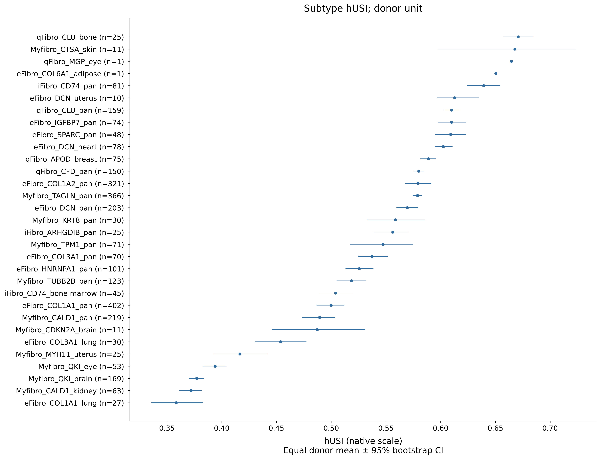
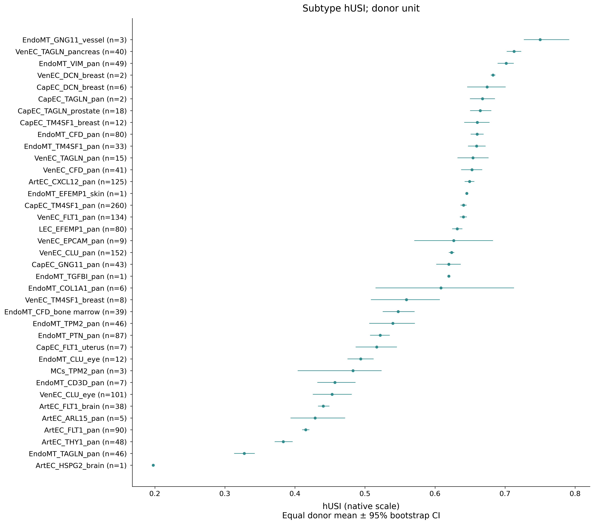
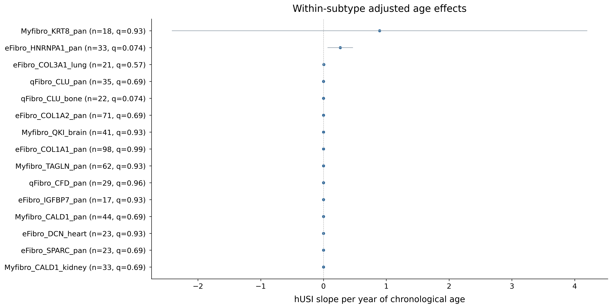
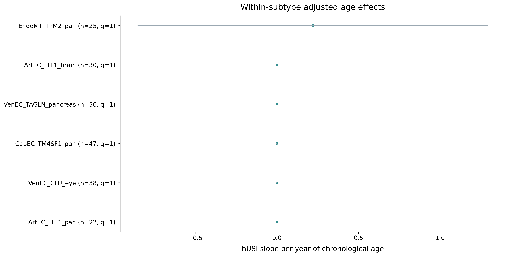
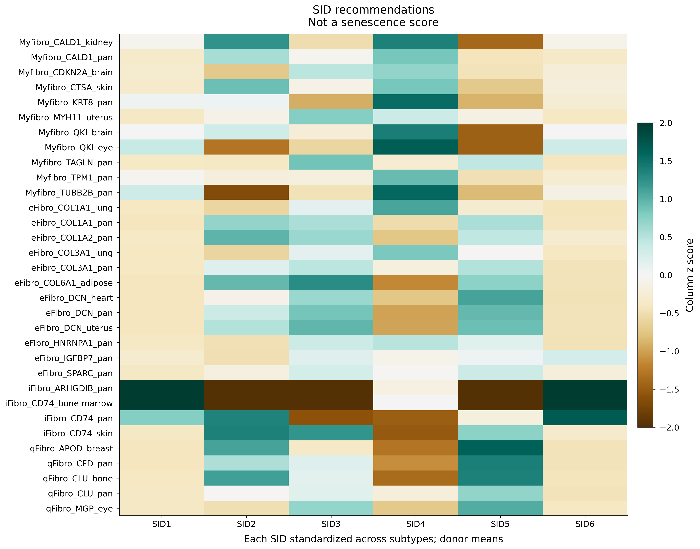
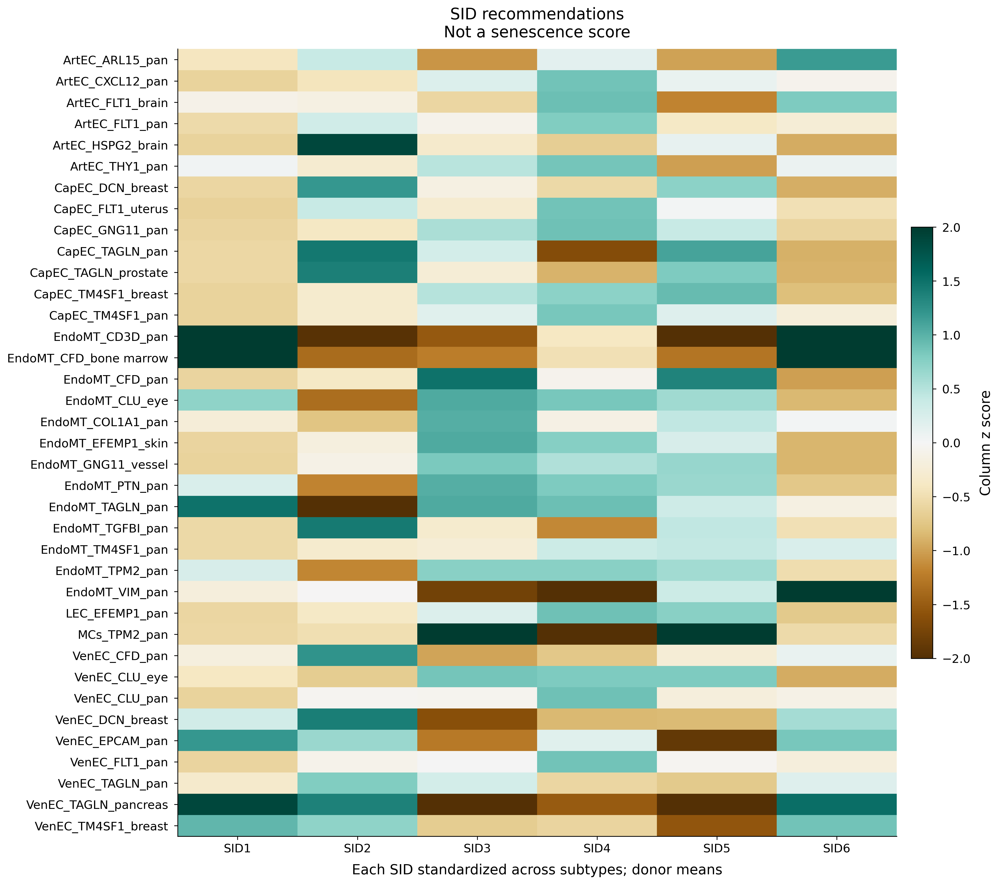

# CellAge: Senescence-Associated Scores and Clock Integration

Source project directory: `AgePrediction/CellAge_Exploration`. This page presents the selected verified result versions, original figure files, and aggregate evidence.

**Results:** [English text](../docs/results/Results_Part2_ClockPerformance_CellAge.md) · [Editable Word](../docs/results/Results_Part2_ClockPerformance_CellAge.docx) · [Figure legends](../docs/results/Figure_Legends.md)

**Audit:** [File inventory](audit/file_inventory.csv) · [Figure inventory](audit/figure_inventory.csv) · [Evidence registry](evidence/evidence_registry.csv) · [Released asset hashes](audit/released_assets.csv)

**Code:** [Workflow source](../workflows/cellage/) · [Reproduction instructions](../docs/reproducing.md)

## Figure 4: historical CellAge integration

[Original PDF](figures/Fig_CellAge_Stromal_Integration.pdf). Source run: 20261030_220917_407544; large_text is a display revision of that run, not a new analysis.

## Subtype scores and adjusted age effects

  
  

  
  

The primary adjusted models contain 15 identifiable fibroblast and 6 endothelial subtype fits; none has BH q<0.05. Source donor terminology refers to configured sample aggregation and is not independent identity verification.

## SID recommendations and historical clock context

  
  

recSID outputs are identity recommendations, not genuine SenCID senescence intensities. hUSI is not age in years. Panels I–L use older K=8,000 EN/stable sets and do not validate the current final clocks. Significant-only historical pathway tables preserve the source q values and their original correction family.

## Released file catalogue

Original figure and aggregate-table files

| File | Type | Size (MB) |
| --- | --- | ---: |
| [figures/Fig_CellAge_Stromal_Integration.pdf](figures/Fig_CellAge_Stromal_Integration.pdf) | figure | 1.14 |
| [figures/Fig_CellAge_Stromal_Integration.png](figures/Fig_CellAge_Stromal_Integration.png) | figure | 5.76 |
| [figures/panels/A_fibro_embedding.pdf](figures/panels/A_fibro_embedding.pdf) | figure | 0.87 |
| [figures/panels/A_fibro_embedding.png](figures/panels/A_fibro_embedding.png) | figure | 1.14 |
| [figures/panels/B_endo_embedding.pdf](figures/panels/B_endo_embedding.pdf) | figure | 0.86 |
| [figures/panels/B_endo_embedding.png](figures/panels/B_endo_embedding.png) | figure | 1.21 |
| [figures/panels/C_fibro_ranking.pdf](figures/panels/C_fibro_ranking.pdf) | figure | 0.02 |
| [figures/panels/C_fibro_ranking.png](figures/panels/C_fibro_ranking.png) | figure | 0.58 |
| [figures/panels/D_endo_ranking.pdf](figures/panels/D_endo_ranking.pdf) | figure | 0.02 |
| [figures/panels/D_endo_ranking.png](figures/panels/D_endo_ranking.png) | figure | 0.63 |
| [figures/panels/E_fibro_age.pdf](figures/panels/E_fibro_age.pdf) | figure | 0.02 |
| [figures/panels/E_fibro_age.png](figures/panels/E_fibro_age.png) | figure | 0.38 |
| [figures/panels/F_endo_age.pdf](figures/panels/F_endo_age.pdf) | figure | 0.02 |
| [figures/panels/F_endo_age.png](figures/panels/F_endo_age.png) | figure | 0.19 |
| [figures/panels/G_fibro_sid.pdf](figures/panels/G_fibro_sid.pdf) | figure | 0.08 |
| [figures/panels/G_fibro_sid.png](figures/panels/G_fibro_sid.png) | figure | 0.50 |
| [figures/panels/H_endo_sid.pdf](figures/panels/H_endo_sid.pdf) | figure | 0.08 |
| [figures/panels/H_endo_sid.png](figures/panels/H_endo_sid.png) | figure | 0.53 |
| [figures/panels/I_fibro_feature_integration.pdf](figures/panels/I_fibro_feature_integration.pdf) | figure | 0.01 |
| [figures/panels/I_fibro_feature_integration.png](figures/panels/I_fibro_feature_integration.png) | figure | 0.22 |
| [figures/panels/J_endo_feature_integration.pdf](figures/panels/J_endo_feature_integration.pdf) | figure | 0.01 |
| [figures/panels/J_endo_feature_integration.png](figures/panels/J_endo_feature_integration.png) | figure | 0.20 |
| [figures/panels/K_fibro_pathways.pdf](figures/panels/K_fibro_pathways.pdf) | figure | 0.02 |
| [figures/panels/K_fibro_pathways.png](figures/panels/K_fibro_pathways.png) | figure | 0.69 |
| [figures/panels/L_endo_pathways.pdf](figures/panels/L_endo_pathways.pdf) | figure | 0.02 |
| [figures/panels/L_endo_pathways.png](figures/panels/L_endo_pathways.png) | figure | 0.68 |
| [tables/cohort_overview.csv](tables/cohort_overview.csv) | aggregate_table | 0.00 |
| [tables/endo_age_associations.csv](tables/endo_age_associations.csv) | aggregate_table | 0.09 |
| [tables/endo_clock_associations.csv](tables/endo_clock_associations.csv) | aggregate_table | 0.01 |
| [tables/endo_pathway_enrichment_significant.csv](tables/endo_pathway_enrichment_significant.csv) | aggregate_table | 0.18 |
| [tables/endo_score_feature_gene_overlap.csv](tables/endo_score_feature_gene_overlap.csv) | aggregate_table | 0.00 |
| [tables/endo_score_qc.csv](tables/endo_score_qc.csv) | aggregate_table | 0.00 |
| [tables/endo_subtype_contrasts.csv](tables/endo_subtype_contrasts.csv) | aggregate_table | 0.01 |
| [tables/endo_subtype_ranking.csv](tables/endo_subtype_ranking.csv) | aggregate_table | 0.00 |
| [tables/fibro_age_associations.csv](tables/fibro_age_associations.csv) | aggregate_table | 0.11 |
| [tables/fibro_clock_associations.csv](tables/fibro_clock_associations.csv) | aggregate_table | 0.01 |
| [tables/fibro_pathway_enrichment_significant.csv](tables/fibro_pathway_enrichment_significant.csv) | aggregate_table | 0.04 |
| [tables/fibro_score_feature_gene_overlap.csv](tables/fibro_score_feature_gene_overlap.csv) | aggregate_table | 0.00 |
| [tables/fibro_score_qc.csv](tables/fibro_score_qc.csv) | aggregate_table | 0.00 |
| [tables/fibro_subtype_contrasts.csv](tables/fibro_subtype_contrasts.csv) | aggregate_table | 0.01 |
| [tables/fibro_subtype_ranking.csv](tables/fibro_subtype_ranking.csv) | aggregate_table | 0.00 |

All released images/PDFs are original copies. The figure inventory also lists unselected historical candidates as metadata-only; their presence does not establish a verified or published result.
