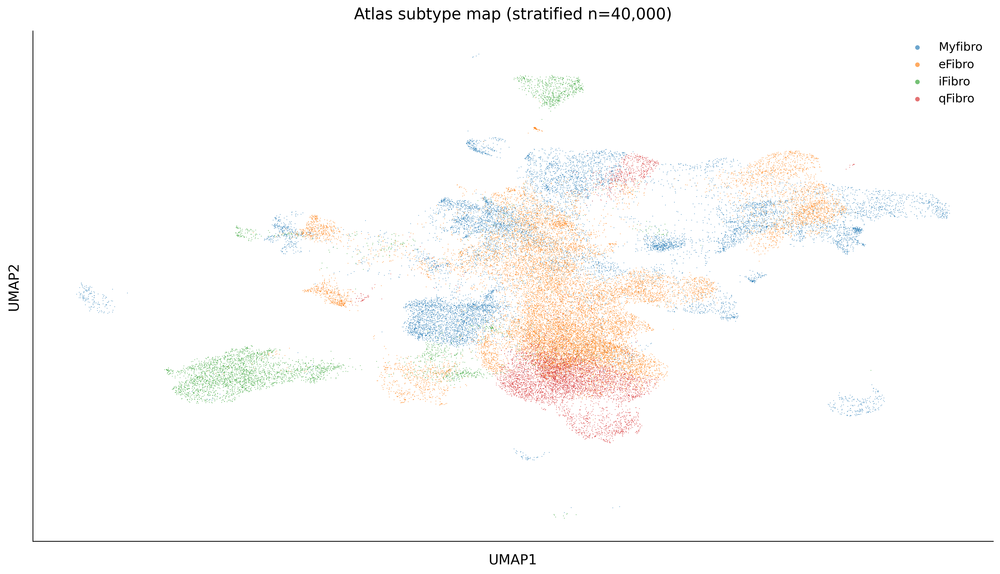
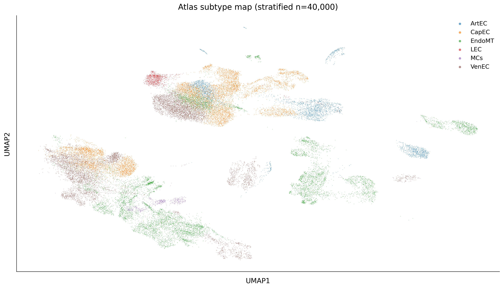
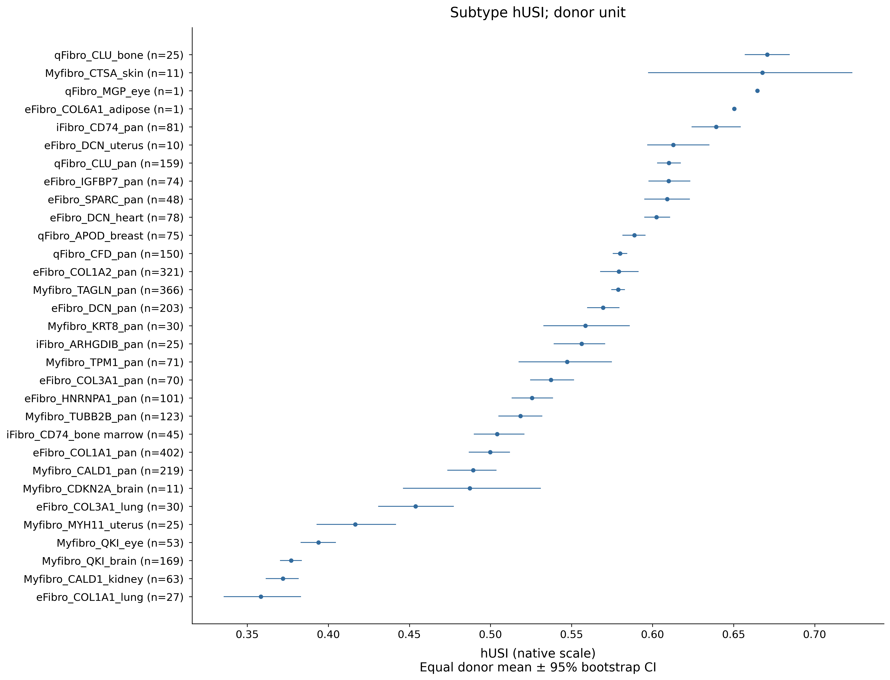
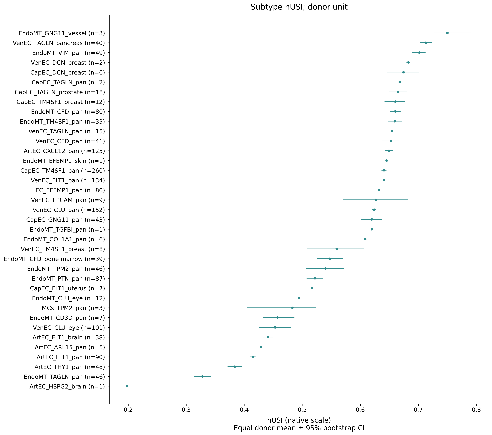
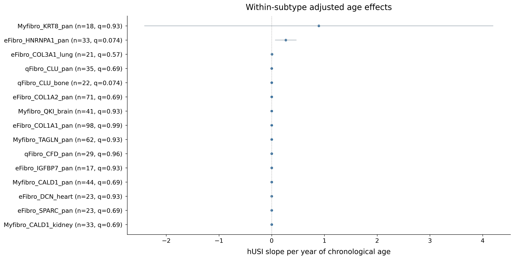
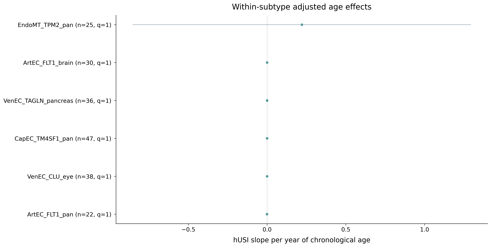
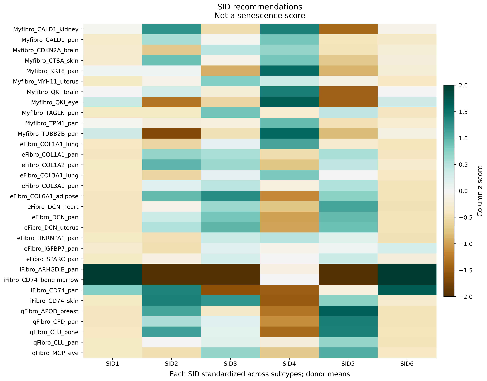

# figures

Current snapshot: **25 November 2026**. Counts refer to sample/proxy units unless stated otherwise. Selected expression features are not explicit cell-type proportions; predictive weights and regulatory annotations are not causal evidence.

[Module overview](../README.md) · [Results and legends](../../docs/results)

This folder belongs to the historical score snapshot. The current selected-state analysis is linked from the module overview.

Subdirectories: [panels](panels/).

- [Fig_CellAge_Stromal_Integration.pdf](Fig_CellAge_Stromal_Integration.pdf)
- [Fig_CellAge_Stromal_Integration.png](Fig_CellAge_Stromal_Integration.png)
