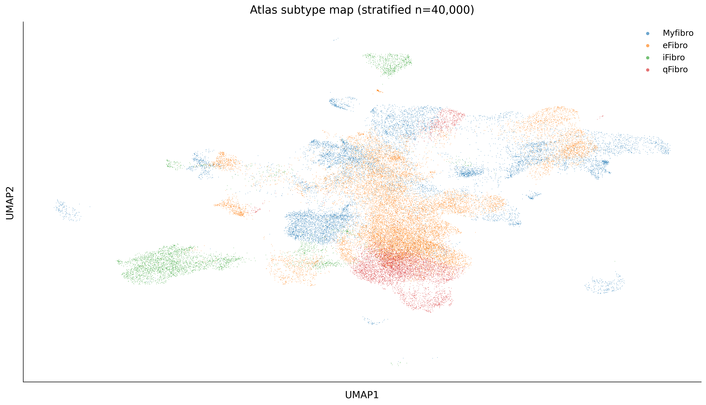
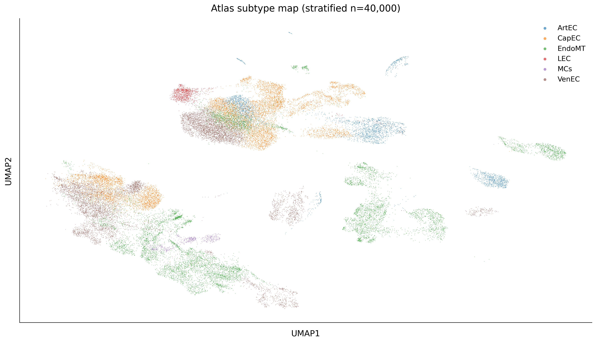
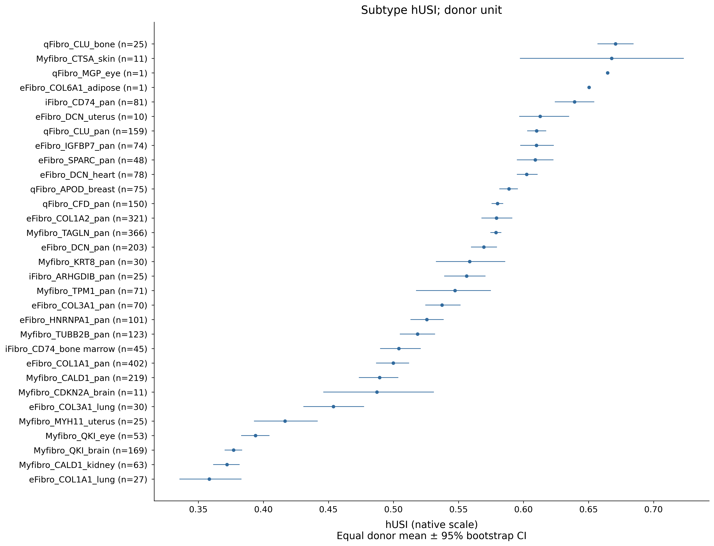
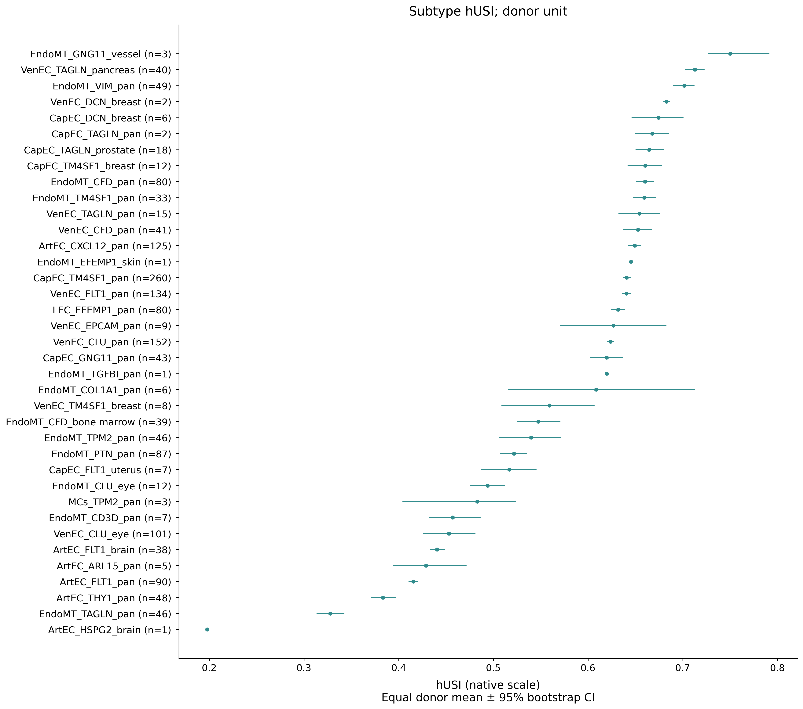
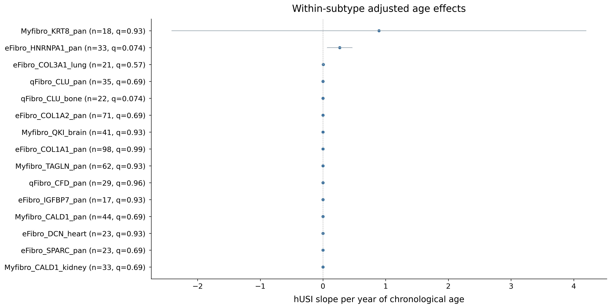
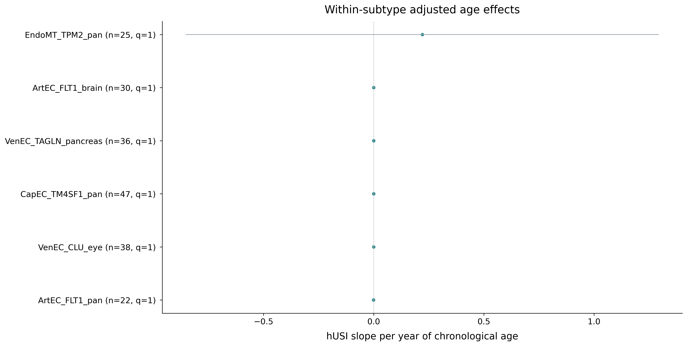
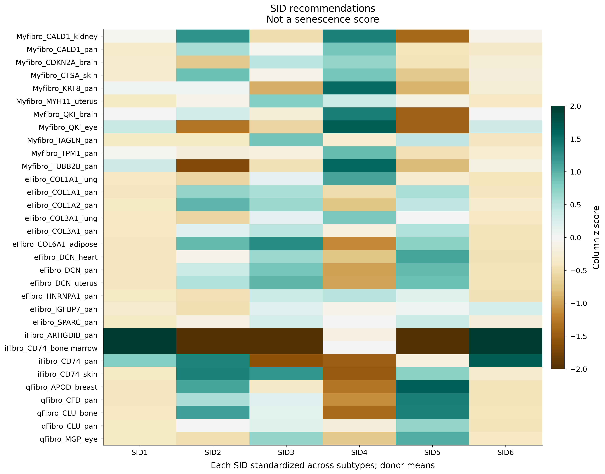
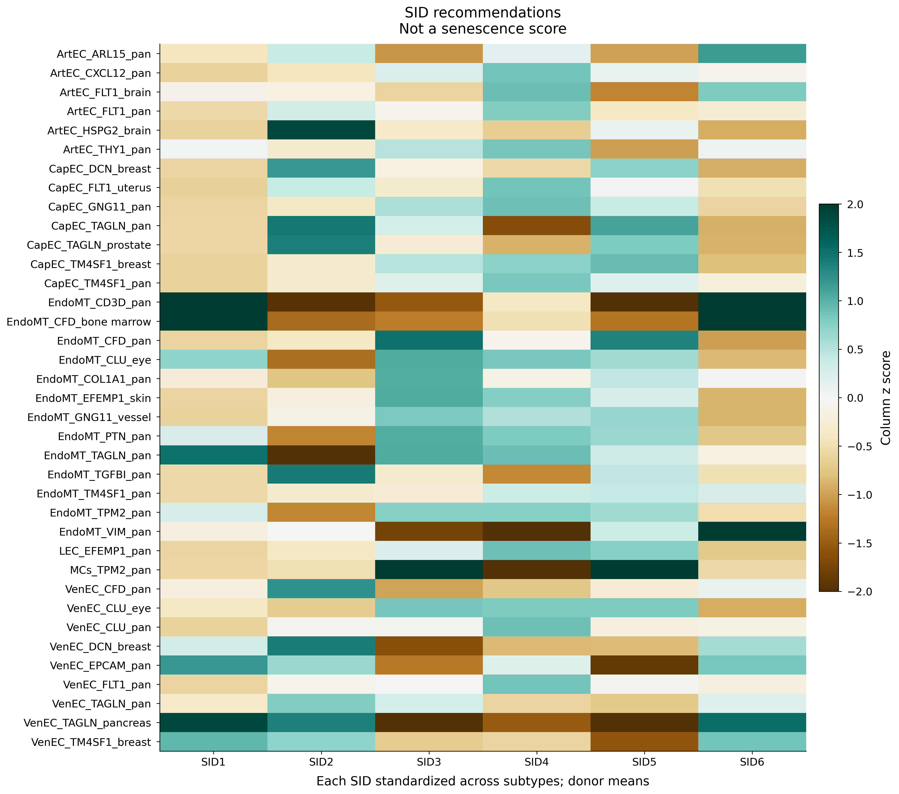

# panels

Current snapshot: **19 November 2026**. Counts refer to sample/proxy units unless stated otherwise. Selected expression features are not explicit cell-type proportions; predictive weights and regulatory annotations are not causal evidence.

[Module overview](../../README.md) · [Results and legends](../../../docs/results)

This folder belongs to the historical score snapshot. The current selected-state analysis is linked from the module overview.

- [A_fibro_embedding.pdf](A_fibro_embedding.pdf)
- [A_fibro_embedding.png](A_fibro_embedding.png)
- [B_endo_embedding.pdf](B_endo_embedding.pdf)
- [B_endo_embedding.png](B_endo_embedding.png)
- [C_fibro_ranking.pdf](C_fibro_ranking.pdf)
- [C_fibro_ranking.png](C_fibro_ranking.png)
- [D_endo_ranking.pdf](D_endo_ranking.pdf)
- [D_endo_ranking.png](D_endo_ranking.png)
- [E_fibro_age.pdf](E_fibro_age.pdf)
- [E_fibro_age.png](E_fibro_age.png)
- [F_endo_age.pdf](F_endo_age.pdf)
- [F_endo_age.png](F_endo_age.png)
- [G_fibro_sid.pdf](G_fibro_sid.pdf)
- [G_fibro_sid.png](G_fibro_sid.png)
- [H_endo_sid.pdf](H_endo_sid.pdf)
- [H_endo_sid.png](H_endo_sid.png)
- [I_fibro_feature_integration.pdf](I_fibro_feature_integration.pdf)
- [I_fibro_feature_integration.png](I_fibro_feature_integration.png)
- [J_endo_feature_integration.pdf](J_endo_feature_integration.pdf)
- [J_endo_feature_integration.png](J_endo_feature_integration.png)
- [K_fibro_pathways.pdf](K_fibro_pathways.pdf)
- [K_fibro_pathways.png](K_fibro_pathways.png)
- [L_endo_pathways.pdf](L_endo_pathways.pdf)
- [L_endo_pathways.png](L_endo_pathways.png)
