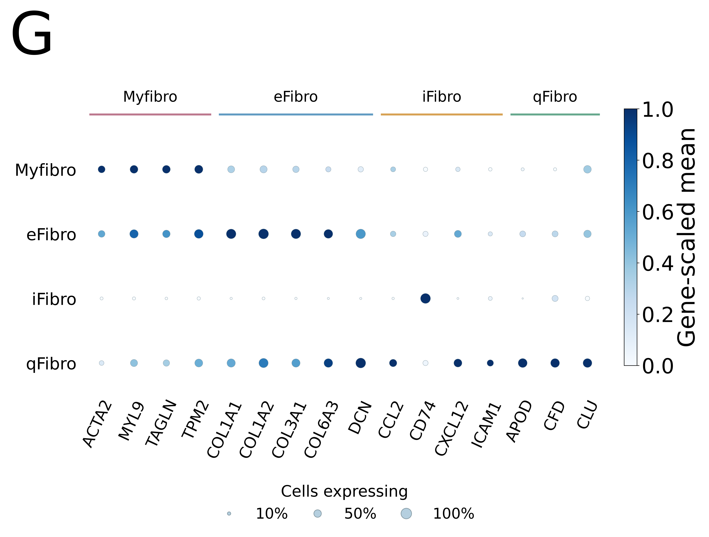
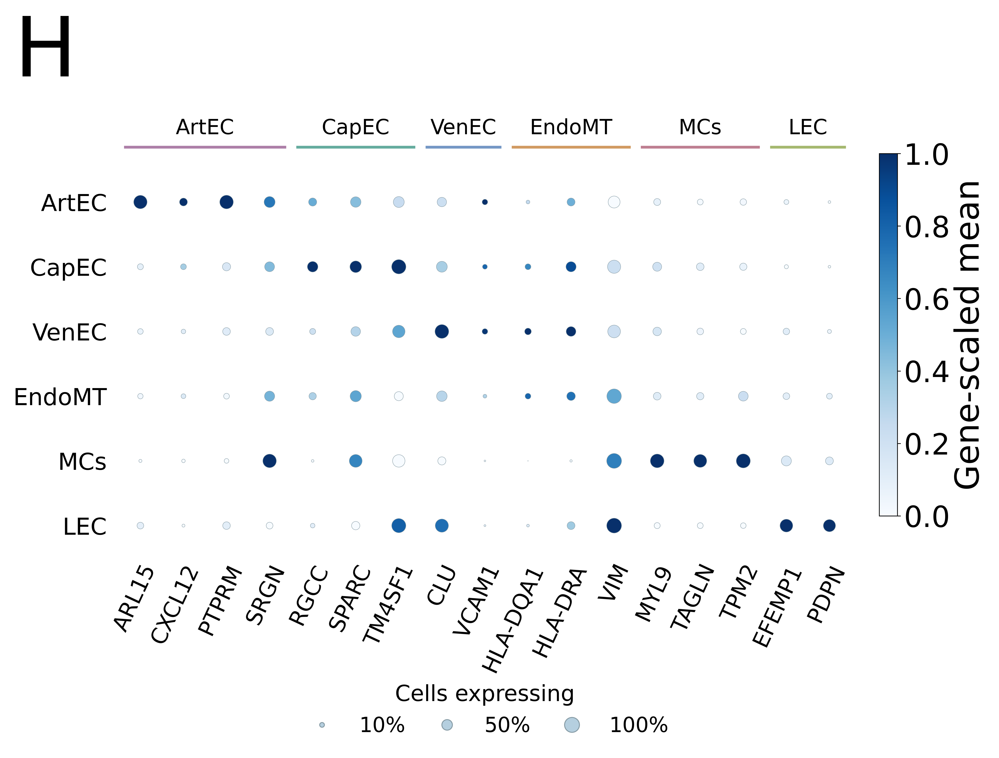
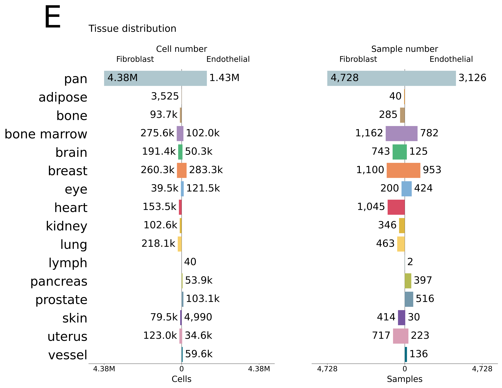
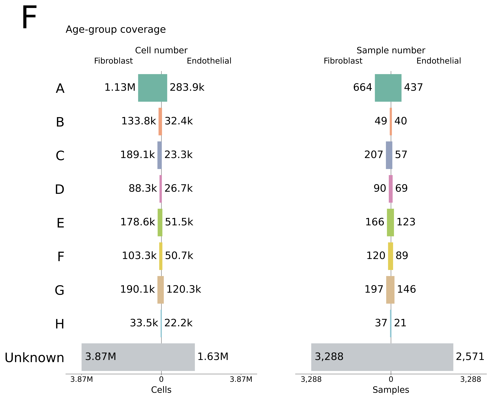
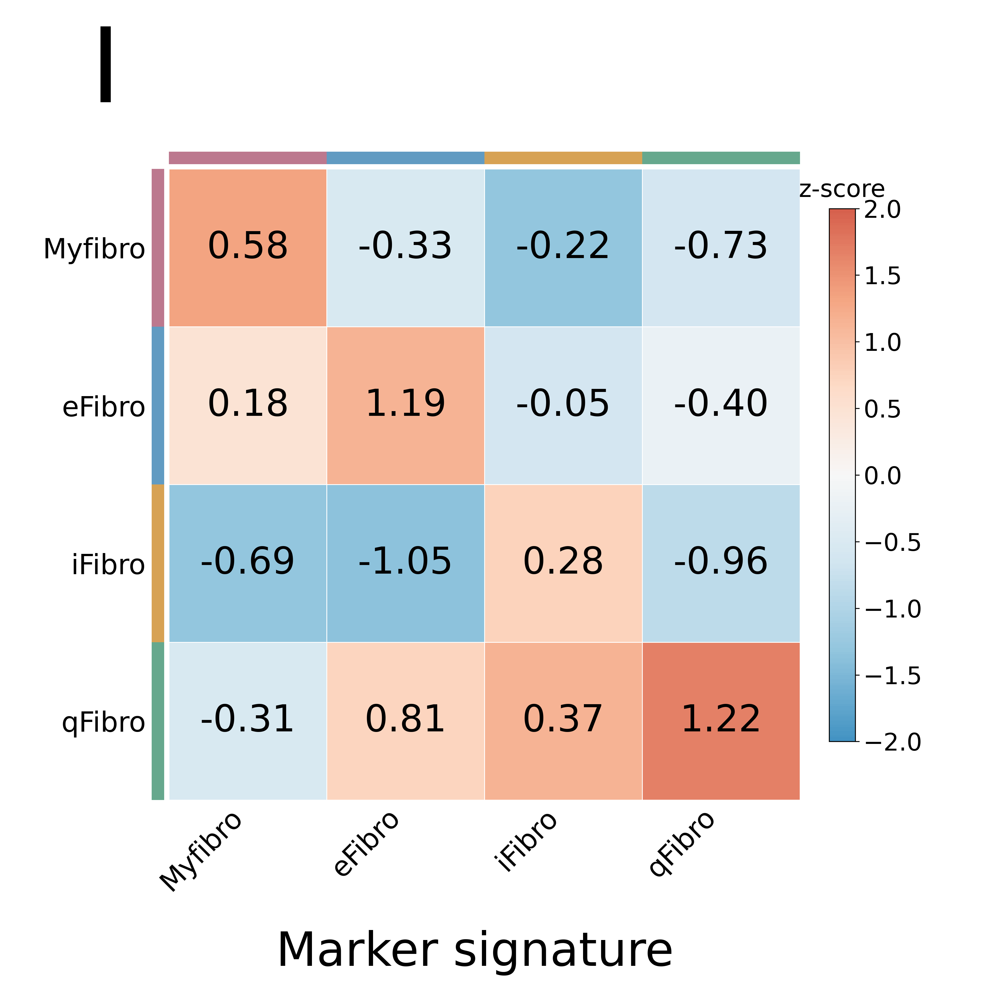
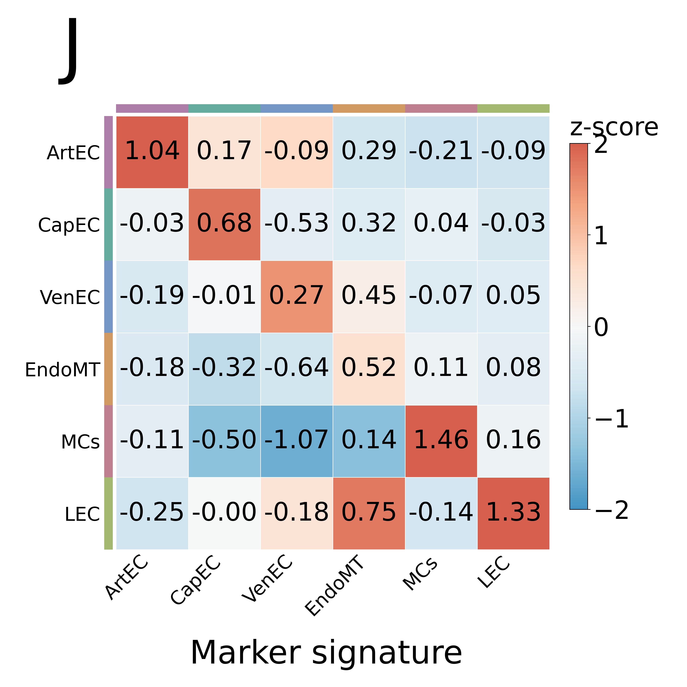
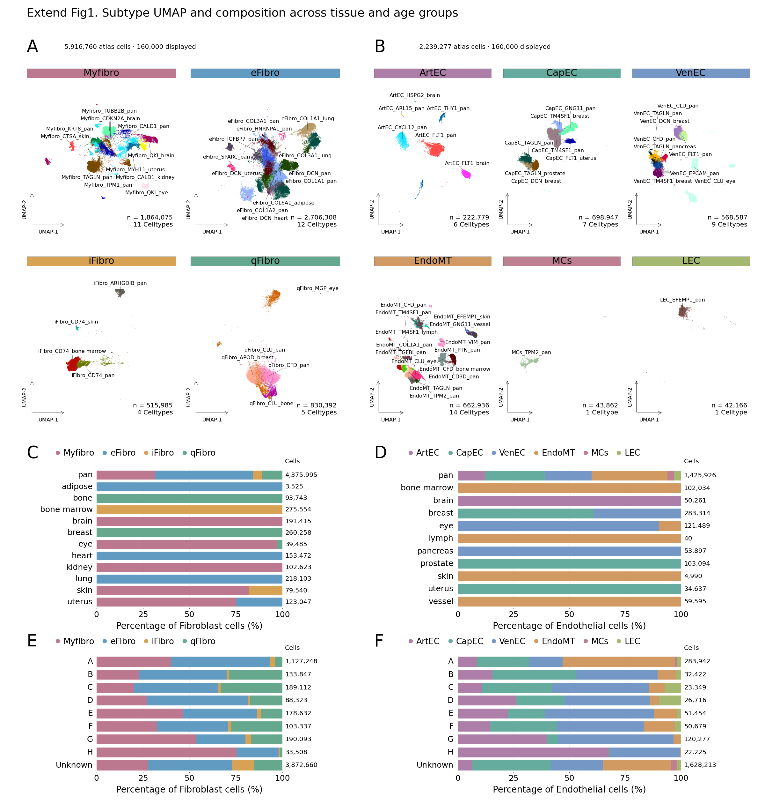
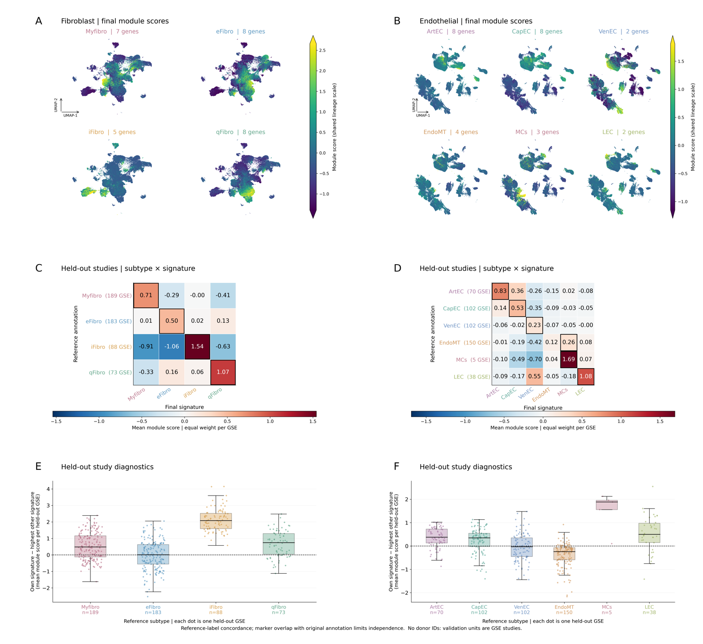

# Stromal Atlas

Source project directory: `F1_StromalAtlas`. This page presents the selected verified result versions, original figure files, and aggregate evidence.

**Results:** [English text](../docs/results/Results_Part1_StromalAtlas.md) · [Editable Word](../docs/results/Results_Part1_StromalAtlas.docx) · [PDF preview](../docs/results/Results_Part1_StromalAtlas.pdf) · [Figure legends](../docs/results/Figure_Legends.md)

**Audit:** [File inventory](audit/file_inventory.csv) · [Figure inventory](audit/figure_inventory.csv) · [Evidence registry](evidence/evidence_registry.csv) · [Released asset hashes](audit/released_assets.csv)

**Code:** [Workflow source](../workflows/atlas/) · [Reproduction instructions](../docs/reproducing.md)

## Atlas and annotation coverage

| Lineage | Cells | Sample labels | GSE labels | Detailed Celltype labels |
| --- | ---: | ---: | ---: | ---: |
| Fibro | 5,916,760 | 4,818 | 848 | 32 |
| Endo | 2,239,277 | 3,553 | 748 | 38 |

Sample labels are not a verified count of unique donors. The full atlas includes heterogeneous disease metadata. Figure 1C–E use annotation suffixes including pan; these are different from original tissue labels.

## Figure 1: full atlas and expression support

[Original complete PNG](figures/Fig1_StromalAtlas_main.png) · [Complete vector PDF](figures/Fig1_StromalAtlas_main.pdf)

The full-resolution composite is available above. Original marker, metadata and signature panels are displayed separately for navigation.

  
  

  
  

  
  

## Extended Data Figure 1: detailed subtypes and composition

[Original PDF](figures/ExtendFig1_subtype_umap_composition.pdf). Pooled-cell proportions are descriptive and are not clock inputs.

## Extended Data Figure 2: marker-signature agreement

[Original PDF](figures/ExtFig1_SignatureScore_Fibro_Endo.pdf). This is retrospective reference-label agreement, not a new blinded annotation test.

## Supplementary filtering figures

[Supplementary Figure 1 — TISCH](figures/Extended_Figure1_TISCH.pdf) · [Supplementary Figure 2 — HUSCH](figures/Extended_Figure1_HUSCH.pdf)

## Released file catalogue

Original figure and aggregate-table files

| File | Type | Size (MB) |
| --- | --- | ---: |
| [figures/Fig1A_Fibroblast_Celltype_general.png](figures/Fig1A_Fibroblast_Celltype_general.png) | figure | 3.99 |
| [figures/Fig1B_Endothelial_Celltype_general.png](figures/Fig1B_Endothelial_Celltype_general.png) | figure | 3.69 |
| [figures/Fig1C_Fibroblast_Tissue_from_Celltype.png](figures/Fig1C_Fibroblast_Tissue_from_Celltype.png) | figure | 3.59 |
| [figures/Fig1D_Endothelial_Tissue_from_Celltype.png](figures/Fig1D_Endothelial_Tissue_from_Celltype.png) | figure | 3.27 |
| [figures/Fig1E_tissue_summary.png](figures/Fig1E_tissue_summary.png) | figure | 0.89 |
| [figures/Fig1F_age_summary.png](figures/Fig1F_age_summary.png) | figure | 0.61 |
| [figures/Fig1G_Fibroblast_markers.png](figures/Fig1G_Fibroblast_markers.png) | figure | 0.62 |
| [figures/Fig1H_Endothelial_markers.png](figures/Fig1H_Endothelial_markers.png) | figure | 0.78 |
| [figures/Fig1I_Fibroblast_signatures.png](figures/Fig1I_Fibroblast_signatures.png) | figure | 0.36 |
| [figures/Fig1J_Endothelial_signatures.png](figures/Fig1J_Endothelial_signatures.png) | figure | 0.52 |
| [figures/Fig1_StromalAtlas_main.png](figures/Fig1_StromalAtlas_main.png) | figure | 14.30 |
| [figures/Fig1_StromalAtlas_main.pdf](figures/Fig1_StromalAtlas_main.pdf) | figure | 11.55 |
| [figures/ExtendFig1_subtype_umap_composition_preview.png](figures/ExtendFig1_subtype_umap_composition_preview.png) | figure | 0.79 |
| [figures/ExtendFig1_subtype_umap_composition.pdf](figures/ExtendFig1_subtype_umap_composition.pdf) | figure | 5.73 |
| [figures/ExtFig1_SignatureScore_preview.png](figures/ExtFig1_SignatureScore_preview.png) | figure | 0.53 |
| [figures/ExtFig1_SignatureScore_Fibro_Endo.pdf](figures/ExtFig1_SignatureScore_Fibro_Endo.pdf) | figure | 4.58 |
| [figures/Extended_Figure1_TISCH.pdf](figures/Extended_Figure1_TISCH.pdf) | figure | 14.41 |
| [figures/Extended_Figure1_HUSCH.pdf](figures/Extended_Figure1_HUSCH.pdf) | figure | 15.64 |
| [tables/figure1/endo_Age_group_summary.csv](tables/figure1/endo_Age_group_summary.csv) | aggregate_table | 0.00 |
| [tables/figure1/endo_Celltype_to_Tissue_mapping.csv](tables/figure1/endo_Celltype_to_Tissue_mapping.csv) | aggregate_table | 0.00 |
| [tables/figure1/endo_Tissue_from_Celltype_summary.csv](tables/figure1/endo_Tissue_from_Celltype_summary.csv) | aggregate_table | 0.00 |
| [tables/figure1/fibro_Age_group_summary.csv](tables/figure1/fibro_Age_group_summary.csv) | aggregate_table | 0.00 |
| [tables/figure1/fibro_Celltype_to_Tissue_mapping.csv](tables/figure1/fibro_Celltype_to_Tissue_mapping.csv) | aggregate_table | 0.00 |
| [tables/figure1/fibro_Tissue_from_Celltype_summary.csv](tables/figure1/fibro_Tissue_from_Celltype_summary.csv) | aggregate_table | 0.00 |
| [tables/fibro/counts_general.csv](tables/fibro/counts_general.csv) | aggregate_table | 0.00 |
| [tables/fibro/counts_subtype.csv](tables/fibro/counts_subtype.csv) | aggregate_table | 0.00 |
| [tables/fibro/counts_celltype.csv](tables/fibro/counts_celltype.csv) | aggregate_table | 0.00 |
| [tables/fibro/counts_tissue.csv](tables/fibro/counts_tissue.csv) | aggregate_table | 0.00 |
| [tables/fibro/counts_age_group.csv](tables/fibro/counts_age_group.csv) | aggregate_table | 0.00 |
| [tables/fibro/marker_summary.csv](tables/fibro/marker_summary.csv) | aggregate_table | 0.00 |
| [tables/fibro/signature_mean.csv](tables/fibro/signature_mean.csv) | aggregate_table | 0.00 |
| [tables/signatures/marker_combination_train_holdout_fibro.csv](tables/signatures/marker_combination_train_holdout_fibro.csv) | aggregate_table | 0.00 |
| [tables/signatures/plot_reference_umap_signatures_fibro.csv](tables/signatures/plot_reference_umap_signatures_fibro.csv) | aggregate_table | 0.00 |
| [tables/endo/counts_general.csv](tables/endo/counts_general.csv) | aggregate_table | 0.00 |
| [tables/endo/counts_subtype.csv](tables/endo/counts_subtype.csv) | aggregate_table | 0.00 |
| [tables/endo/counts_celltype.csv](tables/endo/counts_celltype.csv) | aggregate_table | 0.00 |
| [tables/endo/counts_tissue.csv](tables/endo/counts_tissue.csv) | aggregate_table | 0.00 |
| [tables/endo/counts_age_group.csv](tables/endo/counts_age_group.csv) | aggregate_table | 0.00 |
| [tables/endo/marker_summary.csv](tables/endo/marker_summary.csv) | aggregate_table | 0.01 |
| [tables/endo/signature_mean.csv](tables/endo/signature_mean.csv) | aggregate_table | 0.00 |
| [tables/signatures/marker_combination_train_holdout_endo.csv](tables/signatures/marker_combination_train_holdout_endo.csv) | aggregate_table | 0.00 |
| [tables/signatures/plot_reference_umap_signatures_endo.csv](tables/signatures/plot_reference_umap_signatures_endo.csv) | aggregate_table | 0.00 |
| [tables/signatures/plot_reference_cluster_check.csv](tables/signatures/plot_reference_cluster_check.csv) | aggregate_table | 0.05 |
| [tables/filtering/dataset_audit.csv](tables/filtering/dataset_audit.csv) | aggregate_table | 0.01 |
| [tables/filtering/full_reference_cell_counts.csv](tables/filtering/full_reference_cell_counts.csv) | aggregate_table | 0.02 |
| [tables/filtering/full_saved_filter_counts.csv](tables/filtering/full_saved_filter_counts.csv) | aggregate_table | 0.01 |
| [tables/filtering/stored_evaluation_all_lineages.csv](tables/filtering/stored_evaluation_all_lineages.csv) | aggregate_table | 0.30 |

All released images/PDFs are original copies. The figure inventory also lists unselected historical candidates as metadata-only; their presence does not establish a verified or published result.
