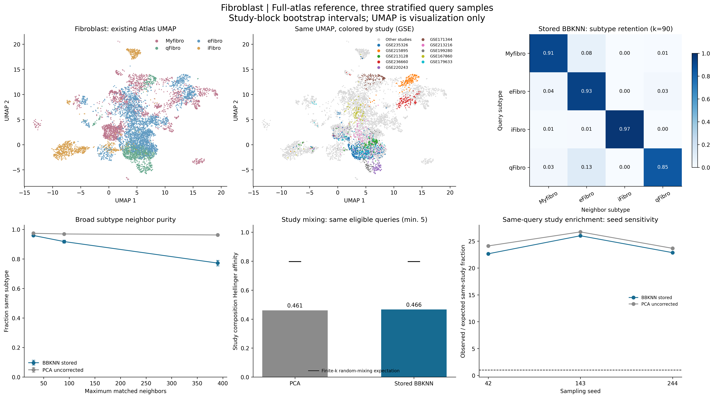
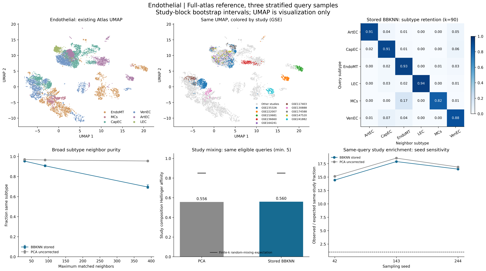

# F1 — Human stromal atlas

The full reference contains **5,916,760 fibroblast** and **2,239,277 endothelial-lineage cells**, with **4,818/3,553 sample labels** and **848/748 study labels**. These are not verified unique donor counts. The source atlas includes heterogeneous disease annotations.

The UMAPs display 160,000 stratified representative cells per lineage; counts and expression summaries use the full source. Detailed annotation resolves 32/38 states. The `pan`/organ-like Celltype suffixes are naming categories, not original anatomical tissue metadata. Marker/signature agreement is retrospective rather than blinded identity validation.

[Results Part 1](../docs/results/Results_Part1_StromalAtlas.md) · [Full PDF](figures/Fig1_StromalAtlas_main.pdf) · [Figure gallery](figures/) · [Aggregate source tables](tables/) · [Evidence](evidence/evidence_registry.csv) · [File inventory](audit/file_inventory.csv)

## Annotation curation and integration diagnostics

Marker-name revision preserves 32/38 annotation units; frozen model features retain their earlier labels. Stored full-reference BBKNN graphs used tissue as the batch key. Conditional same-study enrichment remains 23.82-fold/16.26-fold above random mixing within tissue-by-broad-state strata. Matched reconstructed scIB is not full-graph scIB or scVI. External label transfer updates 79,285/47,847 cells and retains low-support assignments; it does not change saved clock-cohort validation.

[Aggregate tables](tables/) · [Updated Results Part 1](../docs/results/Results_Part1_StromalAtlas.md)
