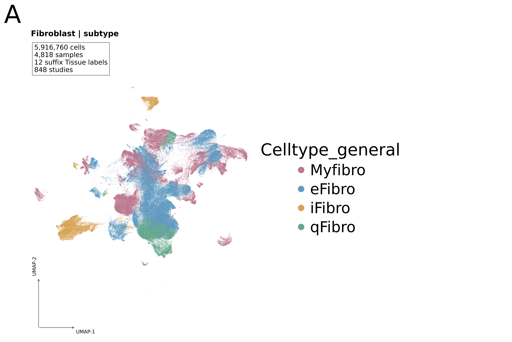
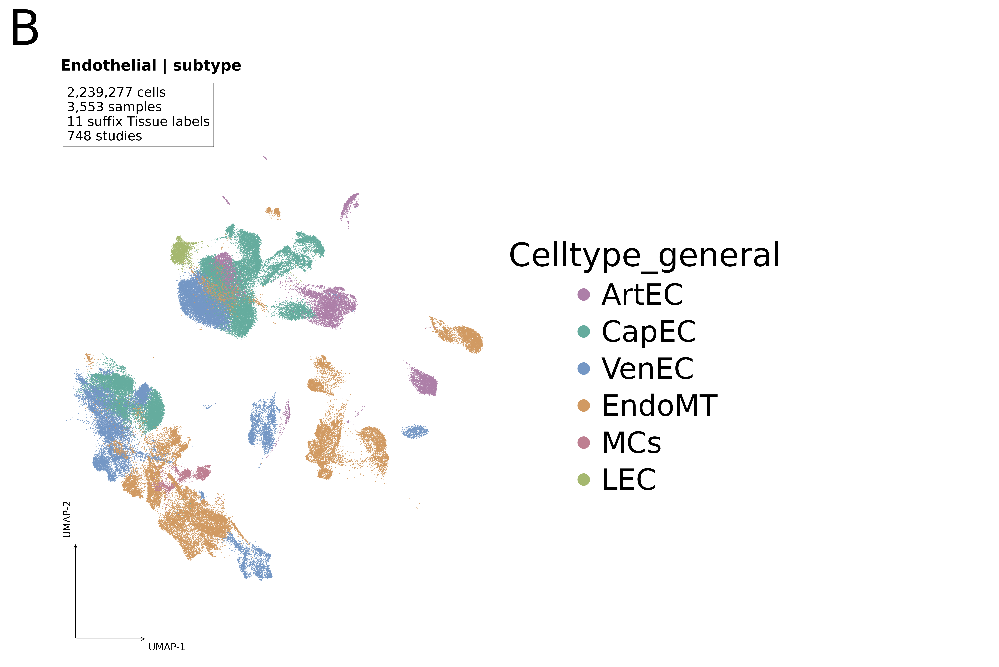
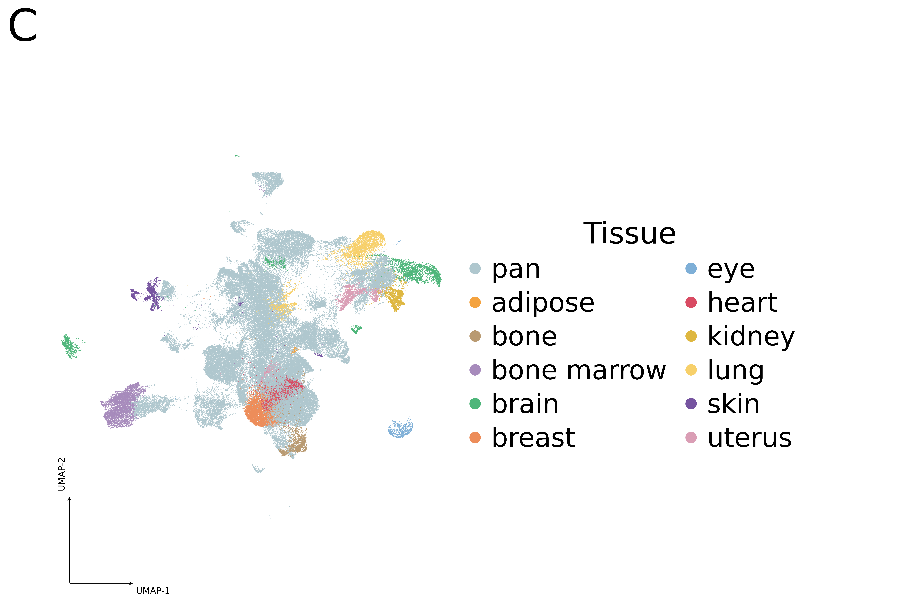
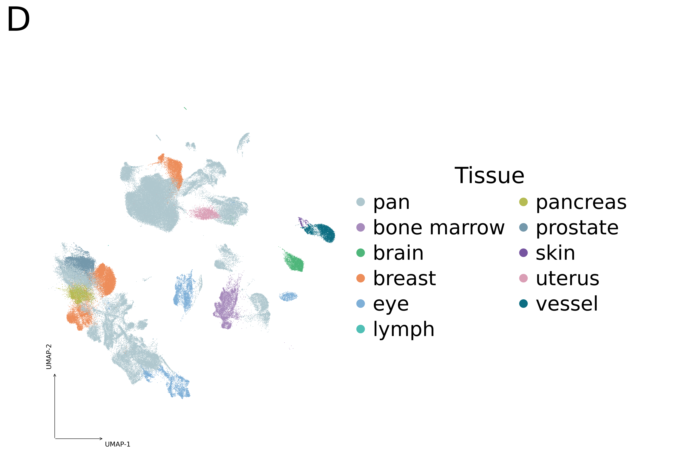
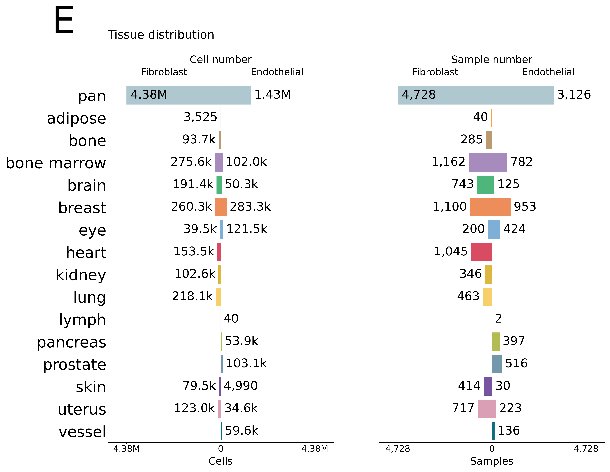
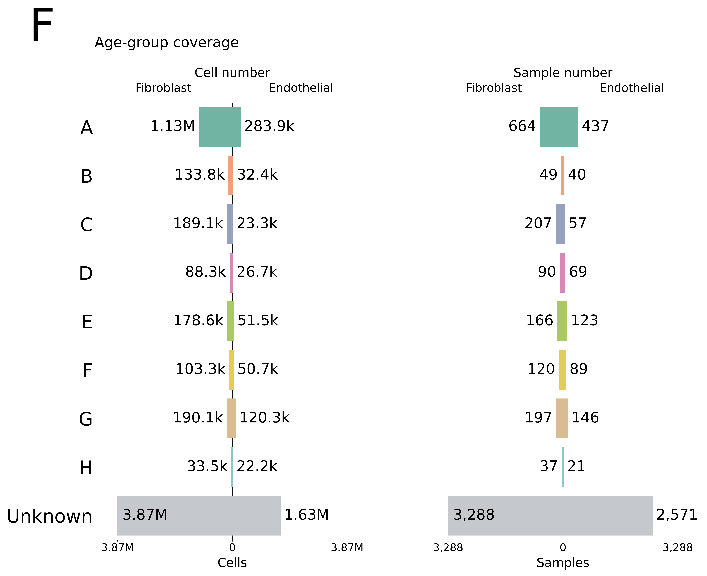
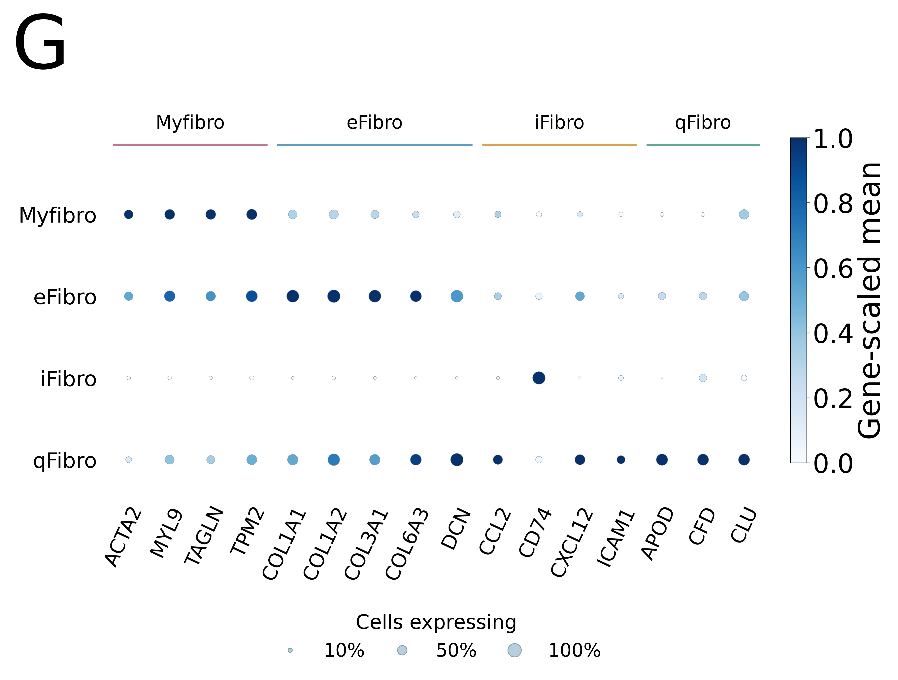
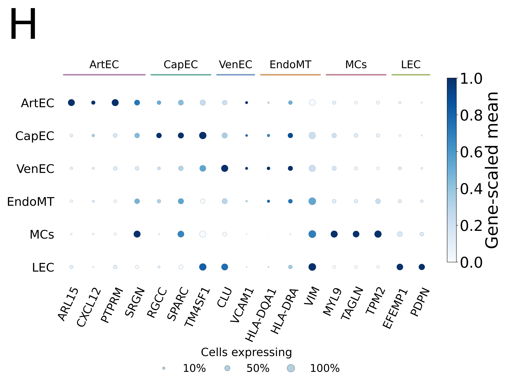

# figures

Current snapshot: **25 November 2026**. Counts refer to sample/proxy units unless stated otherwise. Selected expression features are not explicit cell-type proportions; predictive weights and regulatory annotations are not causal evidence.

[Module overview](../README.md) · [Results and legends](../../docs/results)

- [BatchRemoval_Endothelial_Diagnostics.pdf](BatchRemoval_Endothelial_Diagnostics.pdf)
- [BatchRemoval_Endothelial_Diagnostics.png](BatchRemoval_Endothelial_Diagnostics.png)
- [BatchRemoval_Fibroblast_Diagnostics.pdf](BatchRemoval_Fibroblast_Diagnostics.pdf)
- [BatchRemoval_Fibroblast_Diagnostics.png](BatchRemoval_Fibroblast_Diagnostics.png)
- [BatchRemoval_scIB_MatchedSample.pdf](BatchRemoval_scIB_MatchedSample.pdf)
- [BatchRemoval_scIB_MatchedSample.png](BatchRemoval_scIB_MatchedSample.png)
- [ExtFig1_SignatureScore_Fibro_Endo.pdf](ExtFig1_SignatureScore_Fibro_Endo.pdf)
- [ExtFig1_SignatureScore_Fibro_Endo.png](ExtFig1_SignatureScore_Fibro_Endo.png)
- [ExtFig1_SignatureScore_preview.png](ExtFig1_SignatureScore_preview.png)
- [ExtendFig1_subtype_umap_composition.pdf](ExtendFig1_subtype_umap_composition.pdf)
- [ExtendFig1_subtype_umap_composition.png](ExtendFig1_subtype_umap_composition.png)
- [ExtendFig1_subtype_umap_composition_preview.png](ExtendFig1_subtype_umap_composition_preview.png)
- [Extended_Figure1_HUSCH.pdf](Extended_Figure1_HUSCH.pdf)
- [Extended_Figure1_HUSCH.png](Extended_Figure1_HUSCH.png)
- [Extended_Figure1_TISCH.pdf](Extended_Figure1_TISCH.pdf)
- [Extended_Figure1_TISCH.png](Extended_Figure1_TISCH.png)
- [Fig1A_Fibroblast_Celltype_general.png](Fig1A_Fibroblast_Celltype_general.png)
- [Fig1B_Endothelial_Celltype_general.png](Fig1B_Endothelial_Celltype_general.png)
- [Fig1C_Fibroblast_Tissue_from_Celltype.png](Fig1C_Fibroblast_Tissue_from_Celltype.png)
- [Fig1D_Endothelial_Tissue_from_Celltype.png](Fig1D_Endothelial_Tissue_from_Celltype.png)
- [Fig1E_tissue_summary.png](Fig1E_tissue_summary.png)
- [Fig1F_age_summary.png](Fig1F_age_summary.png)
- [Fig1G_Fibroblast_markers.png](Fig1G_Fibroblast_markers.png)
- [Fig1H_Endothelial_markers.png](Fig1H_Endothelial_markers.png)
- [Fig1I_Fibroblast_signatures.png](Fig1I_Fibroblast_signatures.png)
- [Fig1J_Endothelial_signatures.png](Fig1J_Endothelial_signatures.png)
- [Fig1_StromalAtlas_main.pdf](Fig1_StromalAtlas_main.pdf)
- [Fig1_StromalAtlas_main.png](Fig1_StromalAtlas_main.png)
