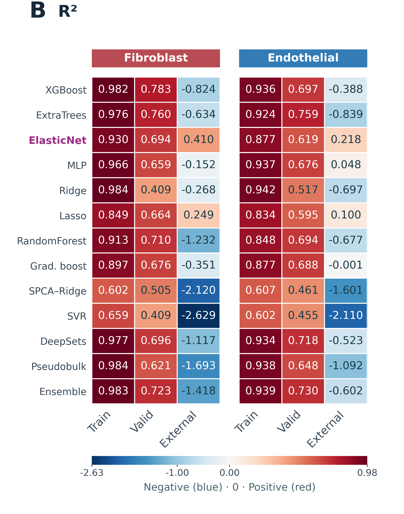
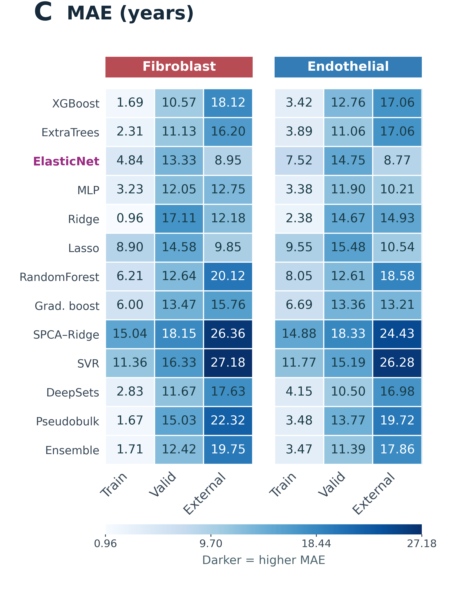
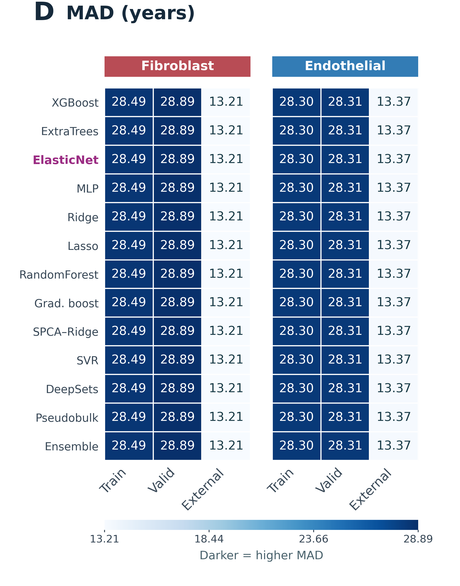

# F2 — Clock overview and current Figure 2

[Full-resolution PNG](figures/Fig2_StromalClock_ModelPerformance.png) · [PDF](figures/Fig2_StromalClock_ModelPerformance.pdf) · [Current source manifest](tables/source_manifest.json) · [Results Part 2](../docs/results/Results_Part2_ClockPerformance_CellAge.md)

- **B–D:** source fold 4, K selected separately per model; external FT30→ALL100 includes adaptation samples. Panel D MAD is mean absolute age-label deviation.
- **E/F:** development-set in-sample fits of the current 750/350-feature ElasticNet source models, n=640/437, R²≈0.950, MAE=4.98/5.03 years. MAD means MedAE here.
- **A updated external elements:** n=93/77, R²=0.377/0.391, MAE=8.71/9.28 after adaptation and ALL100-informed selection. These are not independent external-validation estimates.

The full grouped five-fold benchmark and earlier unreduced EN branch are separate protocols. See [the legend](../docs/results/Figure_Legends.md) for remaining conceptual workflow labels and the metric definitions.

[Development-fit metrics](tables/Fig2_scatter_metrics.csv) · [Outcome-selected external metrics](tables/Fig2_workflow_external_metrics.csv) · [Source-fold-4 metrics](tables/Fig2_performance_long.csv) · [Evidence](evidence/evidence_registry.csv)
