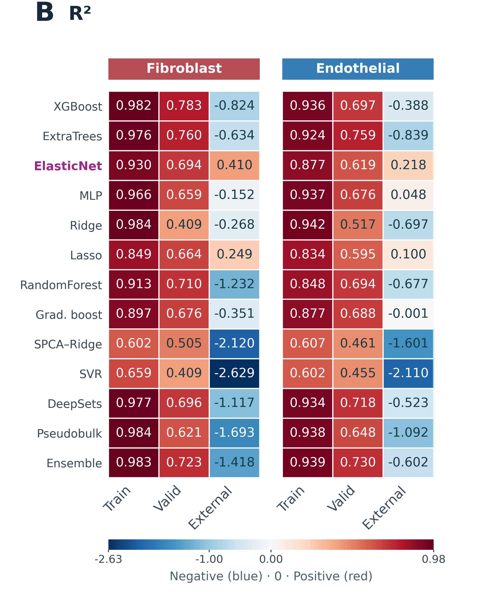
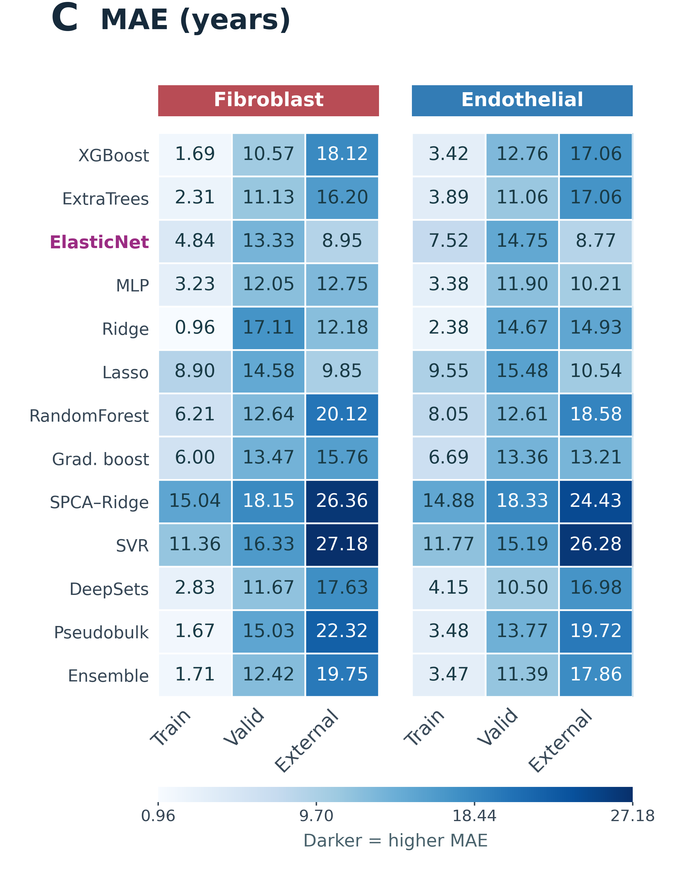
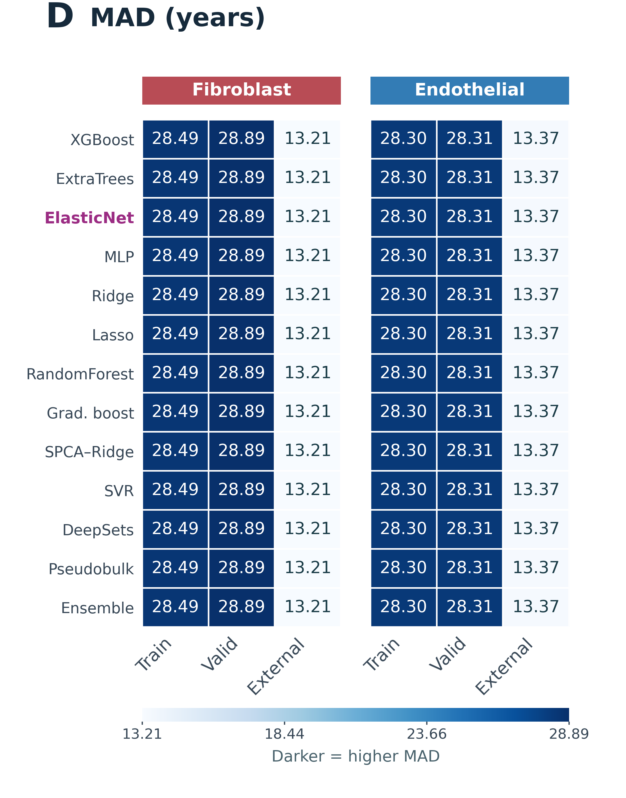
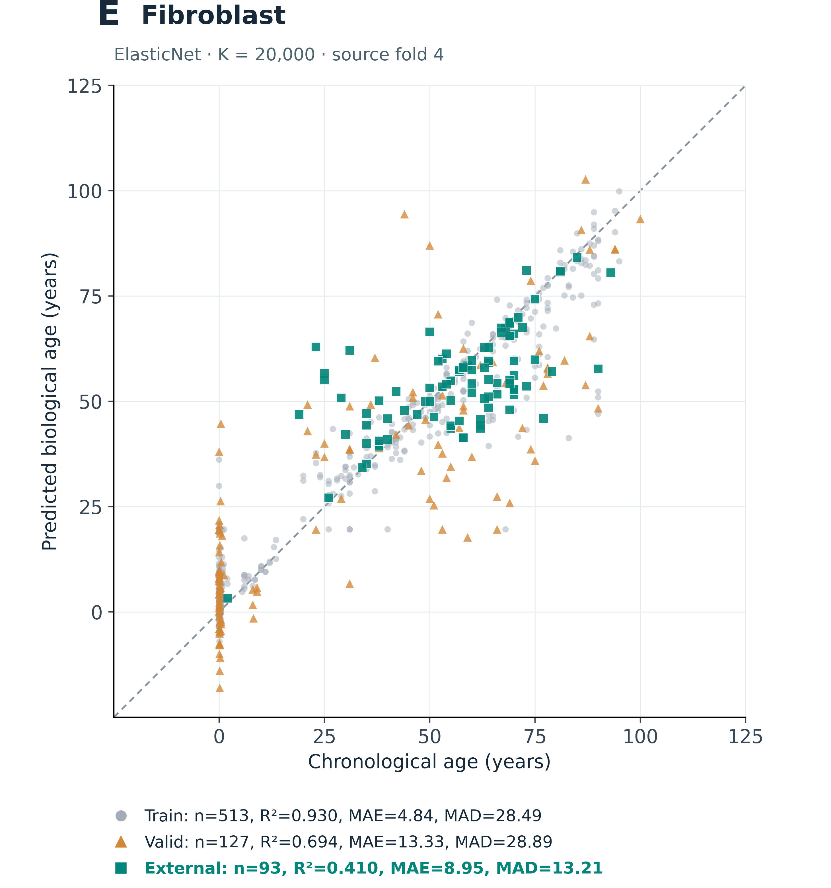
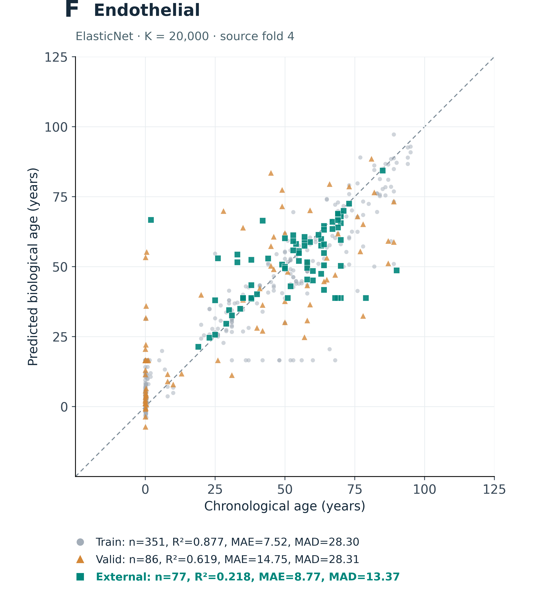

# Clock Overview and Source-Fold Performance

Source project directory: `F2_ModelPerformance`. This page presents the selected verified result versions, original figure files, and aggregate evidence.

**Results:** [English text](../docs/results/Results_Part2_ClockPerformance_CellAge.md) · [Editable Word](../docs/results/Results_Part2_ClockPerformance_CellAge.docx) · [PDF preview](../docs/results/Results_Part2_ClockPerformance_CellAge.pdf) · [Figure legends](../docs/results/Figure_Legends.md)

**Audit:** [File inventory](audit/file_inventory.csv) · [Figure inventory](audit/figure_inventory.csv) · [Evidence registry](evidence/evidence_registry.csv) · [Released asset hashes](audit/released_assets.csv)

**Code:** [Workflow source](../workflows/model_performance/) · [Reproduction instructions](../docs/reproducing.md)

## Model Overview

The supplied overview is schematic. Its illustrative values, healthy-only label and GWAS/TF sketches are not substituted for audited study evidence.

## Model Performance: panels B–D

  
  
  

These are source-fold-4 values with internally selected K, not fivefold averages. External uses FT30 ALL100, including adaptation samples. MAD is mean absolute deviation of age labels, not median prediction error.

## ElasticNet example: panels E–F

  
  

Both displayed EN examples use K=20,000. They differ from the later full-development final clocks. The historical biological-age axis wording refers to the recorded chronological-age target.

[Full Figure 2 PNG](figures/Fig2_StromalClock_ModelPerformance.png) · [Full Figure 2 PDF](figures/Fig2_StromalClock_ModelPerformance.pdf) · [Final-clock gallery](../TabulaStromal_Rebenchmark_2026/)

## Released file catalogue

Original figure and aggregate-table files

| File | Type | Size (MB) |
| --- | --- | ---: |
| [figures/TabulaStromal_Workflow_V6.png](figures/TabulaStromal_Workflow_V6.png) | figure | 1.90 |
| [figures/Fig2_StromalClock_ModelPerformance.png](figures/Fig2_StromalClock_ModelPerformance.png) | figure | 21.30 |
| [figures/Fig2_StromalClock_ModelPerformance.pdf](figures/Fig2_StromalClock_ModelPerformance.pdf) | figure | 1.97 |
| [figures/panels/Fig2B_R2_heatmap.pdf](figures/panels/Fig2B_R2_heatmap.pdf) | figure | 0.02 |
| [figures/panels/Fig2B_R2_heatmap.png](figures/panels/Fig2B_R2_heatmap.png) | figure | 0.55 |
| [figures/panels/Fig2C_MAE_heatmap.pdf](figures/panels/Fig2C_MAE_heatmap.pdf) | figure | 0.02 |
| [figures/panels/Fig2C_MAE_heatmap.png](figures/panels/Fig2C_MAE_heatmap.png) | figure | 0.47 |
| [figures/panels/Fig2D_MAD_heatmap.pdf](figures/panels/Fig2D_MAD_heatmap.pdf) | figure | 0.02 |
| [figures/panels/Fig2D_MAD_heatmap.png](figures/panels/Fig2D_MAD_heatmap.png) | figure | 0.49 |
| [figures/panels/Fig2E_Fibro_squareplot.pdf](figures/panels/Fig2E_Fibro_squareplot.pdf) | figure | 0.03 |
| [figures/panels/Fig2E_Fibro_squareplot.png](figures/panels/Fig2E_Fibro_squareplot.png) | figure | 0.41 |
| [figures/panels/Fig2F_Endo_squareplot.pdf](figures/panels/Fig2F_Endo_squareplot.pdf) | figure | 0.03 |
| [figures/panels/Fig2F_Endo_squareplot.png](figures/panels/Fig2F_Endo_squareplot.png) | figure | 0.37 |
| [tables/Fig2_performance_long.csv](tables/Fig2_performance_long.csv) | aggregate_table | 0.01 |
| [tables/Fig2_scatter_metrics.csv](tables/Fig2_scatter_metrics.csv) | aggregate_table | 0.00 |
| [tables/Fig2_metric_validation.csv](tables/Fig2_metric_validation.csv) | aggregate_table | 0.00 |

All released images/PDFs are original copies. The figure inventory also lists unselected historical candidates as metadata-only; their presence does not establish a verified or published result.
