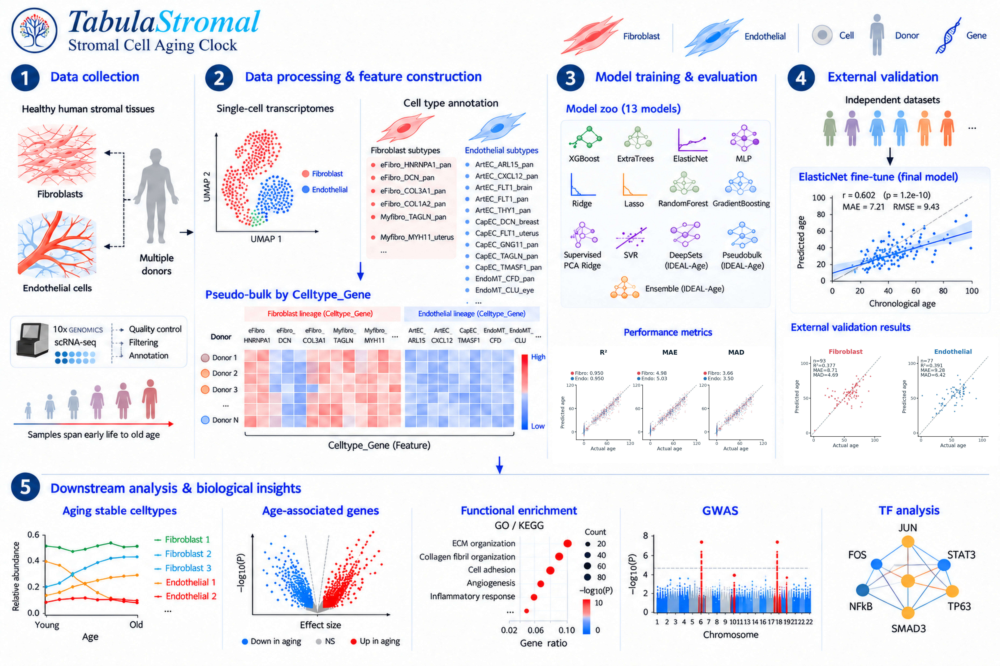
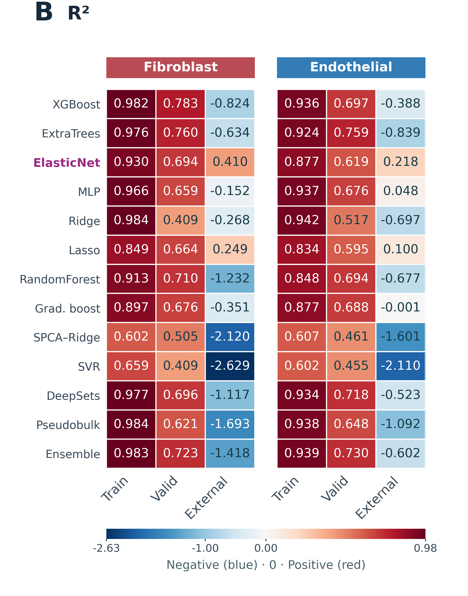
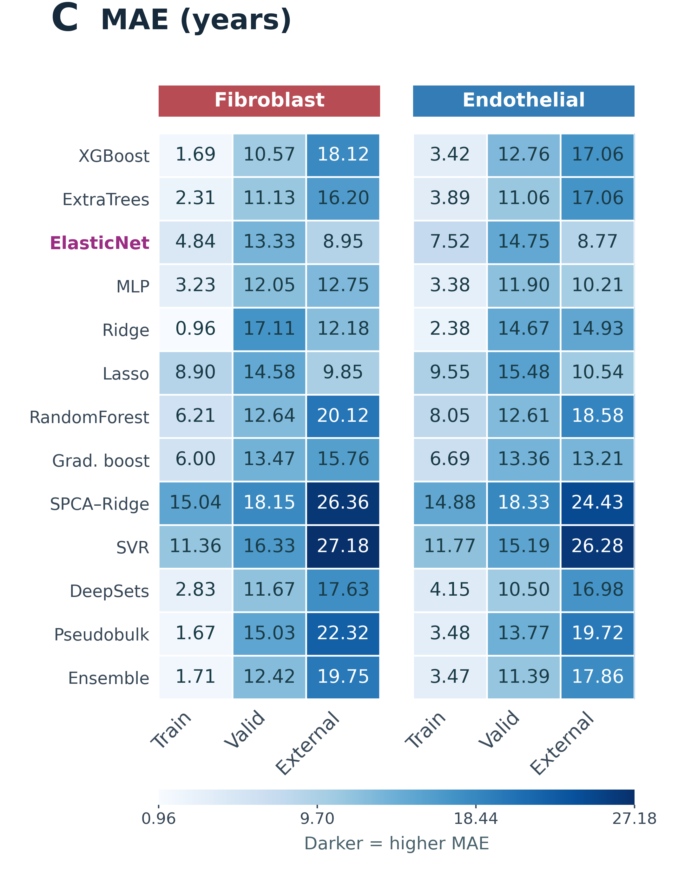
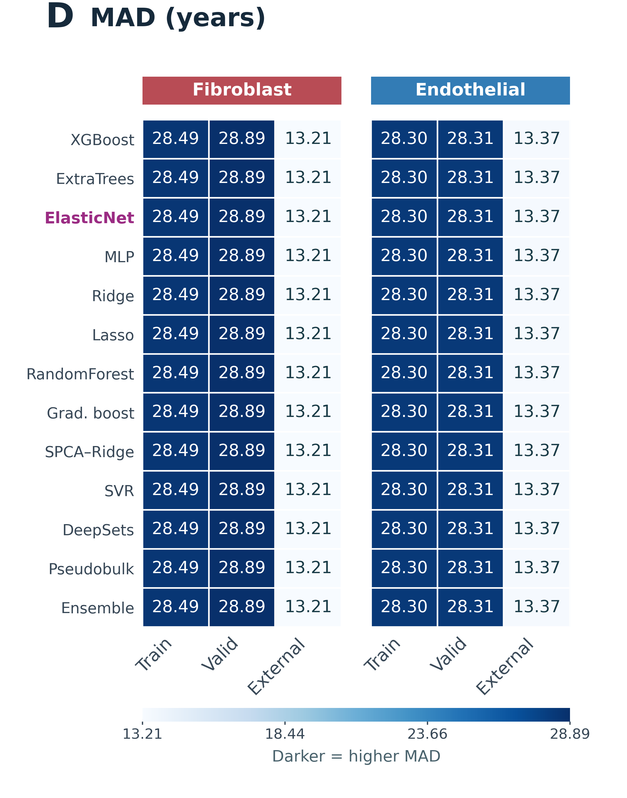
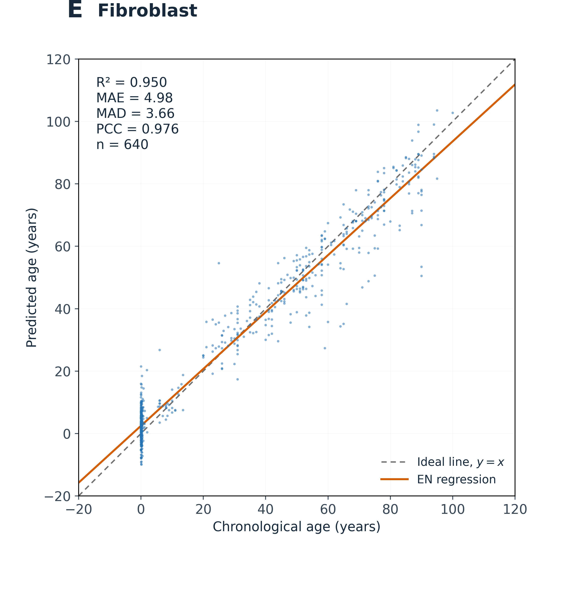
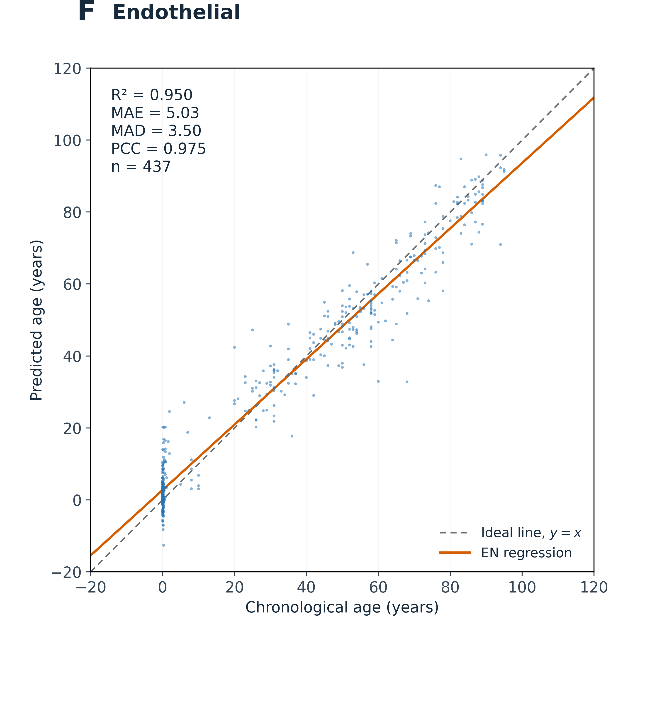

# figures

Current snapshot: **25 November 2026**. Counts refer to sample/proxy units unless stated otherwise. Selected expression features are not explicit cell-type proportions; predictive weights and regulatory annotations are not causal evidence.

[Module overview](../README.md) · [Results and legends](../../docs/results)

The workflow PNG is the updated 6144 × 4096 source image. Its development and outcome-selected external plots have different evaluation scopes from the B–D benchmark panels. See [workflow interpretation](../../docs/workflow.md) and [source refresh record](../../audit/workflow_refresh.json).

Subdirectories: [panels](panels/).

- [Fig2_StromalClock_ModelPerformance.pdf](Fig2_StromalClock_ModelPerformance.pdf)
- [Fig2_StromalClock_ModelPerformance.png](Fig2_StromalClock_ModelPerformance.png)
- [TabulaStromal_Workflow_V6.png](TabulaStromal_Workflow_V6.png)
