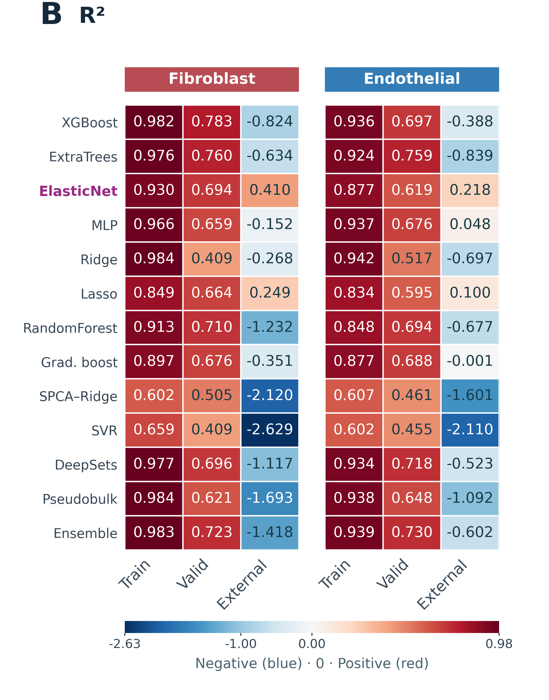
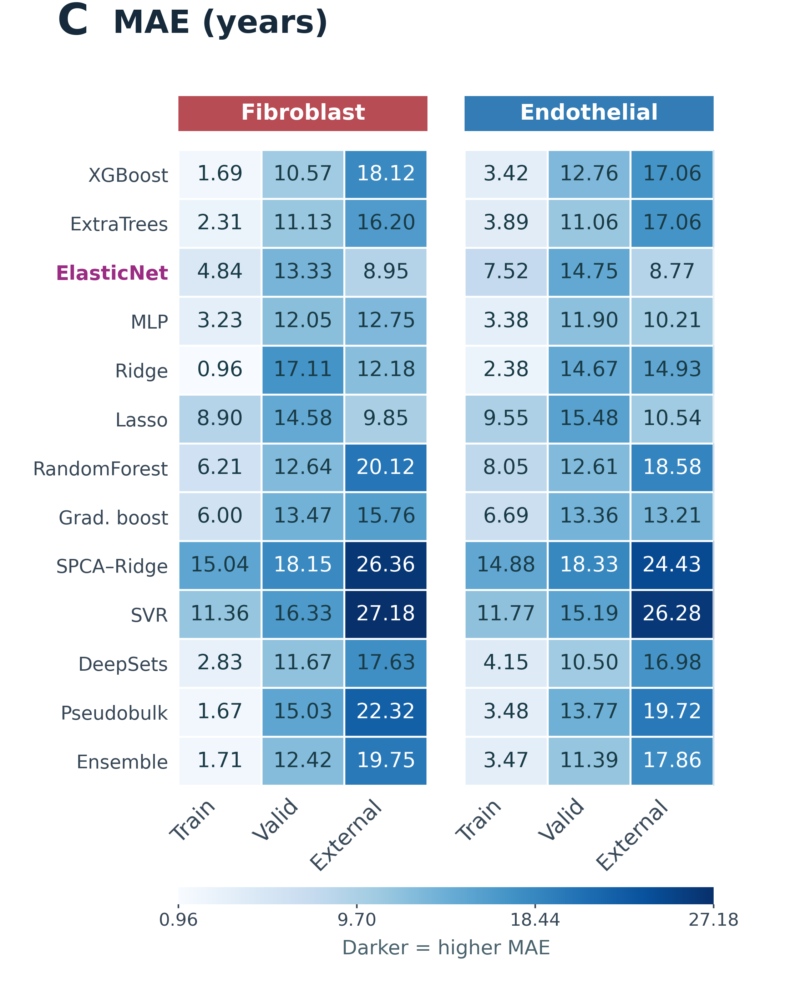
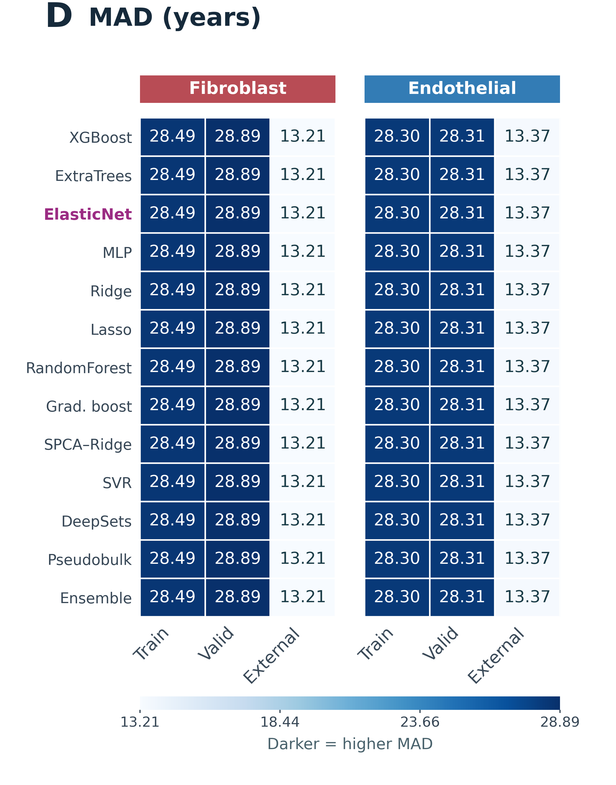
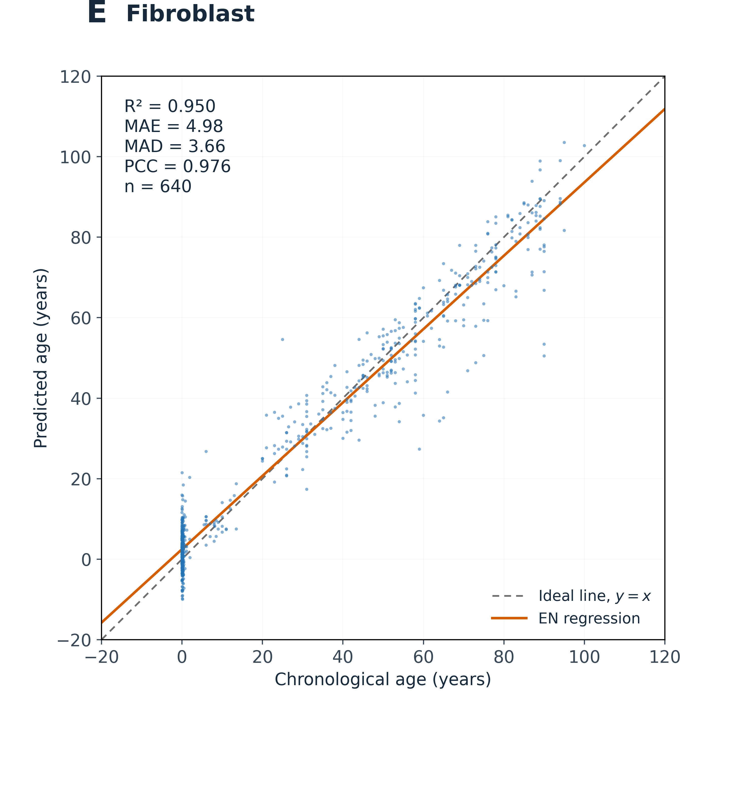
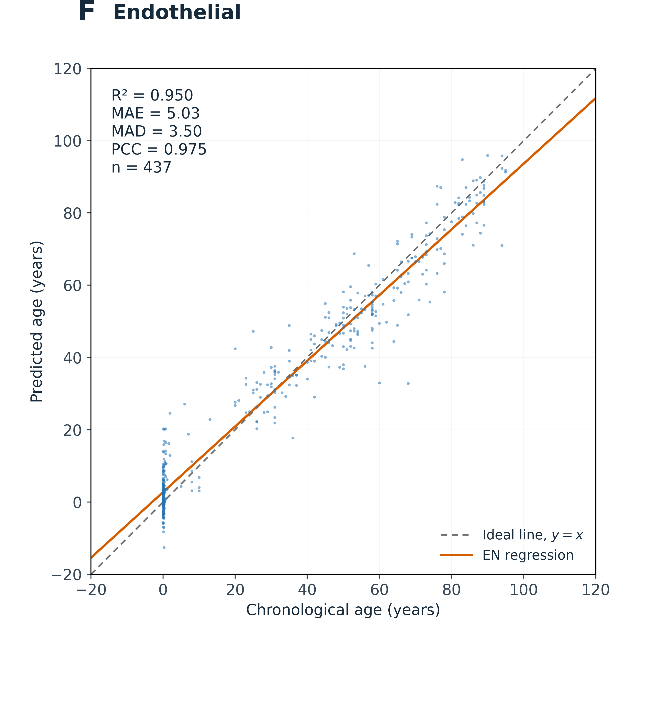

# panels

Current snapshot: **19 November 2026**. Counts refer to sample/proxy units unless stated otherwise. Selected expression features are not explicit cell-type proportions; predictive weights and regulatory annotations are not causal evidence.

[Module overview](../../README.md) · [Results and legends](../../../docs/results)

- [Fig2B_R2_heatmap.pdf](Fig2B_R2_heatmap.pdf)
- [Fig2B_R2_heatmap.png](Fig2B_R2_heatmap.png)
- [Fig2C_MAE_heatmap.pdf](Fig2C_MAE_heatmap.pdf)
- [Fig2C_MAE_heatmap.png](Fig2C_MAE_heatmap.png)
- [Fig2D_MAD_heatmap.pdf](Fig2D_MAD_heatmap.pdf)
- [Fig2D_MAD_heatmap.png](Fig2D_MAD_heatmap.png)
- [Fig2E_Fibro_squareplot.pdf](Fig2E_Fibro_squareplot.pdf)
- [Fig2E_Fibro_squareplot.png](Fig2E_Fibro_squareplot.png)
- [Fig2F_Endo_squareplot.pdf](Fig2F_Endo_squareplot.pdf)
- [Fig2F_Endo_squareplot.png](Fig2F_Endo_squareplot.png)
