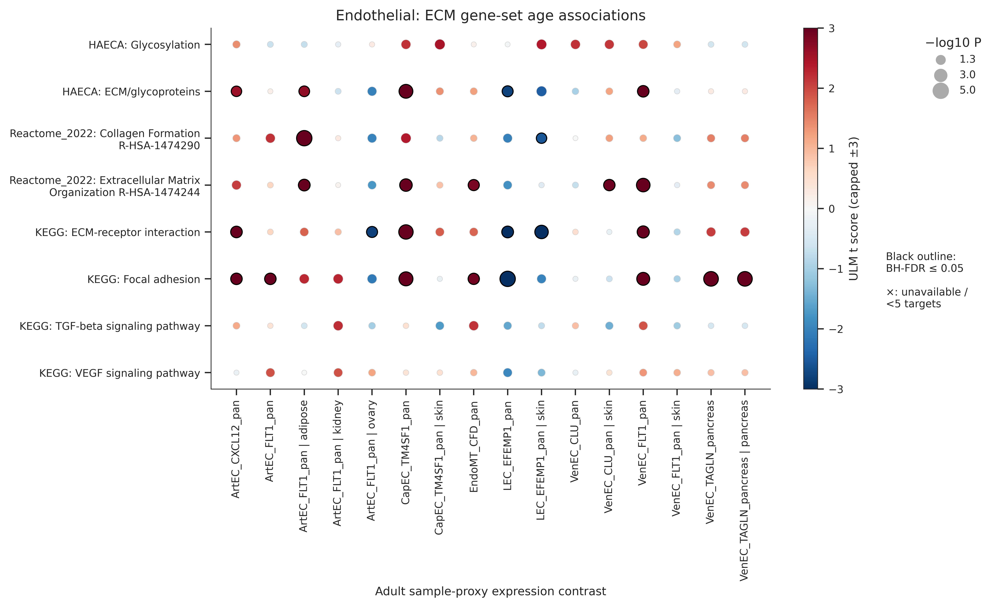

# Adult count-based ECM analysis

Raw X counts are summed by training proxy×state. Noninteger genes are excluded per profile without rounding. Primary younger/older labels use tissue-specific median ages capped at sixty; ULM uses NB Wald z, not clock coefficients.

[stromal_ECM_20261118](stromal_ECM_20261118/)

[Full downstream overview](../README.md)
