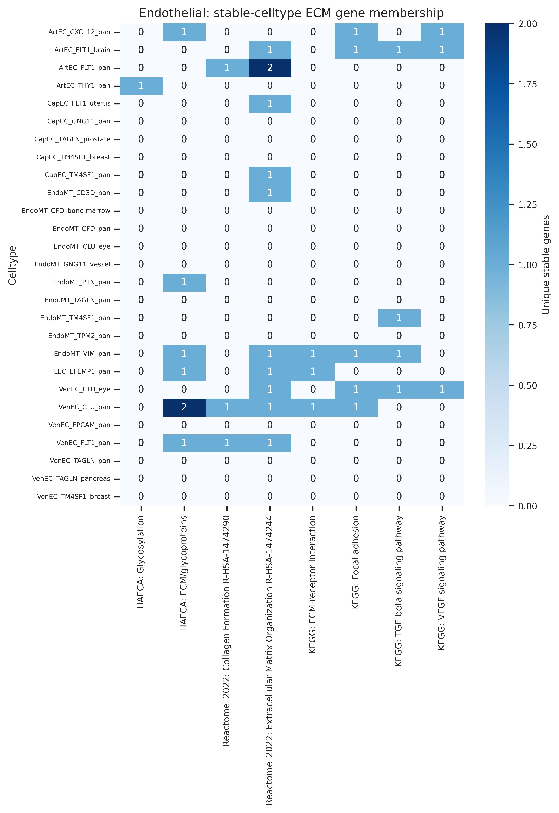
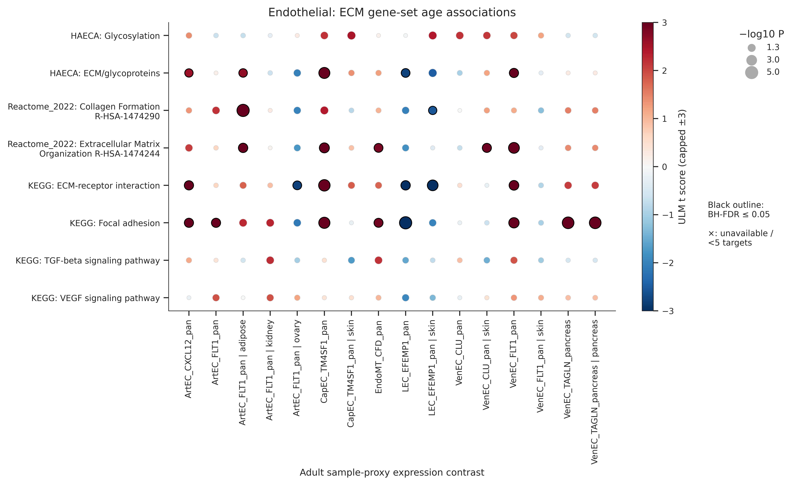
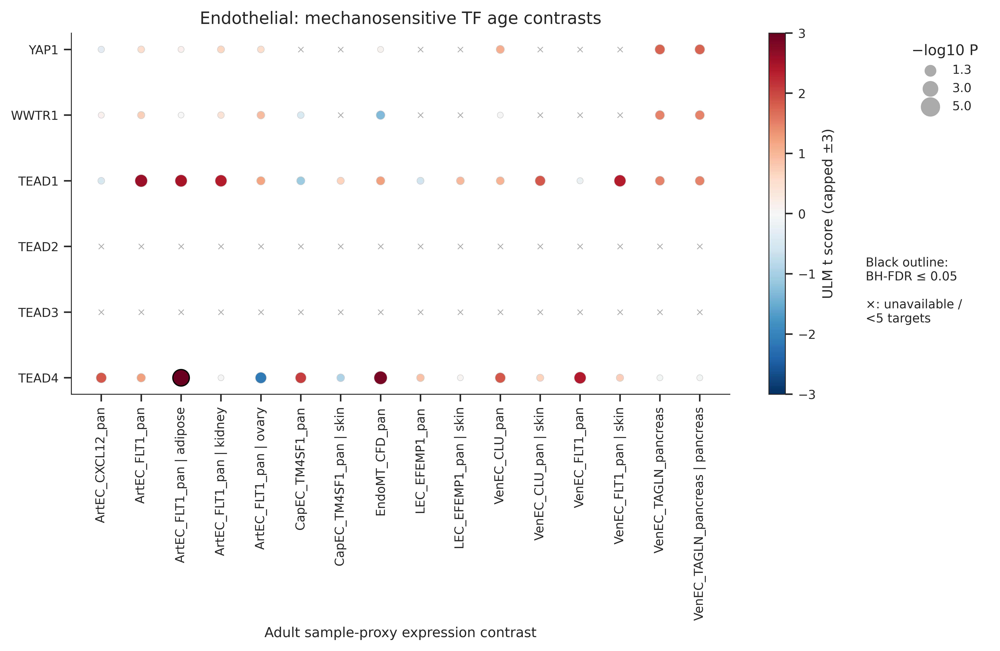
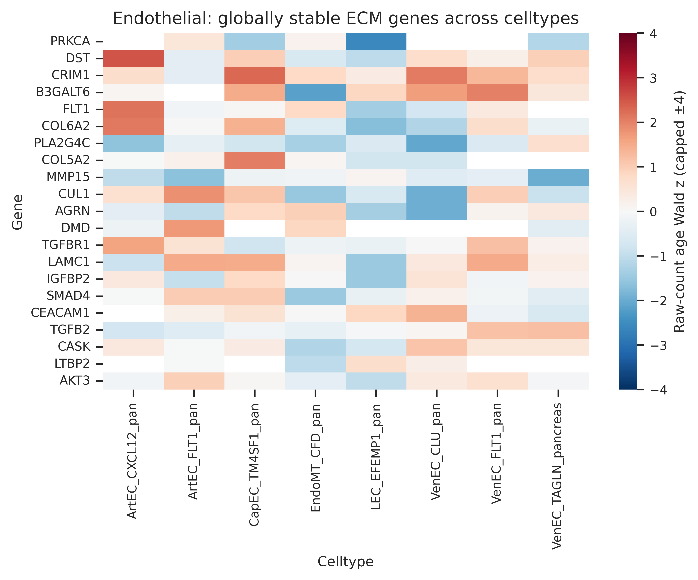

# figures

Current snapshot: **19 November 2026**. Counts refer to sample/proxy units unless stated otherwise. Selected expression features are not explicit cell-type proportions; predictive weights and regulatory annotations are not causal evidence.

[Module overview](../../../../README.md) · [Results and legends](../../../../../docs/results)

- [ECM_signature_age_contrasts.pdf](ECM_signature_age_contrasts.pdf)
- [ECM_signature_age_contrasts.png](ECM_signature_age_contrasts.png)
- [HAECA_Fig3b_mechanosensitive_TF_adaptation.pdf](HAECA_Fig3b_mechanosensitive_TF_adaptation.pdf)
- [HAECA_Fig3b_mechanosensitive_TF_adaptation.png](HAECA_Fig3b_mechanosensitive_TF_adaptation.png)
- [celltype_ECM_membership.pdf](celltype_ECM_membership.pdf)
- [celltype_ECM_membership.png](celltype_ECM_membership.png)
- [stable_ECM_gene_age_heatmap.pdf](stable_ECM_gene_age_heatmap.pdf)
- [stable_ECM_gene_age_heatmap.png](stable_ECM_gene_age_heatmap.png)
