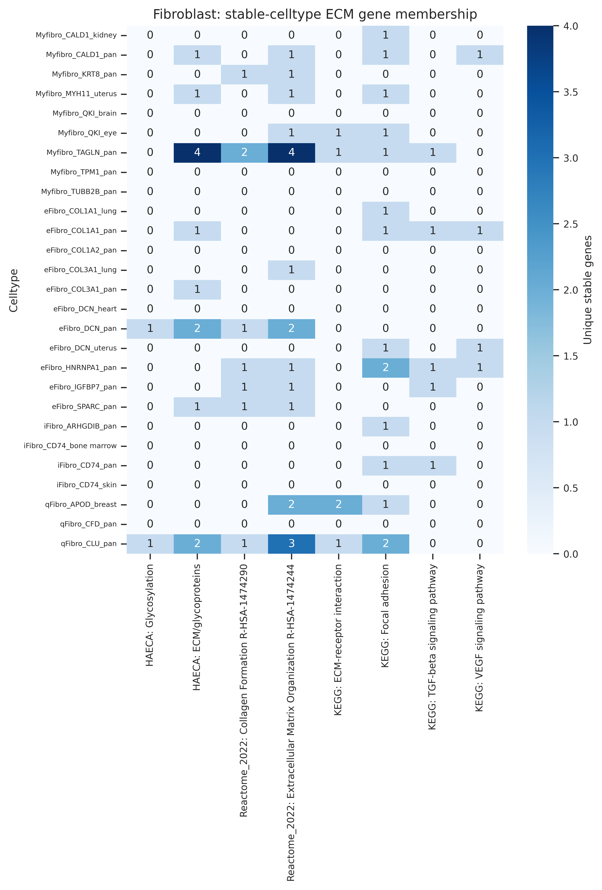
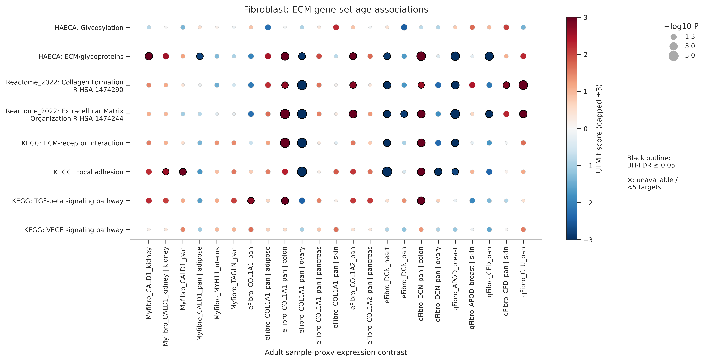
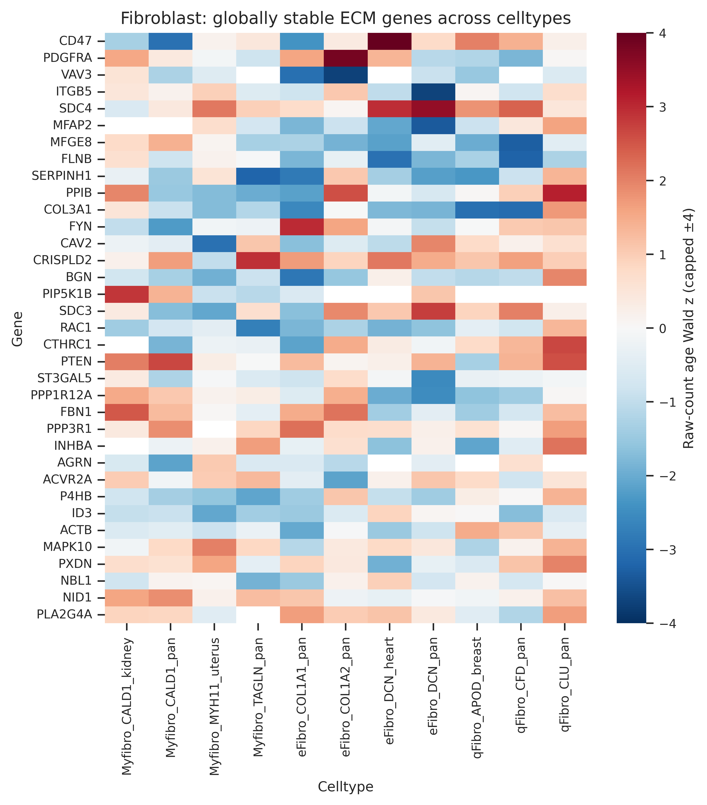

# Fibroblast

Current snapshot: **25 November 2026**. Counts refer to sample/proxy units unless stated otherwise. Selected expression features are not explicit cell-type proportions; predictive weights and regulatory annotations are not causal evidence.

[Module overview](../../../README.md) · [Results and legends](../../../../docs/results)

Subdirectories: [figures](figures/), [tables](tables/).
