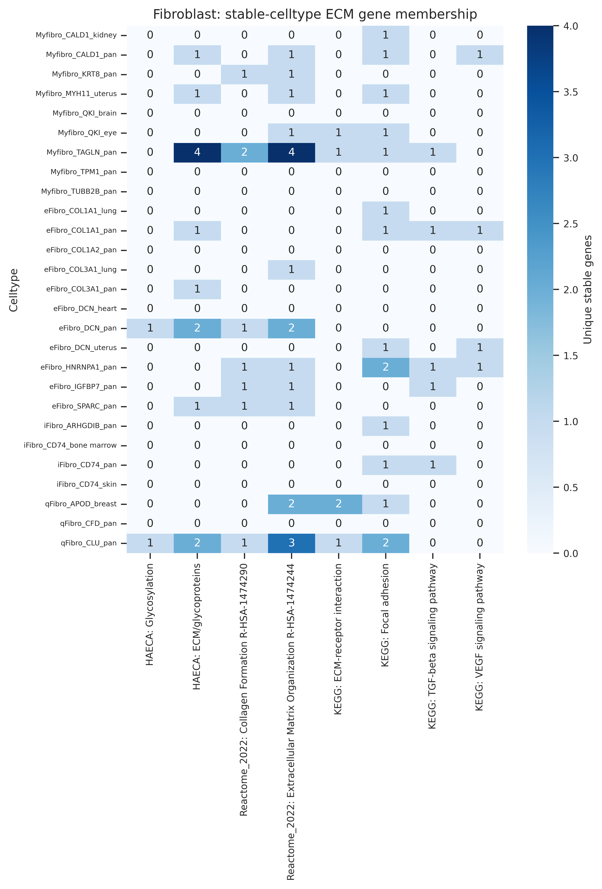
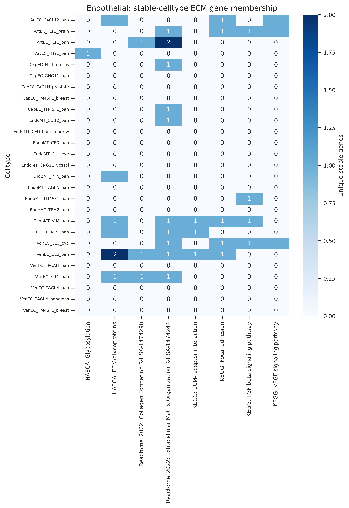
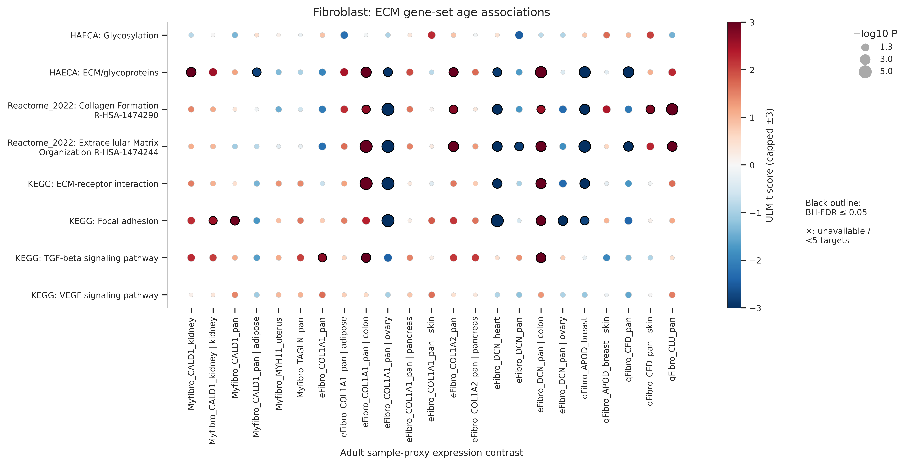
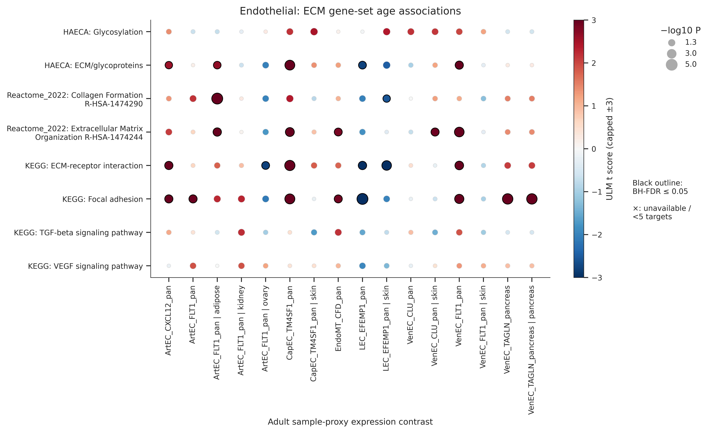
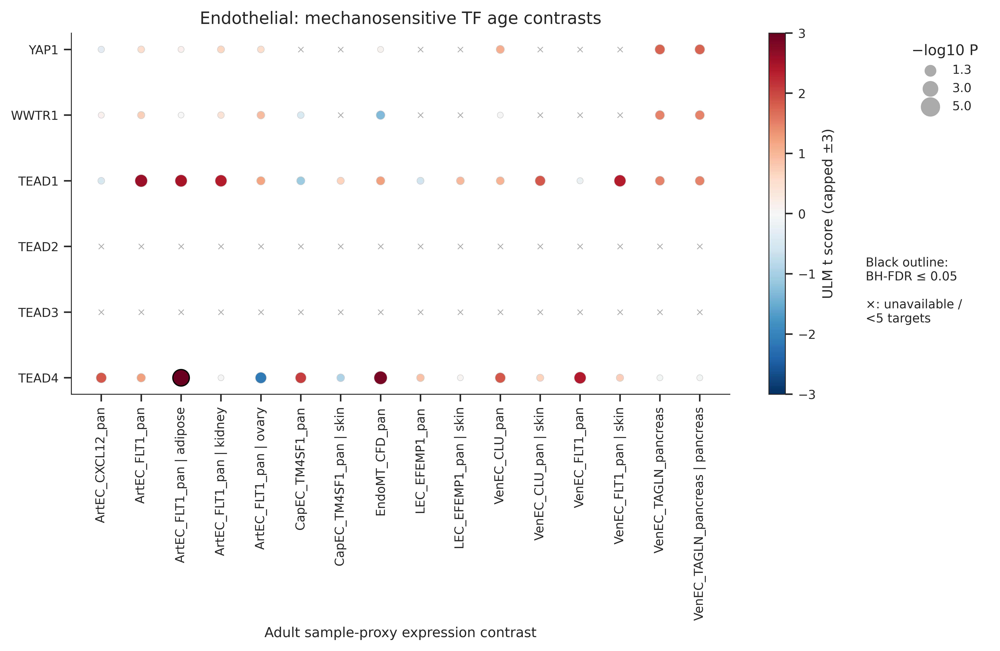
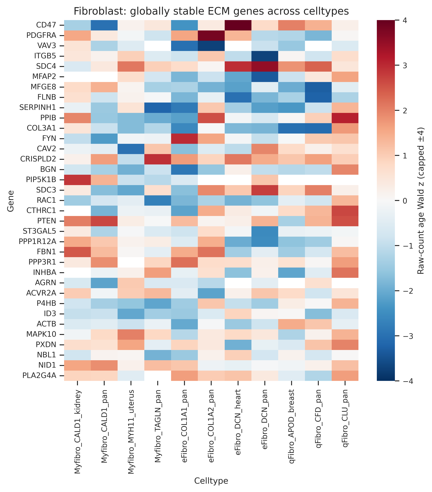
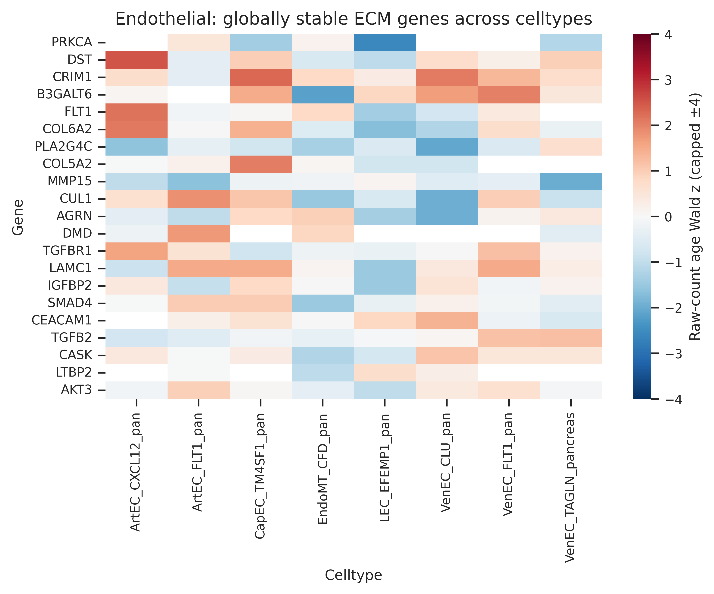

# stromal_ECM_20261118

Current snapshot: **19 November 2026**. Counts refer to sample/proxy units unless stated otherwise. Selected expression features are not explicit cell-type proportions; predictive weights and regulatory annotations are not causal evidence.

[Module overview](../../README.md) · [Results and legends](../../../docs/results)

Subdirectories: [Endothelial](Endothelial/), [Fibroblast](Fibroblast/).

- [all_ECM_ULM_age_contrasts.csv](all_ECM_ULM_age_contrasts.csv)
- [all_TF_ULM_age_contrasts.csv](all_TF_ULM_age_contrasts.csv)
- [all_age_model_coverage.csv](all_age_model_coverage.csv)
- [software_and_parameters.json](software_and_parameters.json)
