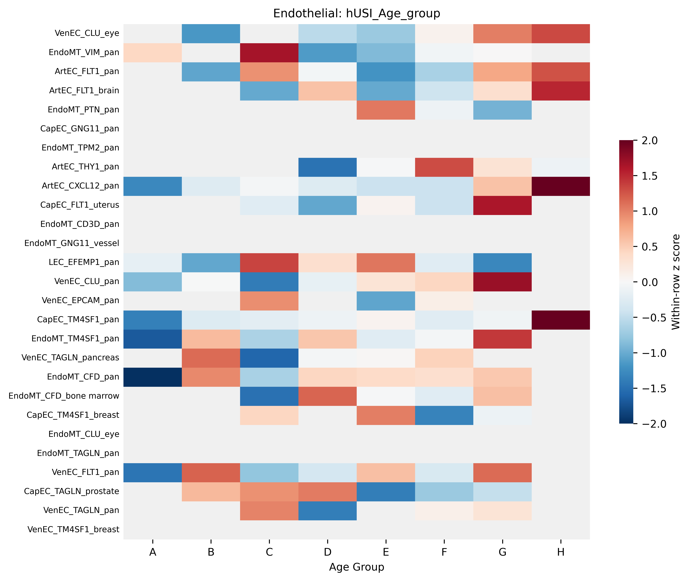
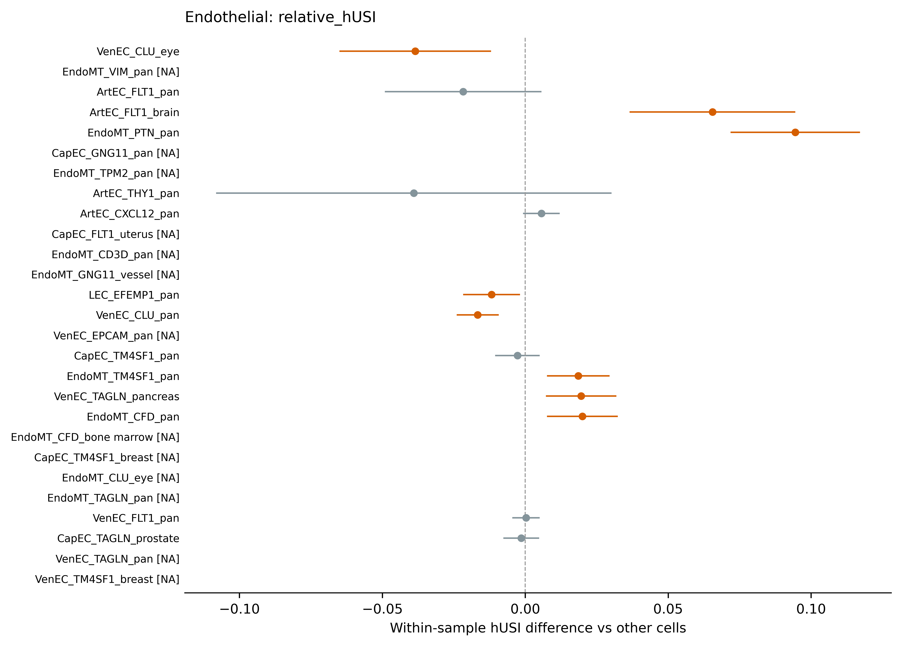
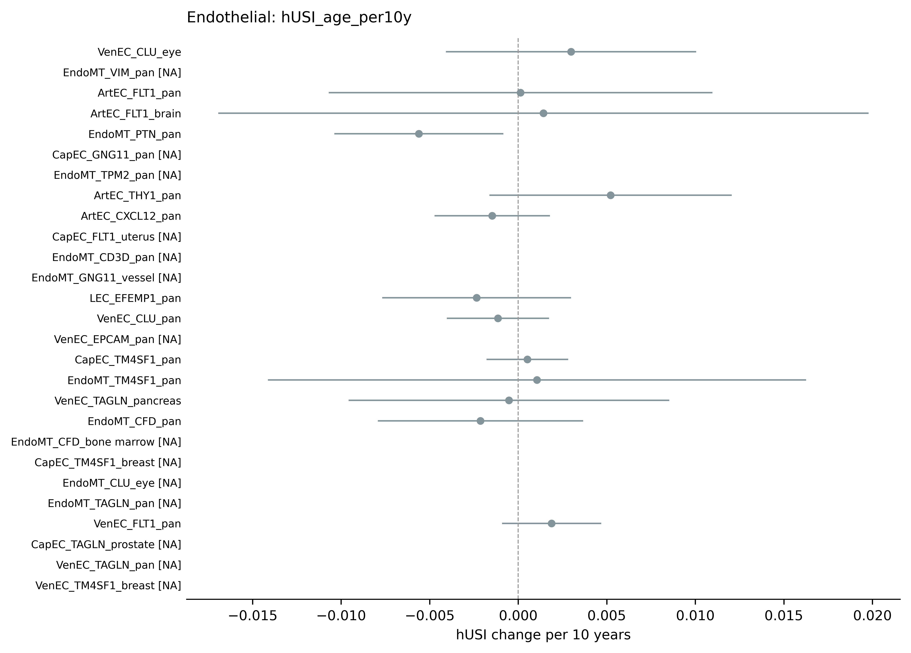
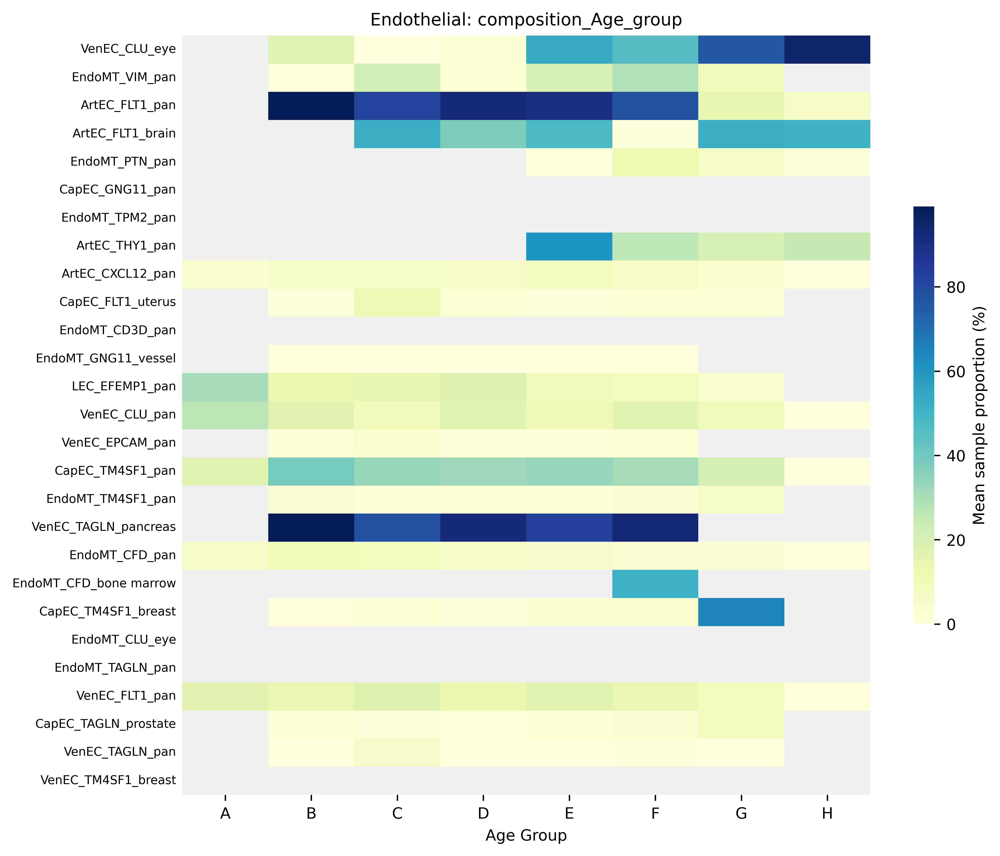
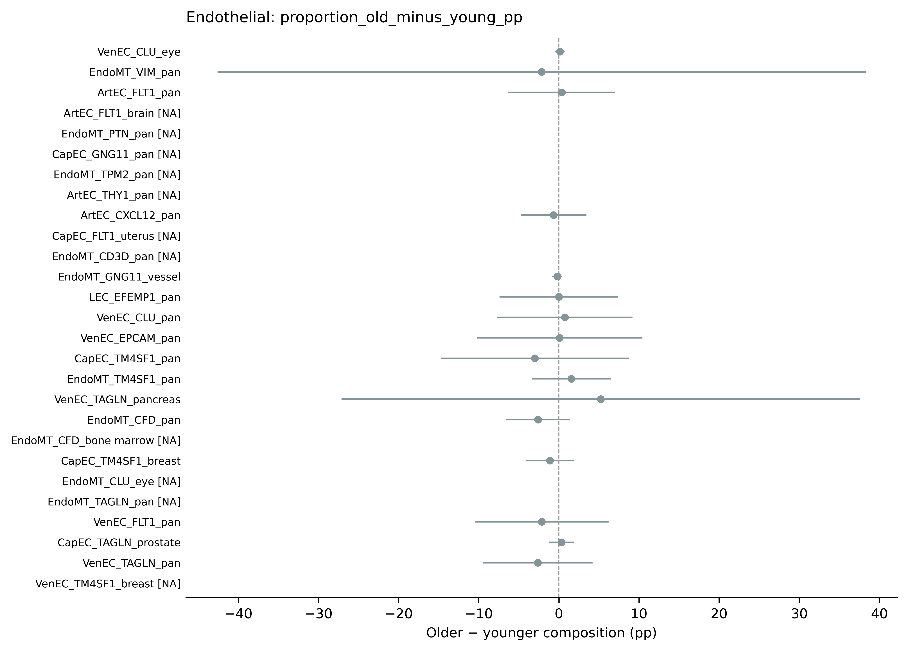
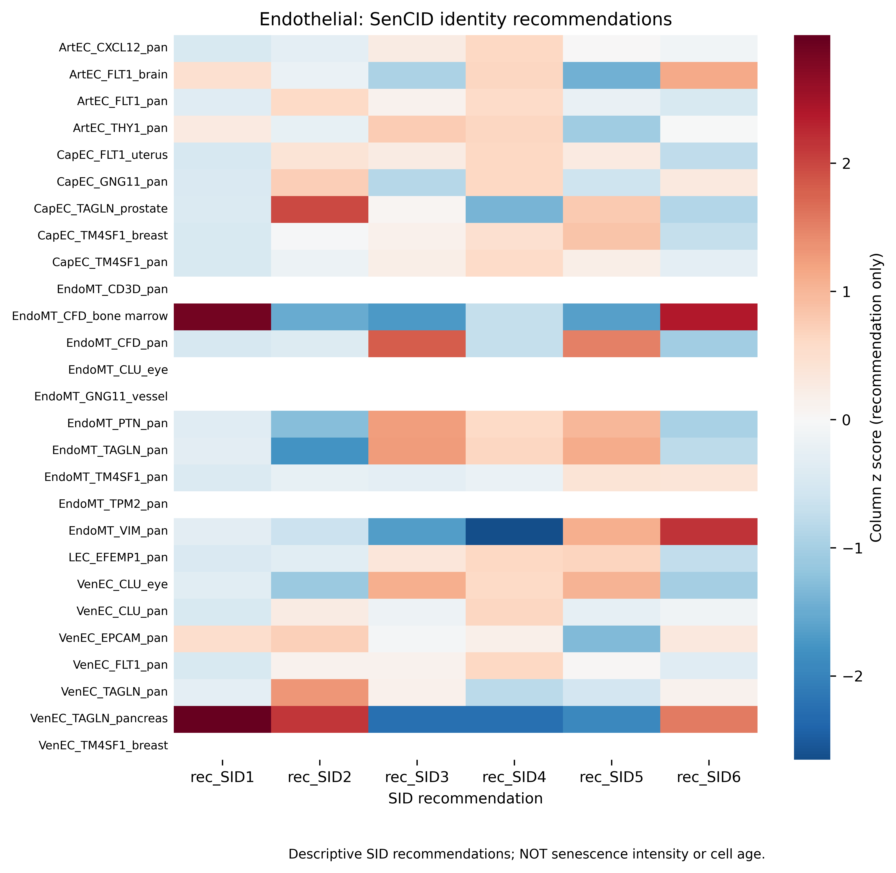
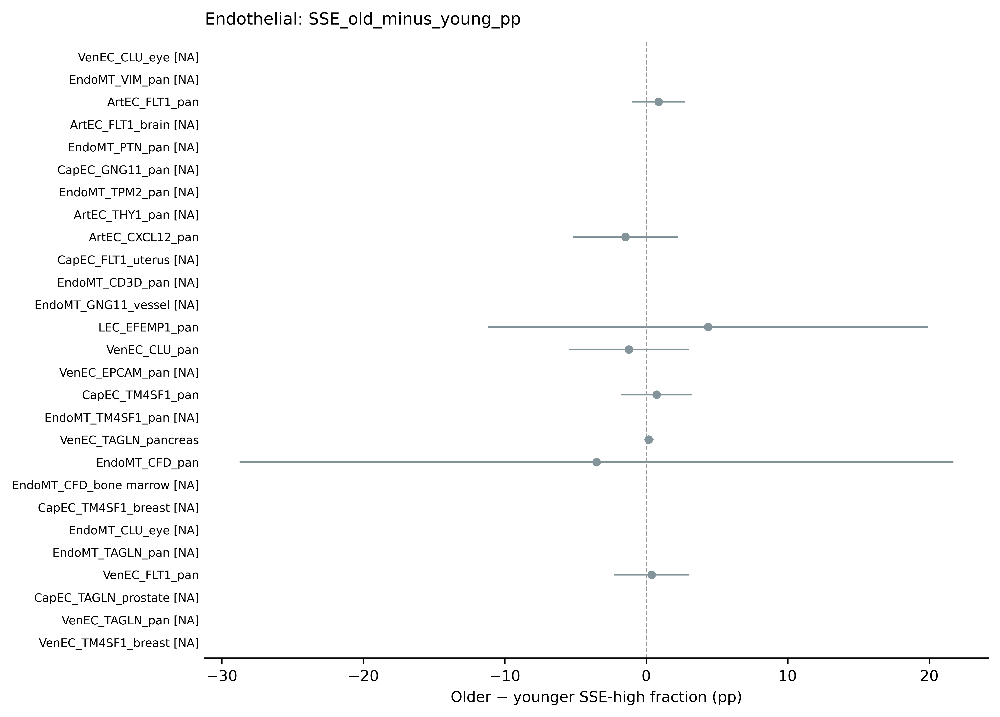

# figures

Current snapshot: **19 November 2026**. Counts refer to sample/proxy units unless stated otherwise. Selected expression features are not explicit cell-type proportions; predictive weights and regulatory annotations are not causal evidence.

[Module overview](../../../../README.md) · [Results and legends](../../../../../docs/results)

- [SSE_old_minus_young_pp.pdf](SSE_old_minus_young_pp.pdf)
- [SSE_old_minus_young_pp.png](SSE_old_minus_young_pp.png)
- [SenCID_recommendation_profiles.pdf](SenCID_recommendation_profiles.pdf)
- [SenCID_recommendation_profiles.png](SenCID_recommendation_profiles.png)
- [composition_Age_group.pdf](composition_Age_group.pdf)
- [composition_Age_group.png](composition_Age_group.png)
- [hUSI_Age_group.pdf](hUSI_Age_group.pdf)
- [hUSI_Age_group.png](hUSI_Age_group.png)
- [hUSI_age_per10y.pdf](hUSI_age_per10y.pdf)
- [hUSI_age_per10y.png](hUSI_age_per10y.png)
- [proportion_old_minus_young_pp.pdf](proportion_old_minus_young_pp.pdf)
- [proportion_old_minus_young_pp.png](proportion_old_minus_young_pp.png)
- [relative_hUSI.pdf](relative_hUSI.pdf)
- [relative_hUSI.png](relative_hUSI.png)
