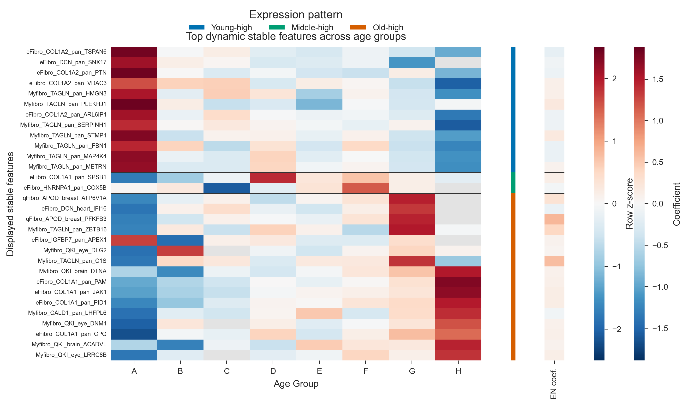

# Selected features and function

750/350 current pairs with 1,500-resample source frequencies. Age-group displays are descriptive and not differential-expression tests. Main functional networks use Reactome 2022; older signed Reactome 2024 plots are a separate family.

[ModelFeature_cellAge](ModelFeature_cellAge/), [functional_network_20261118](functional_network_20261118/), [results](results/)

[Full downstream overview](../README.md)
