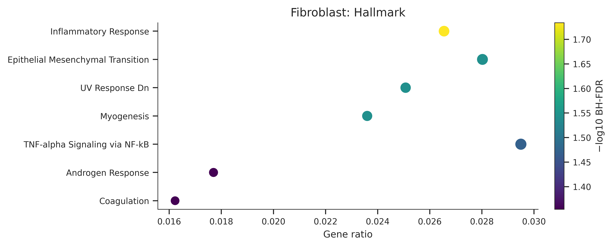
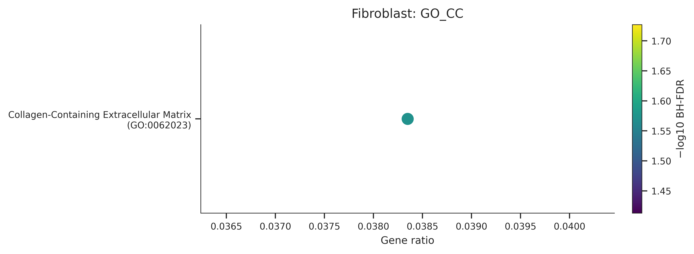
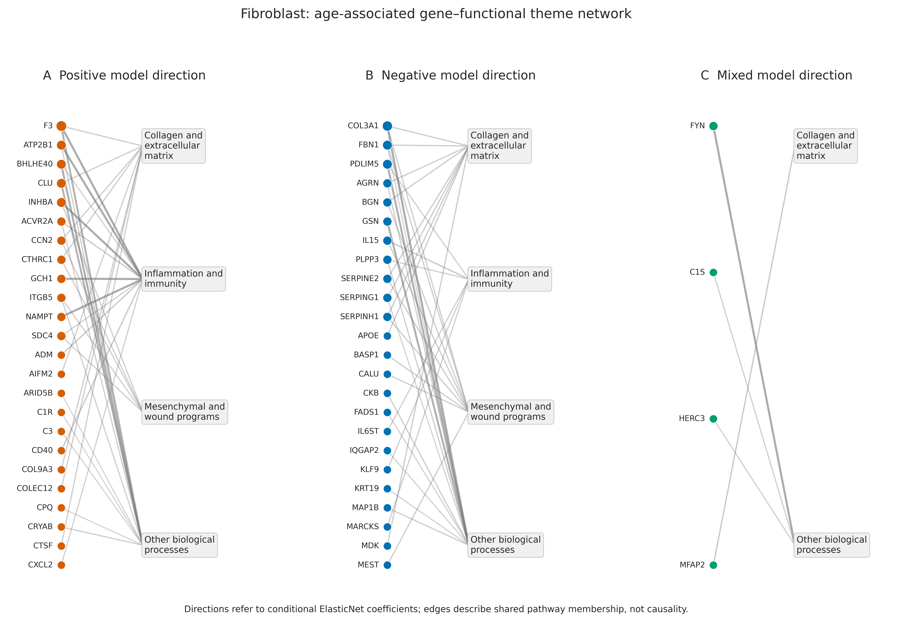

# figures

Current snapshot: **25 November 2026**. Counts refer to sample/proxy units unless stated otherwise. Selected expression features are not explicit cell-type proportions; predictive weights and regulatory annotations are not causal evidence.

[Module overview](../../../../README.md) · [Results and legends](../../../../../docs/results)

- [All_GO_CC_dotplot.pdf](All_GO_CC_dotplot.pdf)
- [All_GO_CC_dotplot.png](All_GO_CC_dotplot.png)
- [All_Hallmark_dotplot.pdf](All_Hallmark_dotplot.pdf)
- [All_Hallmark_dotplot.png](All_Hallmark_dotplot.png)
- [age_associated_gene_functional_theme_network.pdf](age_associated_gene_functional_theme_network.pdf)
- [age_associated_gene_functional_theme_network.png](age_associated_gene_functional_theme_network.png)
