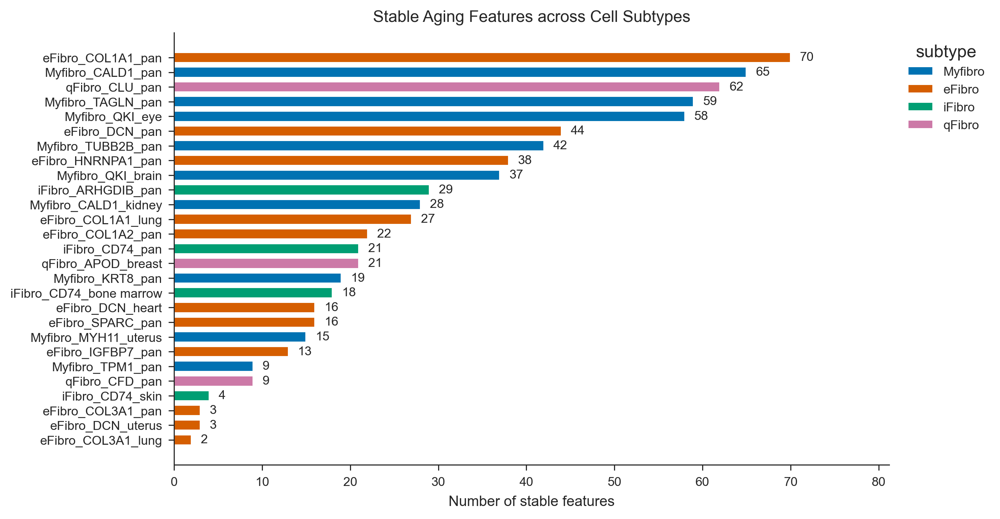
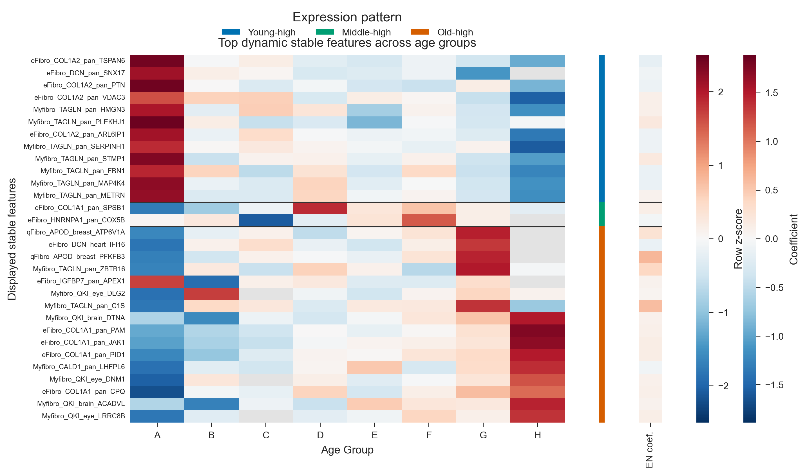
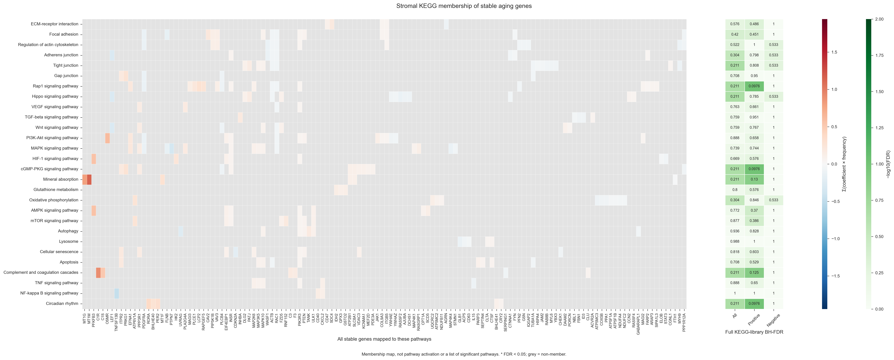
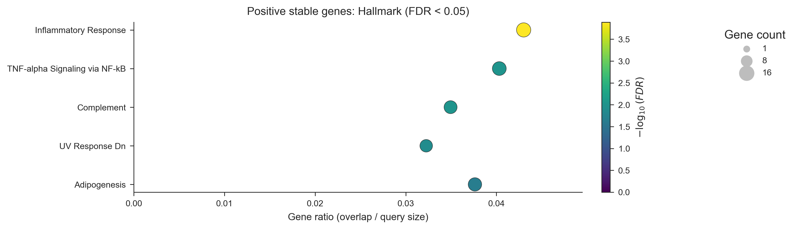
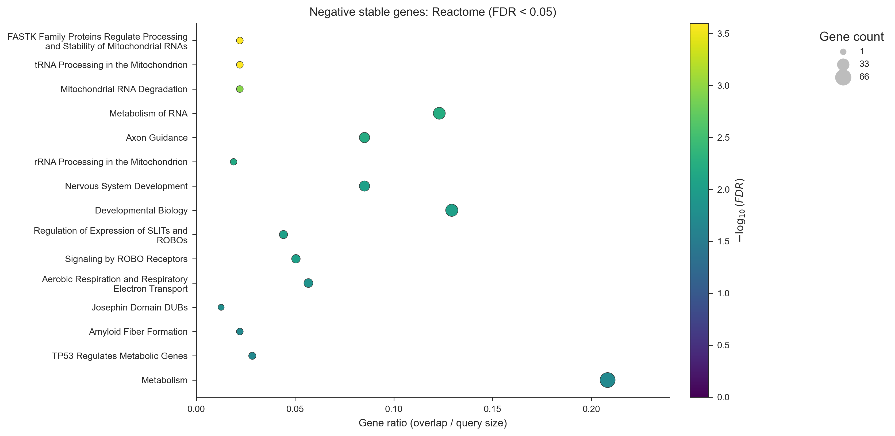

# figures

Current snapshot: **25 November 2026**. Counts refer to sample/proxy units unless stated otherwise. Selected expression features are not explicit cell-type proportions; predictive weights and regulatory annotations are not causal evidence.

[Module overview](../../../../README.md) · [Results and legends](../../../../../docs/results)

- [KEGG_pathway_gene_heatmap.pdf](KEGG_pathway_gene_heatmap.pdf)
- [KEGG_pathway_gene_heatmap.png](KEGG_pathway_gene_heatmap.png)
- [Negative_Reactome_dotplot.pdf](Negative_Reactome_dotplot.pdf)
- [Negative_Reactome_dotplot.png](Negative_Reactome_dotplot.png)
- [Positive_Hallmark_dotplot.pdf](Positive_Hallmark_dotplot.pdf)
- [Positive_Hallmark_dotplot.png](Positive_Hallmark_dotplot.png)
- [stable_feature_age_heatmap.pdf](stable_feature_age_heatmap.pdf)
- [stable_feature_age_heatmap.png](stable_feature_age_heatmap.png)
- [stable_features_subtype_barplot.pdf](stable_features_subtype_barplot.pdf)
- [stable_features_subtype_barplot.png](stable_features_subtype_barplot.png)
- [top_dynamic_stable_features.pdf](top_dynamic_stable_features.pdf)
- [top_dynamic_stable_features.png](top_dynamic_stable_features.png)
