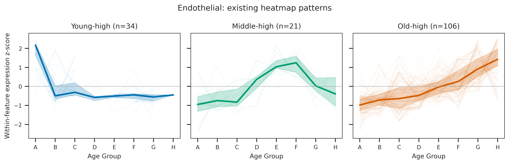
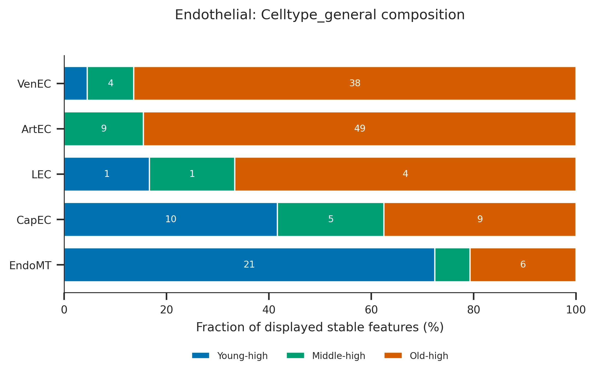
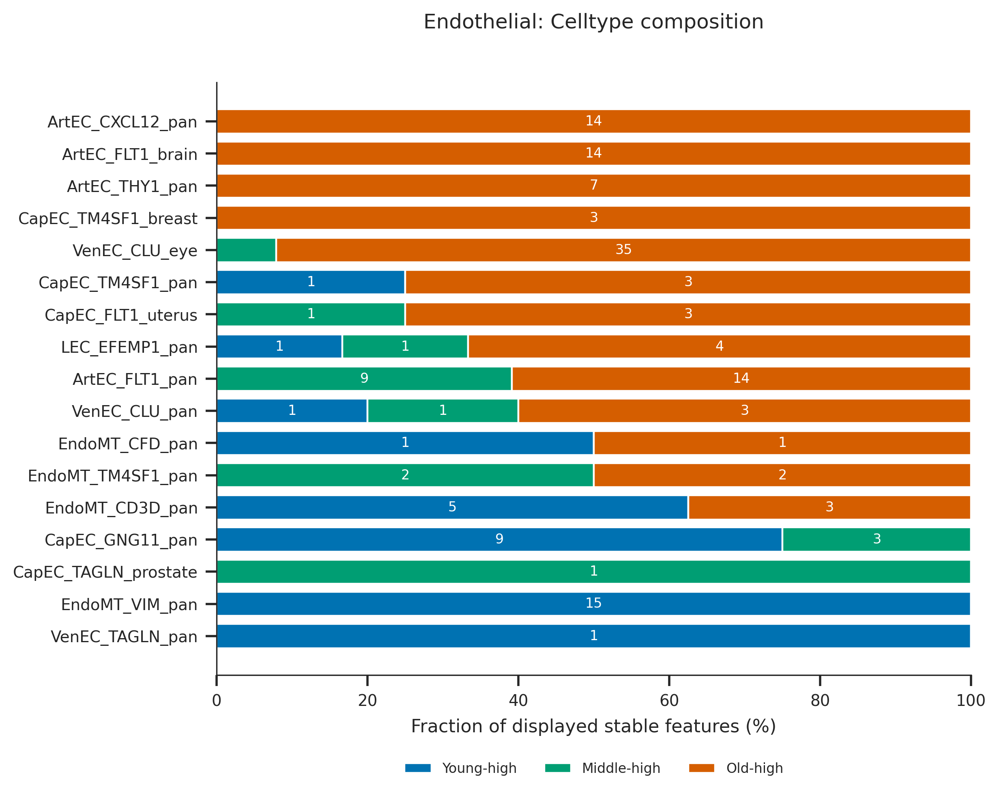
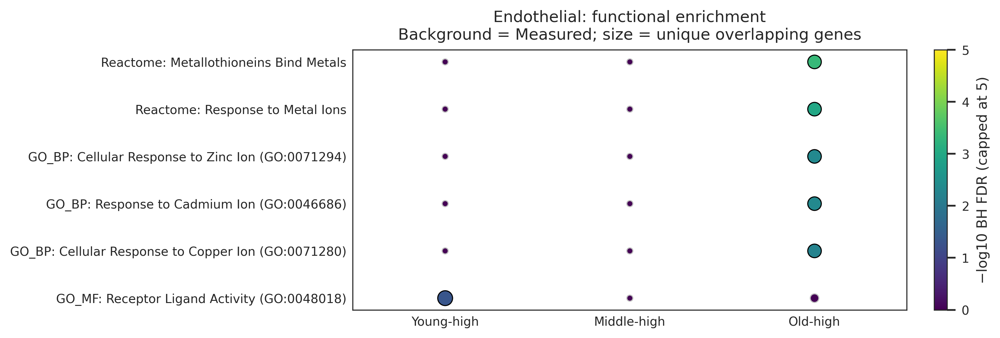
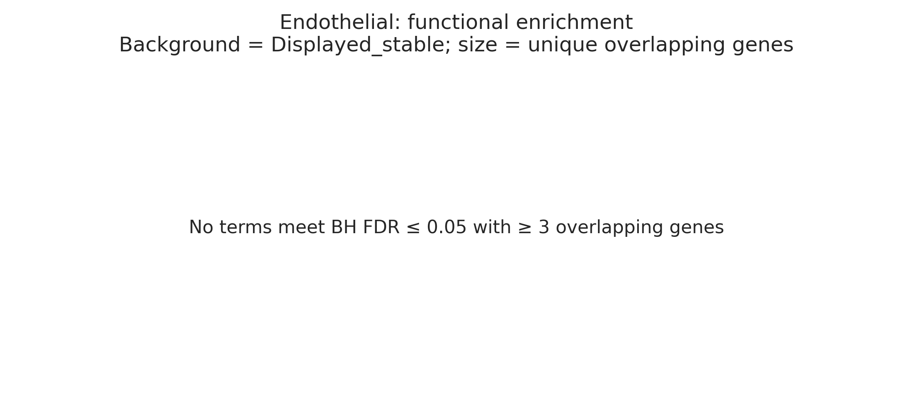
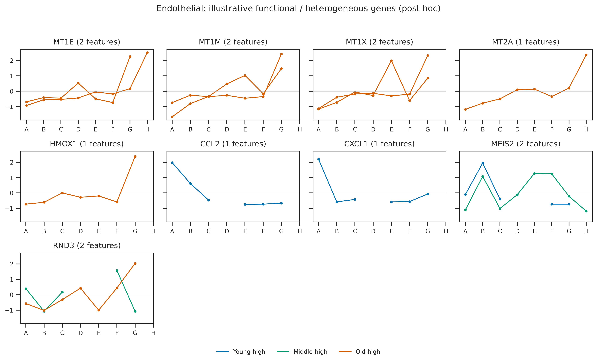
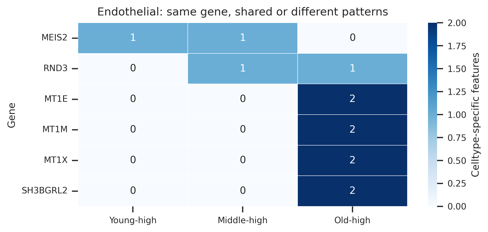
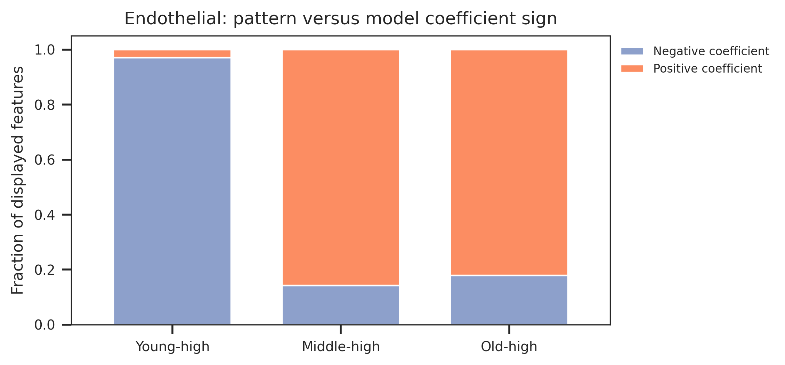

# figures

Current snapshot: **25 November 2026**. Counts refer to sample/proxy units unless stated otherwise. Selected expression features are not explicit cell-type proportions; predictive weights and regulatory annotations are not causal evidence.

[Module overview](../../../../../README.md) · [Results and legends](../../../../../../docs/results)

- [Celltype_general_pattern_composition.pdf](Celltype_general_pattern_composition.pdf)
- [Celltype_general_pattern_composition.png](Celltype_general_pattern_composition.png)
- [Celltype_pattern_composition.pdf](Celltype_pattern_composition.pdf)
- [Celltype_pattern_composition.png](Celltype_pattern_composition.png)
- [coefficient_sign_by_pattern.pdf](coefficient_sign_by_pattern.pdf)
- [coefficient_sign_by_pattern.png](coefficient_sign_by_pattern.png)
- [functional_candidate_profiles.pdf](functional_candidate_profiles.pdf)
- [functional_candidate_profiles.png](functional_candidate_profiles.png)
- [functional_enrichment_Displayed_stable.pdf](functional_enrichment_Displayed_stable.pdf)
- [functional_enrichment_Displayed_stable.png](functional_enrichment_Displayed_stable.png)
- [functional_enrichment_Measured.pdf](functional_enrichment_Measured.pdf)
- [functional_enrichment_Measured.png](functional_enrichment_Measured.png)
- [pattern_assignment_sensitivity.pdf](pattern_assignment_sensitivity.pdf)
- [pattern_assignment_sensitivity.png](pattern_assignment_sensitivity.png)
- [pattern_profiles.pdf](pattern_profiles.pdf)
- [pattern_profiles.png](pattern_profiles.png)
- [repeated_gene_pattern_membership.pdf](repeated_gene_pattern_membership.pdf)
- [repeated_gene_pattern_membership.png](repeated_gene_pattern_membership.png)
