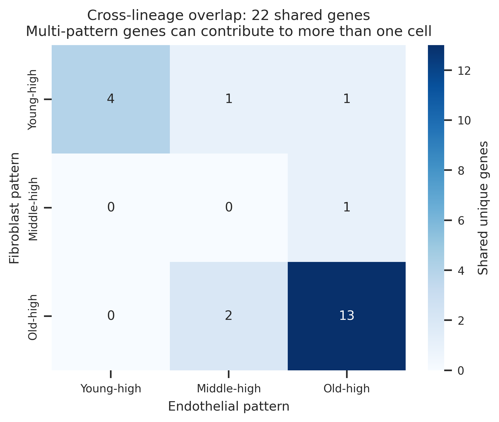
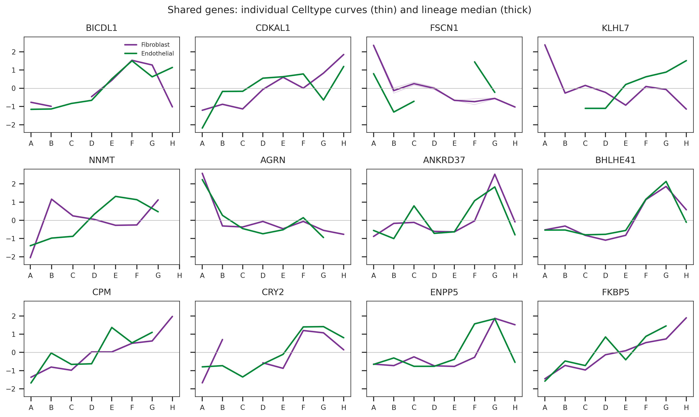

# figures

Current snapshot: **25 November 2026**. Counts refer to sample/proxy units unless stated otherwise. Selected expression features are not explicit cell-type proportions; predictive weights and regulatory annotations are not causal evidence.

[Module overview](../../../../README.md) · [Results and legends](../../../../../docs/results)

- [cross_lineage_shared_gene_patterns.pdf](cross_lineage_shared_gene_patterns.pdf)
- [cross_lineage_shared_gene_patterns.png](cross_lineage_shared_gene_patterns.png)
- [shared_gene_profile_examples.pdf](shared_gene_profile_examples.pdf)
- [shared_gene_profile_examples.png](shared_gene_profile_examples.png)
