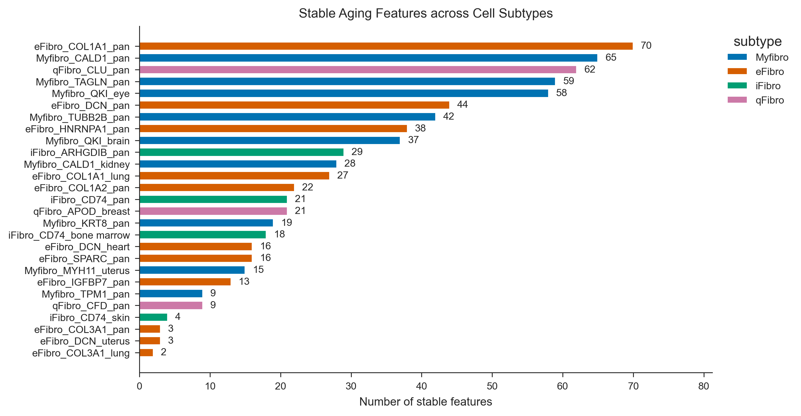
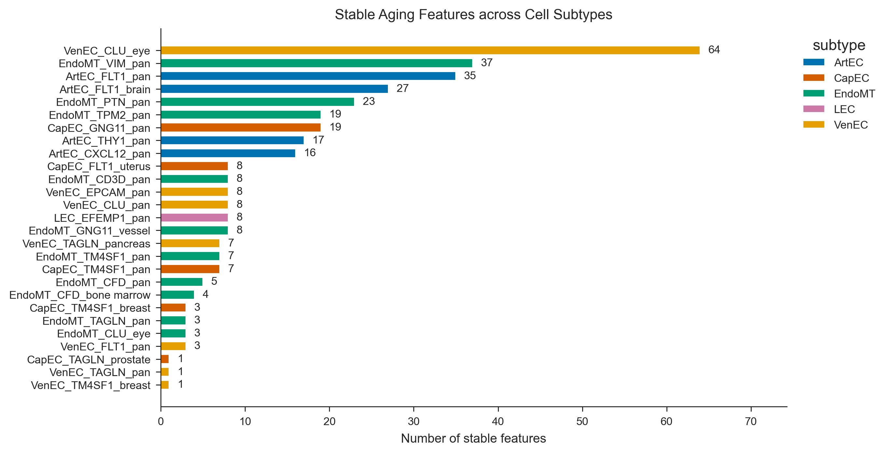

# F3 — Selected features and downstream molecular associations

Current snapshot: **25 November 2026**. Counts refer to sample/proxy units unless stated otherwise. Selected expression features are not explicit cell-type proportions; predictive weights and regulatory annotations are not causal evidence.

[Download the 56-slide downstream presentation](TabulaStromal_F3_Downstream_Results_20261119.pptx) · [Slide index](TabulaStromal_F3_PPT_slide_index.csv) · [Original image provenance](TabulaStromal_F3_PPT_sources.json) · [Results Part 3](../docs/results/Results_Part3_StableFeatures_Mechanisms.md) · [Figure legends](../docs/results/Figure_Legends.md)

The presentation has **56 slides, 74 image placements and 72 unique original images**. Its source images and available PDF partners are reproduced below the corresponding analysis directories. Public PPTX XML paths are generalized; embedded scientific image bytes are unchanged. The PPT is a navigation aid; statistical claims use the underlying tables.

| Analysis | Results and scope |
|---|---|
| [Features and function](F3_features/) | 750/350 selected pairs, 678/337 genes, 27 states each; 45 shared genes; coverage-filtered age displays and complete-library enrichment |
| [LISA2 and RNA networks](TF_analysis/) | Public-chromatin gene-set associations and prior-constrained RNA edges are separate evidence layers; adult TF-age sensitivity has no FDR-significant finding |
| [Adult raw-count ECM](2026_Nat%20Aging_HAECA/) | 39 eligible NB profiles; 67/312 ECM comparisons significant across both lineages; 1/142 displayed mechanosensitive comparisons after full-factor correction |
| [Current ModelFeature CellAge](F3_features/ModelFeature_cellAge/) | Relative hUSI state differences, adjusted age associations, composition and sensitivity analyses using current selected states |

These bars count selected model features, not cells or independently tested subtype aging importance. Bootstrap frequency sources use 1,500 resamples, and the representation was selected using ALL100 outcomes. The older 438/23-pair branch is not the current F3 representation.

Relative hUSI compares a state with other cell-weighted lineage cells in the same sample×tissue unit. It is not age acceleration. No primary adjusted age-dependent hUSI/SSE/composition comparison survives its metric-specific BH family. Shared genes with hUSI limit independence.

The two user-excluded audit trees and all their descendants are absent from this public tree. [Evidence](evidence/evidence_registry.csv), [selected assets](audit/released_assets.csv) and [figure inventory](audit/figure_inventory.csv) identify the actual scope. No expression matrices, fitted models or individual-level score/prediction rows are released.

## New pattern and exploratory analyses

[Expression-window reliability and complete-background enrichment](F3_features/results/SF_pattern_analysis/) includes 520/161 displayed features, 22 shared displayed genes, and no significant pattern-specific term against displayed-selected backgrounds. [Six exploratory extensions](exploration/) cover clock/hUSI alignment, nonlinear age, public perturbation, formal tissue interaction, paired-lineage and metal-response associations. These are postselection analyses, with main and sensitivity families separated; no result establishes causal aging or independent validation of the compact clock.
