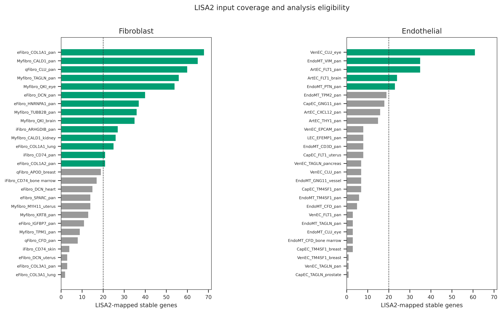

# Regulatory candidates

LISA2 gene-set association, prior-constrained RNA edges and stricter adult TF-age sensitivity are distinct. No strict adult factor-age association survives lineage-wide FDR; candidates do not establish direct binding or causal regulation.

[interpretation](interpretation/), [results](results/), [stable_celltype_LISA2_20261118](stable_celltype_LISA2_20261118/)

[Full downstream overview](../README.md)
