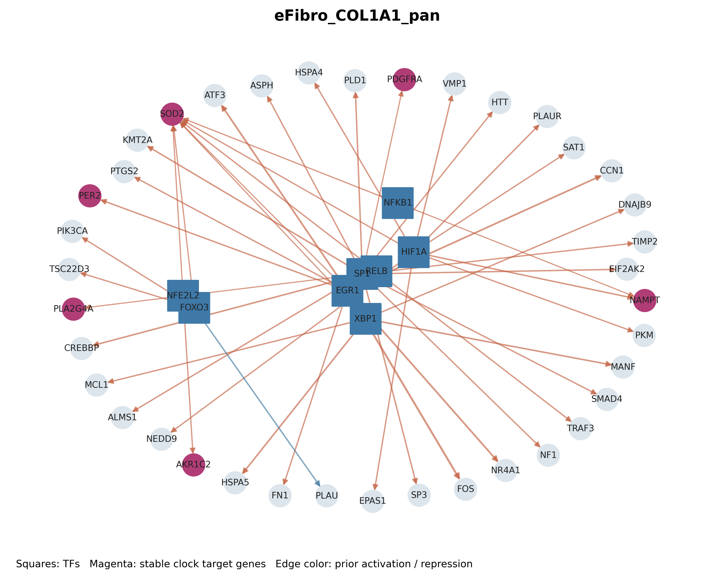

# eFibro_COL1A1_pan

Current snapshot: **19 November 2026**. Counts refer to sample/proxy units unless stated otherwise. Selected expression features are not explicit cell-type proportions; predictive weights and regulatory annotations are not causal evidence.

[Module overview](../../../../../README.md) · [Results and legends](../../../../../../docs/results)

- [TF_target_network.pdf](TF_target_network.pdf)
- [TF_target_network.png](TF_target_network.png)
