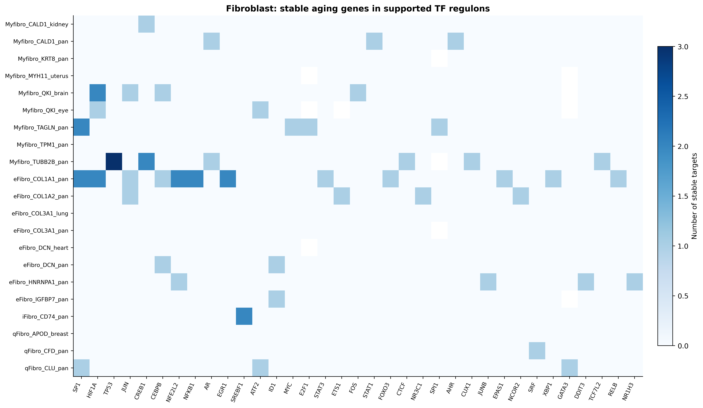
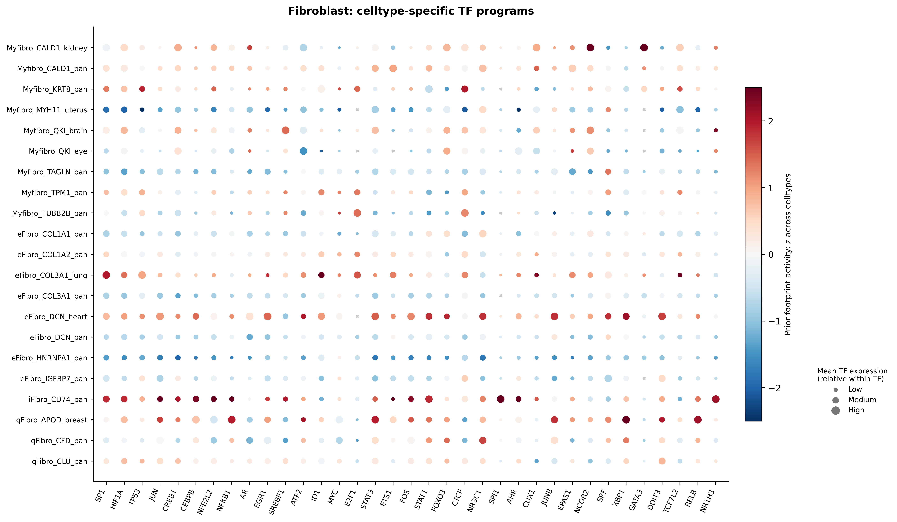

# figures

Current snapshot: **25 November 2026**. Counts refer to sample/proxy units unless stated otherwise. Selected expression features are not explicit cell-type proportions; predictive weights and regulatory annotations are not causal evidence.

[Module overview](../../../../README.md) · [Results and legends](../../../../../docs/results)

- [Fibroblast_TF_grammar_dotplot.pdf](Fibroblast_TF_grammar_dotplot.pdf)
- [Fibroblast_TF_grammar_dotplot.png](Fibroblast_TF_grammar_dotplot.png)
- [Fibroblast_stable_target_heatmap.pdf](Fibroblast_stable_target_heatmap.pdf)
- [Fibroblast_stable_target_heatmap.png](Fibroblast_stable_target_heatmap.png)
