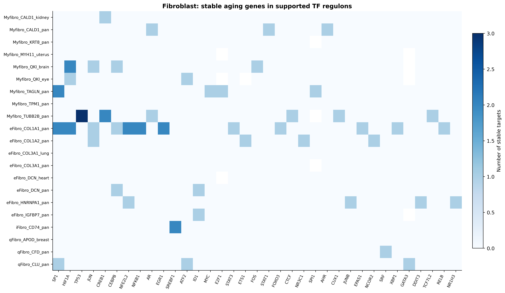
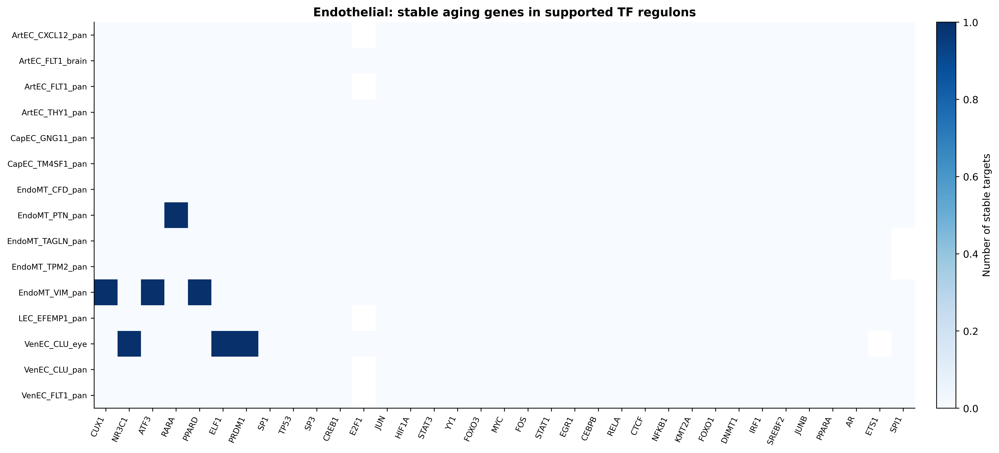
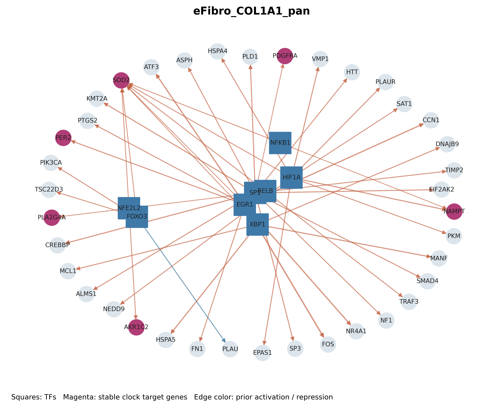
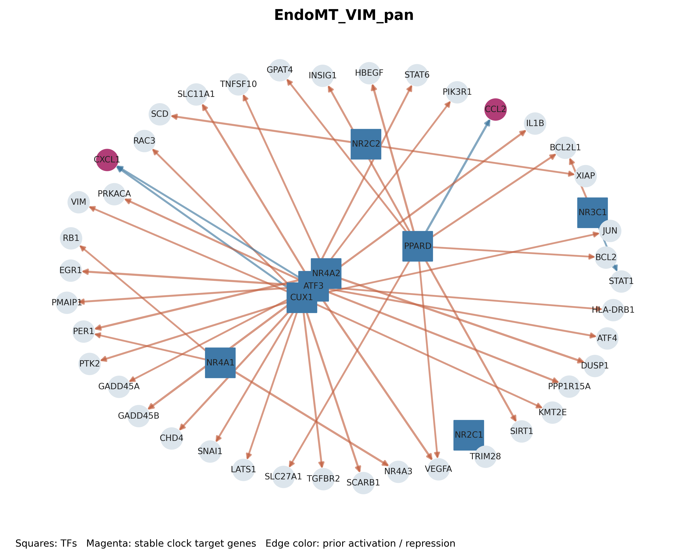
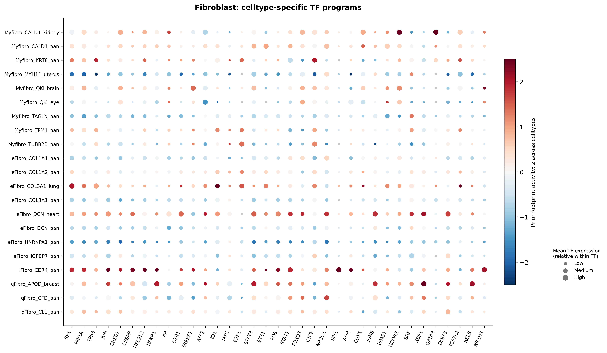
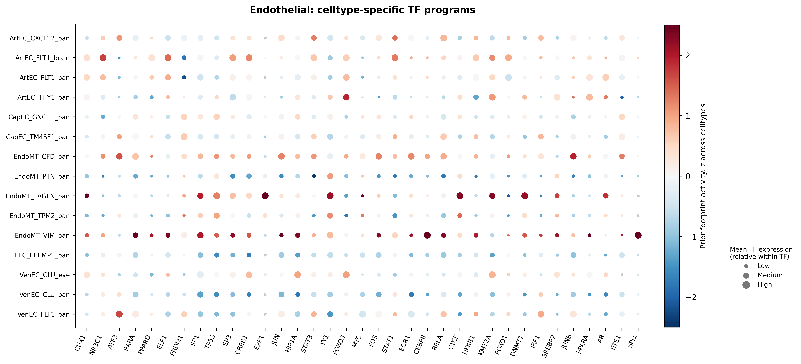

# results

Current snapshot: **19 November 2026**. Counts refer to sample/proxy units unless stated otherwise. Selected expression features are not explicit cell-type proportions; predictive weights and regulatory annotations are not causal evidence.

[Module overview](../../README.md) · [Results and legends](../../../docs/results)

Subdirectories: [Endothelial](Endothelial/), [Fibroblast](Fibroblast/).

- [analysis_summary.csv](analysis_summary.csv)
- [run_config.json](run_config.json)
