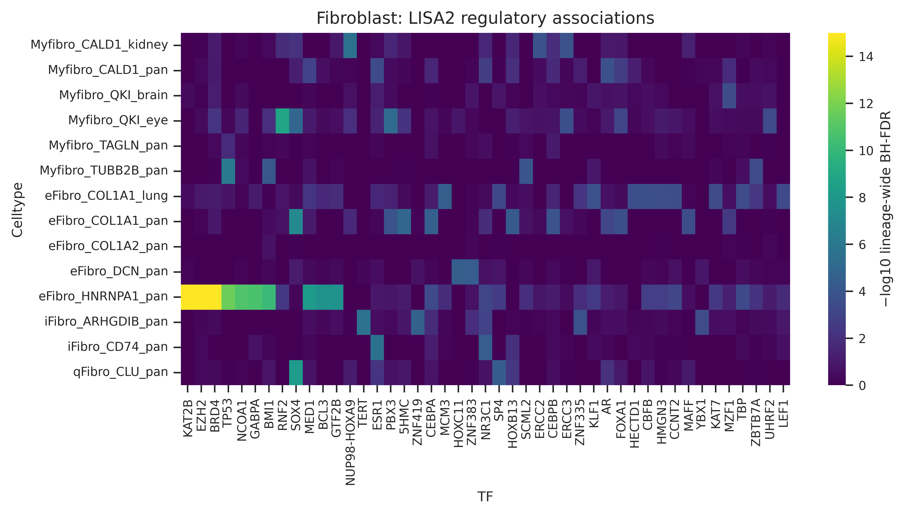

# Fibroblast

Current snapshot: **19 November 2026**. Counts refer to sample/proxy units unless stated otherwise. Selected expression features are not explicit cell-type proportions; predictive weights and regulatory annotations are not causal evidence.

[Module overview](../../../README.md) · [Results and legends](../../../../docs/results)

Subdirectories: [figures](figures/).

- [combined_top_TFs.pdf](combined_top_TFs.pdf)
- [combined_top_TFs.png](combined_top_TFs.png)
