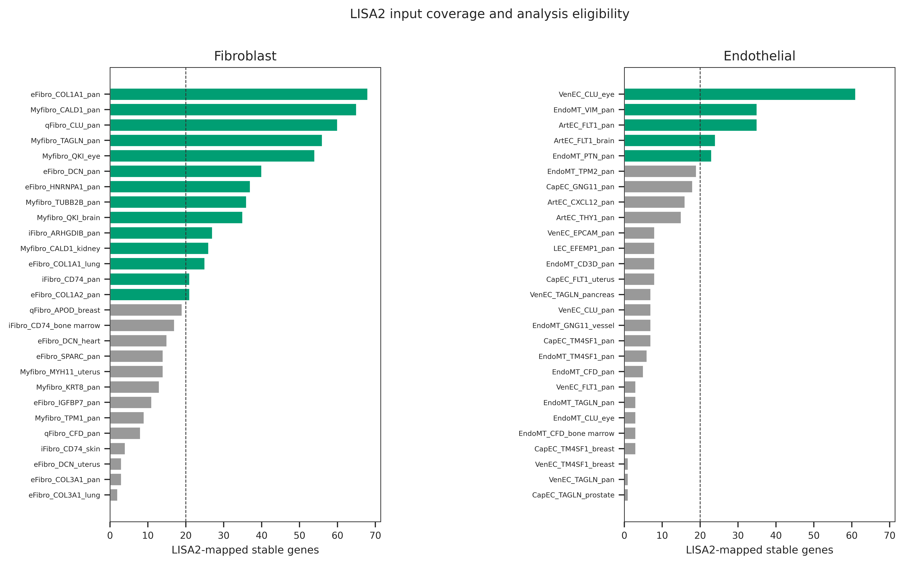
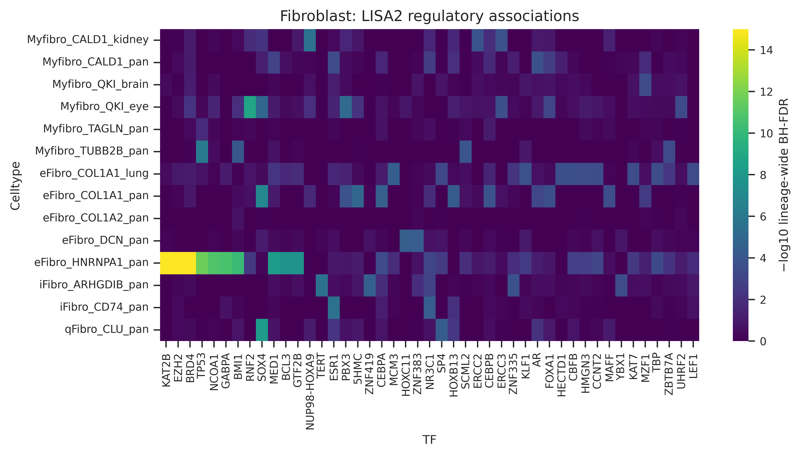
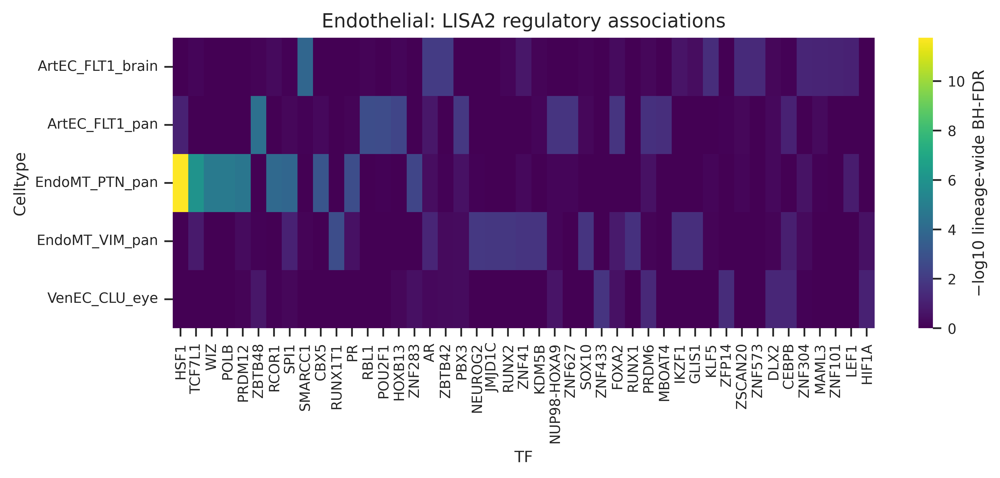
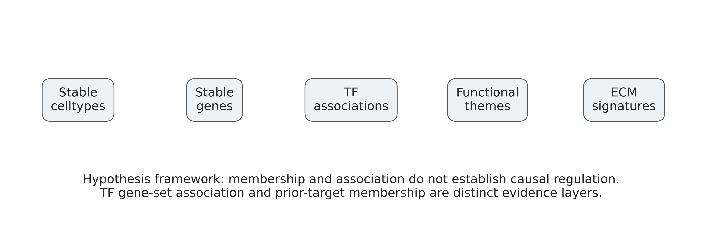
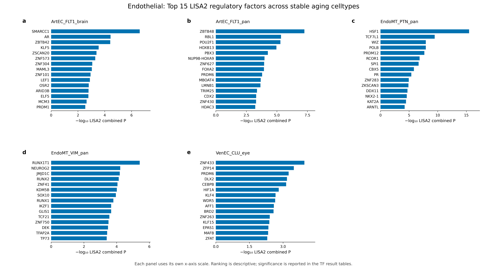

# stable_celltype_LISA2_20261118

Current snapshot: **19 November 2026**. Counts refer to sample/proxy units unless stated otherwise. Selected expression features are not explicit cell-type proportions; predictive weights and regulatory annotations are not causal evidence.

[Module overview](../../README.md) · [Results and legends](../../../docs/results)

Subdirectories: [Endothelial](Endothelial/), [Fibroblast](Fibroblast/), [figures](figures/), [integration](integration/).

- [all_celltype_TF_rankings.csv](all_celltype_TF_rankings.csv)
- [celltype_run_status.csv](celltype_run_status.csv)
- [lisa_parameters.json](lisa_parameters.json)
- [software_and_parameters.json](software_and_parameters.json)
