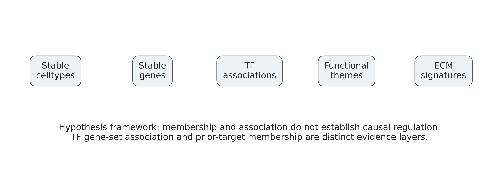

# integration

Current snapshot: **25 November 2026**. Counts refer to sample/proxy units unless stated otherwise. Selected expression features are not explicit cell-type proportions; predictive weights and regulatory annotations are not causal evidence.

[Module overview](../../../README.md) · [Results and legends](../../../../docs/results)

Subdirectories: [figures](figures/).

- [TF_ECM_candidate_evidence_by_feature.csv](TF_ECM_candidate_evidence_by_feature.csv)
- [candidate_TF_target_ECM_intersections.csv](candidate_TF_target_ECM_intersections.csv)
- [shared_specific_stable_ECM_genes.csv](shared_specific_stable_ECM_genes.csv)
