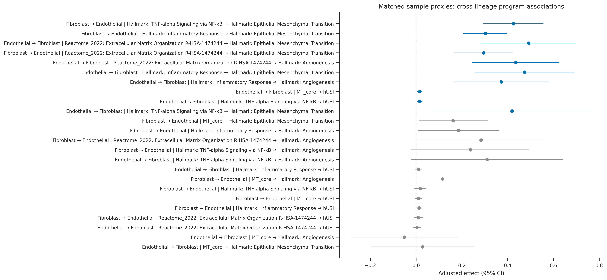

# Six exploratory downstream extensions

Source snapshot: 25 November 2026. Candidate features and the fixed source model are unchanged; all analyses are postselection and observational except the public bulk fibroblast gene-set projection. Exact aggregate families and plots are linked below.

| Task | Estimable / candidates | Main corrected findings |
|---|---:|---|
| [Clock–senescence](task01_clock_vs_senescence/) | 46 / 99 | 3 fibroblast associations; in-sample and shared-input dependence |
| [Nonlinear age](task02_nonlinear_age/) | 649 / 1,100 | 119 FDR; 38 also positive held-study relative-shape improvement |
| [Public perturbation](task03_perturbation/) | 64 / 192 | 0 primary donor-sign-flip FDR; 6 donor lines, 136 matched libraries |
| [Tissue context](task04_tissue_context/) | 10 / 215 | 2 joint age-by-tissue module tests |
| [Paired niche](task05_paired_niche/) | 24 / 24 primary | 10 main FDR; separate 24-test sensitivity has 15 |
| [Metal response](task06_metal_response/) | 126 / 258 primary | 24 main FDR; healthy-only family is separate and overlapping |

[Results and inference limits](../../docs/results/Results_Part3_StableFeatures_Mechanisms.md) · [Figure legends](../../docs/results/Figure_Legends.md)
