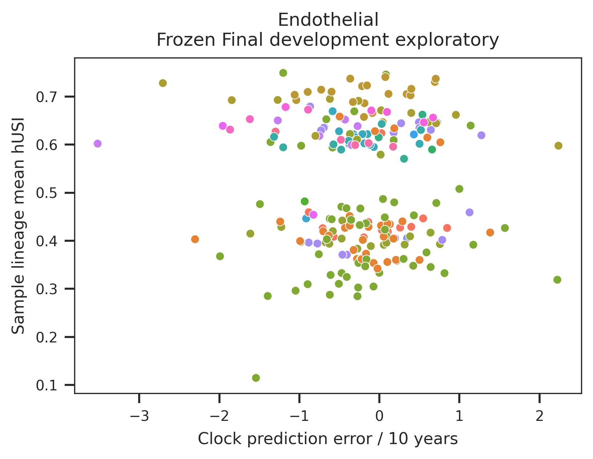
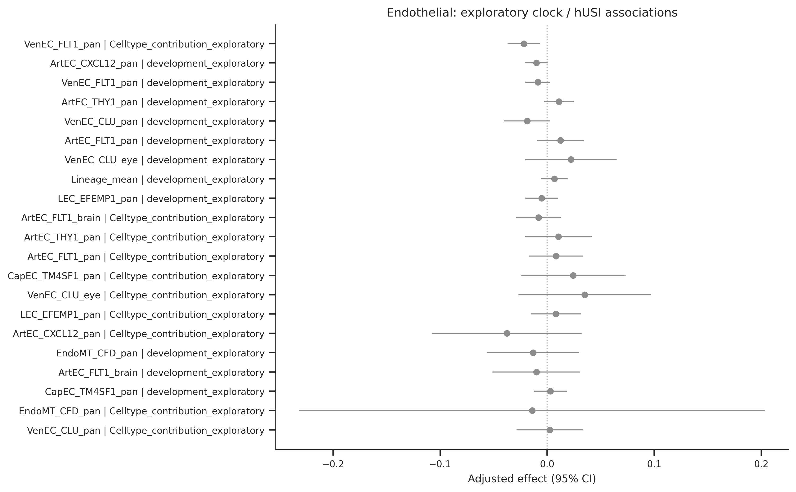

# figures

Current snapshot: **25 November 2026**. Counts refer to sample/proxy units unless stated otherwise. Selected expression features are not explicit cell-type proportions; predictive weights and regulatory annotations are not causal evidence.

[Module overview](../../../../README.md) · [Results and legends](../../../../../docs/results)

- [Frozen_Final_development_exploratory_scatter.pdf](Frozen_Final_development_exploratory_scatter.pdf)
- [Frozen_Final_development_exploratory_scatter.png](Frozen_Final_development_exploratory_scatter.png)
- [adjusted_clock_CellAge_associations.pdf](adjusted_clock_CellAge_associations.pdf)
- [adjusted_clock_CellAge_associations.png](adjusted_clock_CellAge_associations.png)
