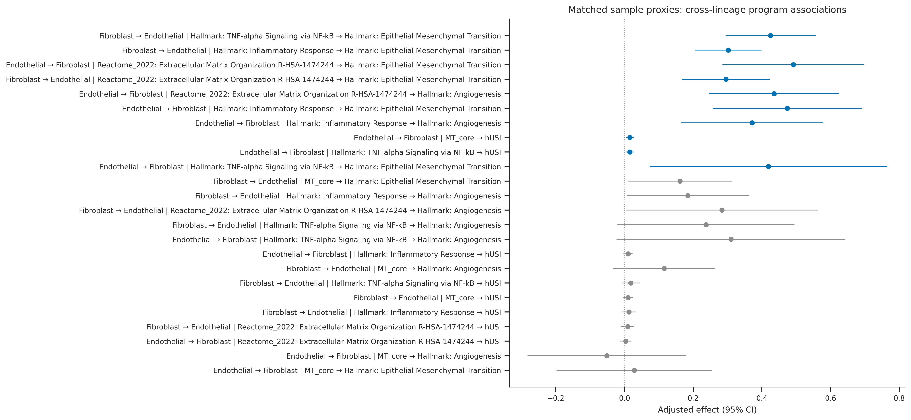
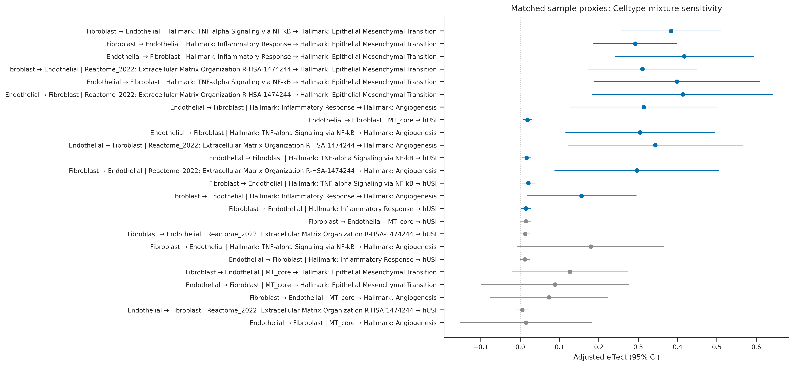

# figures

Current snapshot: **25 November 2026**. Counts refer to sample/proxy units unless stated otherwise. Selected expression features are not explicit cell-type proportions; predictive weights and regulatory annotations are not causal evidence.

[Module overview](../../../README.md) · [Results and legends](../../../../docs/results)

- [paired_niche_associations.pdf](paired_niche_associations.pdf)
- [paired_niche_associations.png](paired_niche_associations.png)
- [paired_niche_composition_sensitivity.pdf](paired_niche_composition_sensitivity.pdf)
- [paired_niche_composition_sensitivity.png](paired_niche_composition_sensitivity.png)
