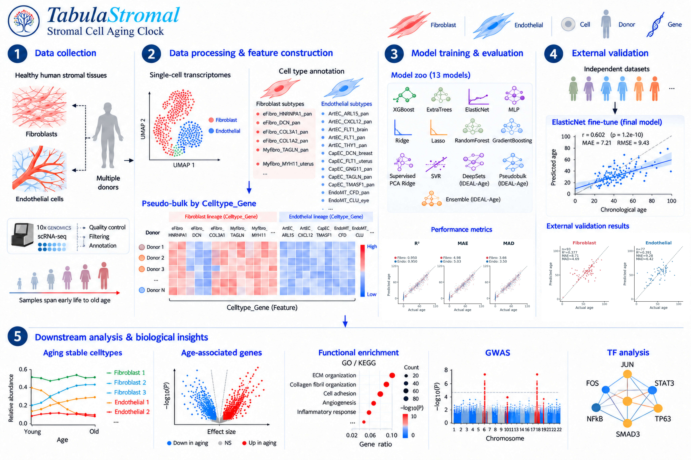
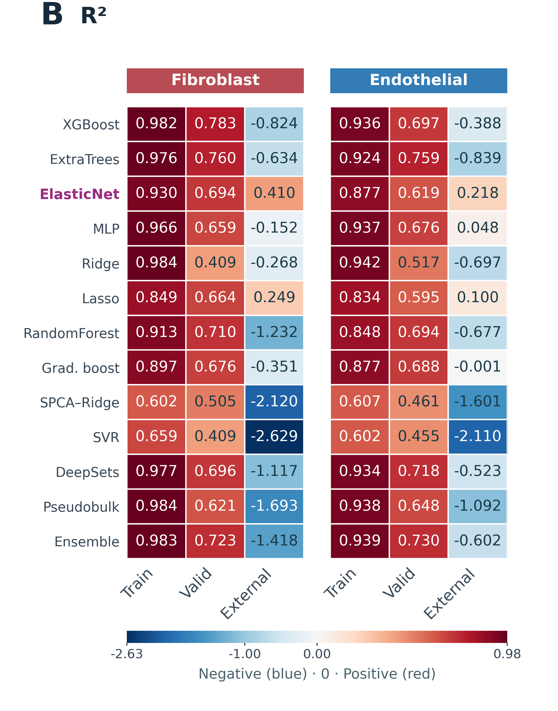
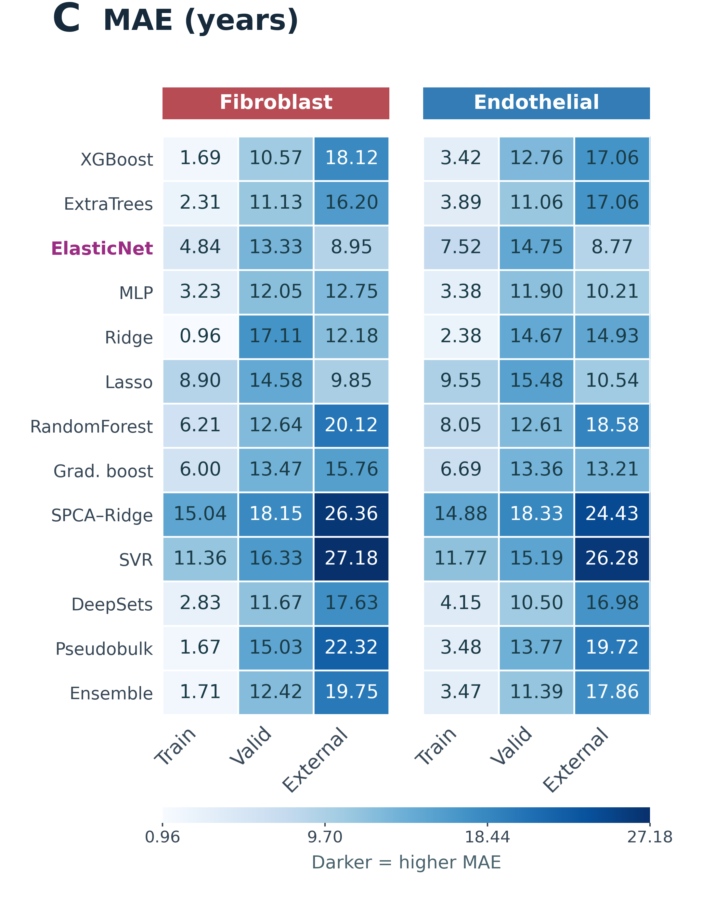
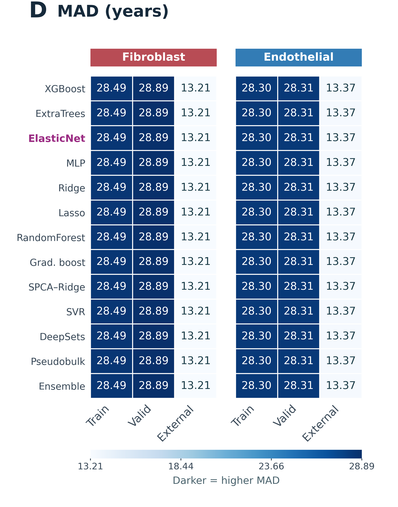

# TabulaStromal

**Human stromal atlases, celltype-resolved chronological-age prediction and downstream molecular associations.**

TabulaStromal integrates fibroblast- and endothelial-lineage references containing **5,916,760** and **2,239,277 cells**. Clock development uses separately filtered sets of **640/437 samples**, grouped into **634/431 GSE/GSM proxies**. These labels are not independently verified donor counts, and the full atlas is not uniformly healthy.

This release updates all five result modules from the source-verified 19 November snapshot, including the downstream presentation, original figures, aggregate tables, evidence records and three English Results sections.

## Model Overview



*Original workflow schematic. Illustrative numbers, healthy-only/donor labels and GWAS drawings are not additional empirical findings. See the current complete Figure 2 and source-specific definitions in [F2_ModelPerformance](F2_ModelPerformance/).*

## Model Performance

<p align="center">
  <a href="docs/assets/Fig2B_R2_heatmap.png"></a>
  <a href="docs/assets/Fig2C_MAE_heatmap.png"></a>
  <a href="docs/assets/Fig2D_MAD_heatmap.png"></a>
</p>

*Original Figure 2 B–D exports. Each model's K is selected using source fold 4. External heatmap values use FT30→ALL100, including adaptation samples. Panel D MAD is mean absolute age-label deviation, not prediction error. These heatmaps are not five-fold means or compact-model validation.*

The current Figure 2 E/F instead shows **development-set in-sample fits** of performance-first ElasticNet models with **750 fibroblast / 350 endothelial Celltype_Gene features**. The current external panels use models selected using **ALL100 outcomes**:

| Current compact-model evaluation | Fibroblast n | Fibroblast R² | MAE, years | Endothelial n | Endothelial R² | MAE, years |
|---|---:|---:|---:|---:|---:|---:|
| Development, in-sample source-model fit | 640 | 0.950 | 4.98 | 437 | 0.950 | 5.03 |
| Adapted ALL100, used in model selection | 93 | 0.377 | 8.71 | 77 | 0.391 | 9.28 |
| Adapted reused 70% subset | 65 | 0.032 | 12.02 | 54 | 0.043 | 11.67 |

**Neither the development fits nor the outcome-selected external estimates establish independent generalization of the current compact models.** The reused 70% outcomes also participated in ALL100 selection. MAD in these current fit/external panels means median absolute prediction error (MedAE), unlike panel D. Exact values and evaluation scopes are linked in [Results Part 2](docs/results/Results_Part2_ClockPerformance_CellAge.md).

The full grouped five-fold benchmark ranked XGBoost first for fibroblasts (mean validation R² 0.803) and ExtraTrees first for endothelial cells (0.716). These are different configurations from the compact ElasticNet fits. The [earlier unreduced EN branch](TabulaStromal_Rebenchmark_2026/) retains its original unadapted and held-out adaptation metrics as historical protocol evidence.

## Explore the five result modules

| Module | Current content |
|---|---|
| [F1_StromalAtlas](F1_StromalAtlas/) | Atlas overview, detailed states, metadata coverage, retrospective annotation agreement and filtering figures |
| [F2_ModelPerformance](F2_ModelPerformance/) | Current complete Figure 2, original overview, B–F panels and exact aggregate metric tables |
| [F3_ds_analysis](F3_ds_analysis/) | Selected features, functional annotation, LISA2, RNA networks, adult raw-count ECM, current CellAge, and the **40-slide PPTX** |
| [TabulaStromal_Rebenchmark_2026](TabulaStromal_Rebenchmark_2026/) | Current 750/350-feature definitions and optimization protocol, with the earlier unreduced EN branch labeled separately |
| [CellAge_Exploration](CellAge_Exploration/) | Historical score provenance and its distinction from the current selected-state CellAge analysis |

Current selected features span **27 states per lineage**, encode **678/337 unique genes**, and share **45 genes**. Functional and regulatory results are exploratory annotations of the selected representation. Relative hUSI state differences are distinct from age slopes; no current primary adjusted hUSI–age or composition–age test survives its applicable correction. Read [Results Part 3](docs/results/Results_Part3_StableFeatures_Mechanisms.md) for complete correction families and coverage limits.

## Read or download the updated Results

| Section | English text | Editable Word | Actual Word-rendered PDF |
|---|---|---|---|
| Stromal atlas | [Part 1](docs/results/Results_Part1_StromalAtlas.md) | [DOCX](docs/results/Results_Part1_StromalAtlas.docx) | [PDF](docs/results/Results_Part1_StromalAtlas.pdf) |
| Clock overview, performance and CellAge context | [Part 2](docs/results/Results_Part2_ClockPerformance_CellAge.md) | [DOCX](docs/results/Results_Part2_ClockPerformance_CellAge.docx) | [PDF](docs/results/Results_Part2_ClockPerformance_CellAge.pdf) |
| Features and molecular associations | [Part 3](docs/results/Results_Part3_StableFeatures_Mechanisms.md) | [DOCX](docs/results/Results_Part3_StableFeatures_Mechanisms.docx) | [PDF](docs/results/Results_Part3_StableFeatures_Mechanisms.pdf) |

[Combined Results Word](docs/results/TabulaStromal_Results_Combined.docx) · [Combined PDF](docs/results/TabulaStromal_Results_Combined.pdf) · [Figure legends](docs/results/Figure_Legends.md) · [Verified references](docs/results/References.md) · [Panel/source manifest](audit/figure_manifest.csv)

## Audit and provenance

The complete five-root metadata discovery contains **1,469,578 file entries**, including historical and environment files; it does not imply reading all file contents. The public release contains **229 original scientific image/PDF files**, **201 aggregate/evidence tables** and the downstream PPTX. Core content hashes were rechecked for **432 audited source files** before export. See [audit scope and inventories](audit/README.md), [evidence registry](evidence/evidence_registry.csv), [release checks](audit/results_release_validation.json) and [Word rendering receipts](audit/docx_rendering_report.md).

All descendants of the F3 audit directory named `VenEC_CLU_eye_audit` and `F3_features/Age10_20_audit_20261117` are excluded. A legitimate Celltype named `VenEC_CLU_eye` in current aggregate results is not that excluded audit directory. Source images are unaltered. The PPTX retains all 40 slides and embedded image bytes; personal server paths in its XML text are generalized. Full cache-path inventories remain local under ignored `outputs/`.

## Run the source workflows

Use Python **3.11**. No private inputs or pretrained weights are downloaded automatically.

```bash
python -m venv .venv
source .venv/bin/activate
python -m pip install -r requirements/benchmark.txt
python scripts/run_workflow.py benchmark --help
python scripts/run_workflow.py benchmark --dry-run --lineage both
python scripts/validate_repository.py --verify-checksums
python scripts/validate_results_release.py
python -m unittest discover -s tests -v
```

The source benchmark and inference workflows retain their documented data contracts. The historical final-EN continuation requires its validated checkpoint archive. Current F3 is a curated result release, not a claim that private raw inputs or all execution environments are distributed. See [data requirements](docs/data.md), [reproduction](docs/reproducing.md) and [testing](docs/testing.md). Synthetic checks are software verification, not biological evidence.

## Citation and permissions

[CITATION.cff](CITATION.cff) provides software attribution; no manuscript DOI or published-paper status is asserted. A project-wide license has not yet been selected; see [NOTICE](NOTICE). Third-party resources retain their terms. Contributions should preserve explicit protocol and inference-unit distinctions: [CONTRIBUTING.md](CONTRIBUTING.md).

[中文说明](README.zh-CN.md) · [Publication procedure](docs/publication.md)
