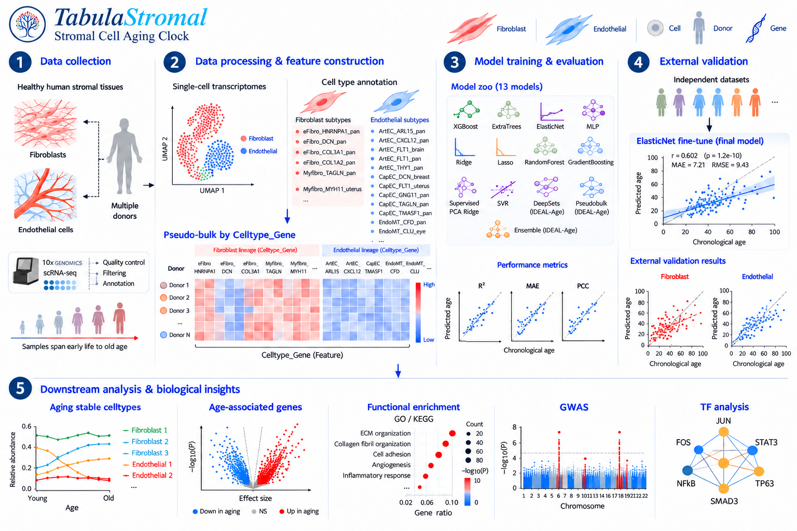
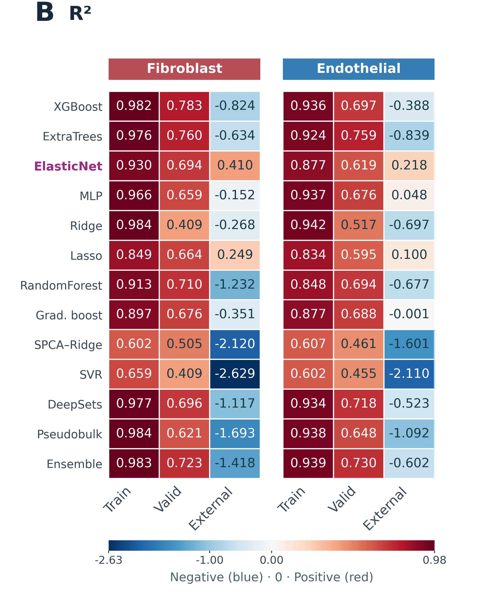
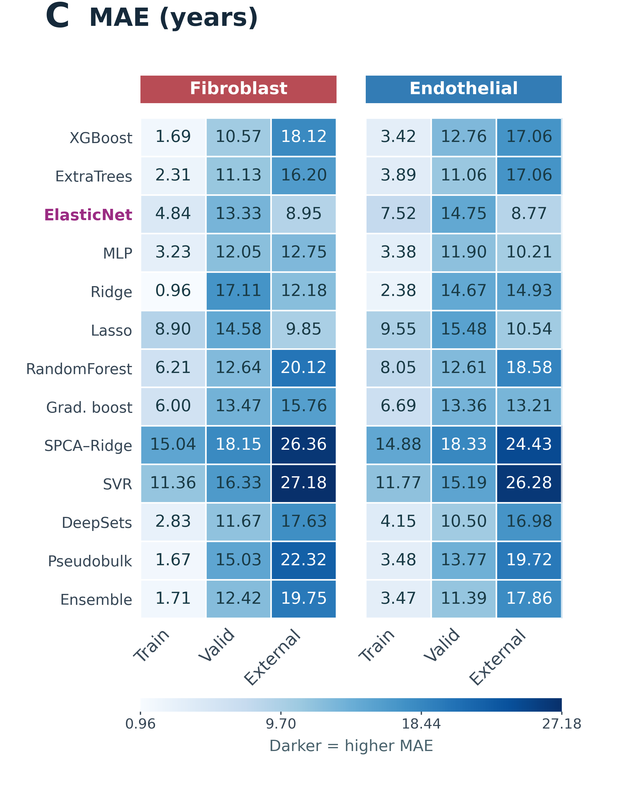
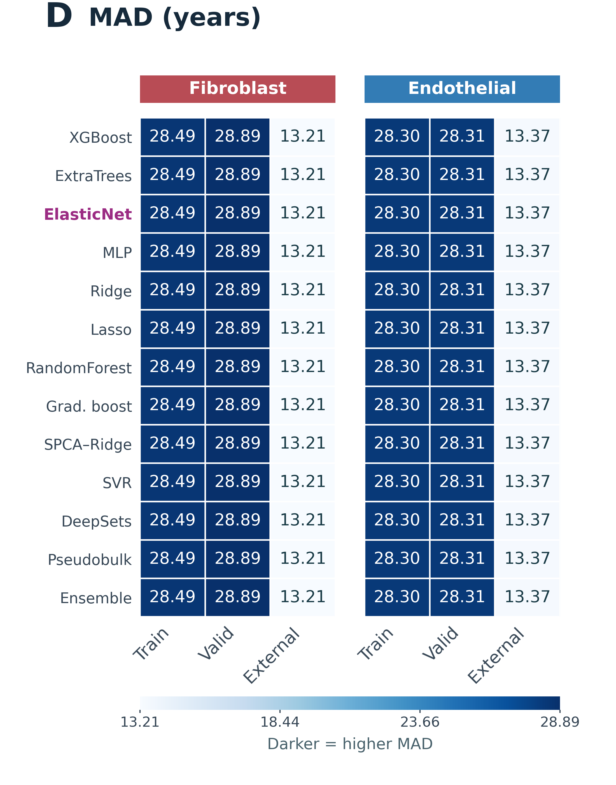

# TabulaStromal

**Human stromal cell atlases, transcriptomic age prediction, and senescence-associated analyses.**

TabulaStromal brings together fibroblast and endothelial atlas analysis, a 13-model age-prediction benchmark, an interpretable ElasticNet clock branch, bootstrap feature stability, pathway analysis, and integration with existing hUSI and SenCID outputs. This repository is a curated source release of the research project, with portable configuration examples, aggregate results, and synthetic verification.

The atlas contains **5,916,760 fibroblast cells** and **2,239,277 endothelial cells**. Clock development uses separate, filtered age-labelled cohorts of **640** and **437 sample units**, respectively. Sample labels and GSE/GSM groups should not be equated with independently verified donors. The full atlas includes heterogeneous disease annotations; it is not a uniformly healthy cohort.

## Model Overview



*Project workflow overview (schematic).*

## Model Performance

<p align="center">
  <a href="docs/assets/Fig2B_R2_heatmap.png"></a>
  <a href="docs/assets/Fig2C_MAE_heatmap.png"></a>
  <a href="docs/assets/Fig2D_MAD_heatmap.png"></a>
</p>

*Original Figure 2 panels B–D, shown using the corresponding standalone panel exports. Source fold: 4. External values use FT30 ALL100, including adaptation samples. MAD describes age-label dispersion; the final-clock evaluation scopes are reported separately below.*

## Start here

Use Python **3.11** and run commands from the repository root. No research data or pretrained weights are downloaded automatically.

```bash
python -m venv .venv
source .venv/bin/activate
python -m pip install -r requirements/benchmark.txt
python scripts/run_workflow.py benchmark --help
python scripts/run_workflow.py benchmark --dry-run --lineage both
```

The dry run reports configured input existence and task counts; it does not prove that data are available. The default configuration points to untracked `data/` inputs. Read the [data contract](docs/data.md) before running real analyses.

Verify the source release and exercise all 13 models on synthetic data:

```bash
python scripts/validate_repository.py
python -m unittest discover -s workflows/benchmark/tests -p 'test_*.py' -v
```

The integration test creates small synthetic H5AD inputs, runs all seven benchmark stages, checks split isolation and metrics, reloads models, and verifies checkpoint resume. Synthetic results are never evidence for biological claims. For CellAge, install `requirements/cellage.txt` and use the separate tests described in [testing](docs/testing.md).

## Analysis modules

| Module | Entry point | Purpose |
| --- | --- | --- |
| Stromal atlas | `python scripts/run_workflow.py atlas --help` | Metadata audit, atlas summaries, marker signatures, trajectory exploration, figures |
| Clock benchmark | `python scripts/run_workflow.py benchmark --help` | Sample pseudobulk, 13 models, grouped CV, external evaluation, bootstrap and enrichment |
| Final ElasticNet | `python scripts/run_workflow.py final-clock --help` | Final-EN audit/refit using the original validated checkpoint archive; see prerequisites below |
| Clock inference | `python scripts/predict_age.py --help` | Apply a trusted final-EN bundle to H5AD or named pseudobulk CSV inputs |
| CellAge | `python scripts/run_workflow.py cellage --help` | Audit and join existing scores, sample aggregation, associations and historical clock integration |
| Figure 2 archive | `workflows/model_performance/` | Historical figure builder and its source-scope documentation |
| Annotation and integration | `legacy/` | Historical notebooks with outputs removed, plus integration scripts |

The benchmark can start from user-supplied H5AD inputs. The final-EN pipeline is an **archive-dependent** continuation: it requires validated benchmark and bootstrap objects, source manifests, and historical figure assets. These private artifacts are not part of this release. Its original audit intentionally refuses incomplete archives. The standalone inference API and its synthetic tests do not require that archive. See [reproduction instructions](docs/reproducing.md).

## Results and evaluation scope

The following values come from [`results/final_clock_results_summary.csv`](results/final_clock_results_summary.csv), with model paths generalized and numerical values retained.

| Final ElasticNet evaluation | Fibroblast R² | Fibroblast MAE (years) | Endothelial R² | Endothelial MAE (years) |
| --- | ---: | ---: | ---: | ---: |
| Internal CV, conditional on selected K | 0.7423 | 11.8642 | 0.6326 | 14.1753 |
| External, no adaptation | −2.9433 | 29.3226 | −1.7196 | 24.8899 |
| External, after 30% adaptation, held-out 70% | −0.0008 | 13.1406 | −0.3551 | 13.1758 |

The benchmark-wide internal winners were XGBoost (fibroblast) and ExtraTrees (endothelial). They are distinct from the final interpretable ElasticNet branch. The final EN uses K=20,000/10,000 features and retains the original feature sets; stable-feature refits performed worse internally. Full-development bootstrap stability identified 438/23 Celltype_Gene pairs at a 0.70 selection-frequency threshold.

External cohorts contain 93/77 sample units; adaptation used 28/23, leaving 65/54 for held-out evaluation. The separate `FT30_all100_*` columns include adaptation samples and must not be described as independent validation. Negative external R² values are retained. `MAD` in the source code means mean absolute deviation of **chronological-age labels from their mean**, not median absolute prediction error; `MedAE` is a separate metric.

The CellAge snapshot uses historical K=8,000 ElasticNet predictions, not the final clocks. hUSI is a senescence-associated score, not an age estimate in years. Inspected `SenCID_rec_SID*` columns are recommendation outputs, not verified senescence intensities. See [results and limitations](docs/results.md) for the full provenance and interpretation boundaries.

## Repository contents

```text
workflows/       Primary source workflows and historical acceleration variants
legacy/          Annotation/integration notebooks and scripts
requirements/    Module dependencies and separate historical environment locks
scripts/         Workflow launcher, configuration helper, inference and validation
resources/       Supplied unverified gene lists and resource acquisition instructions
results/         Aggregate metrics and feature tables, with provenance
provenance/      Original-source hashes and exported-file checksums
docs/            Data contracts, reproduction, scientific scope and project map
.github/         Continuous integration and contribution templates
```

Large expression matrices, individual-level predictions, fitted models, caches, credentials, and unpublished manuscript drafts are excluded. [Source provenance](provenance/source_manifest.csv) links the exported modules to the original project tree. The [portability notes](docs/portability.md) describe modifications made for this release.

## Citation, contribution, and permissions

Use [CITATION.cff](CITATION.cff) for software attribution. No manuscript DOI or publication status is asserted. Contributions should include a reproducible example and maintain explicit separation of training, adaptation, and held-out evaluation; see [CONTRIBUTING.md](CONTRIBUTING.md).

A project-wide open-source license has not yet been selected by the authors. See [NOTICE](NOTICE). External data, gene-set resources, and dependencies retain their own terms.

中文说明见 [README.zh-CN.md](README.zh-CN.md).

Repository publication and remote-commit verification are described in [docs/publication.md](docs/publication.md).
