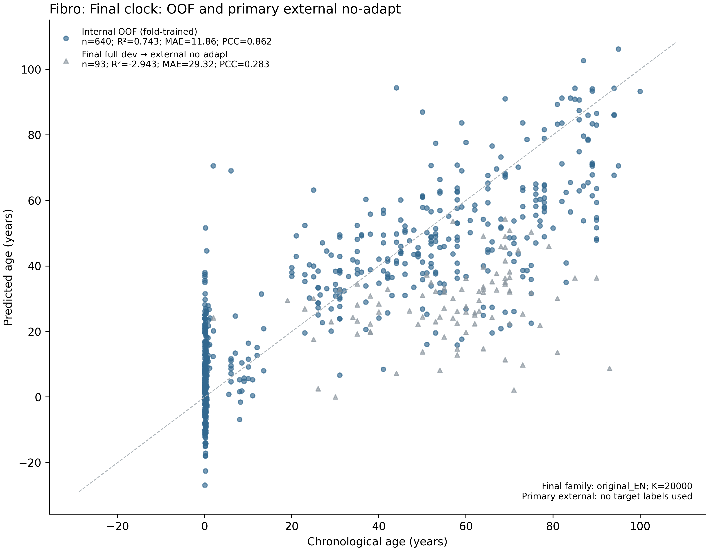
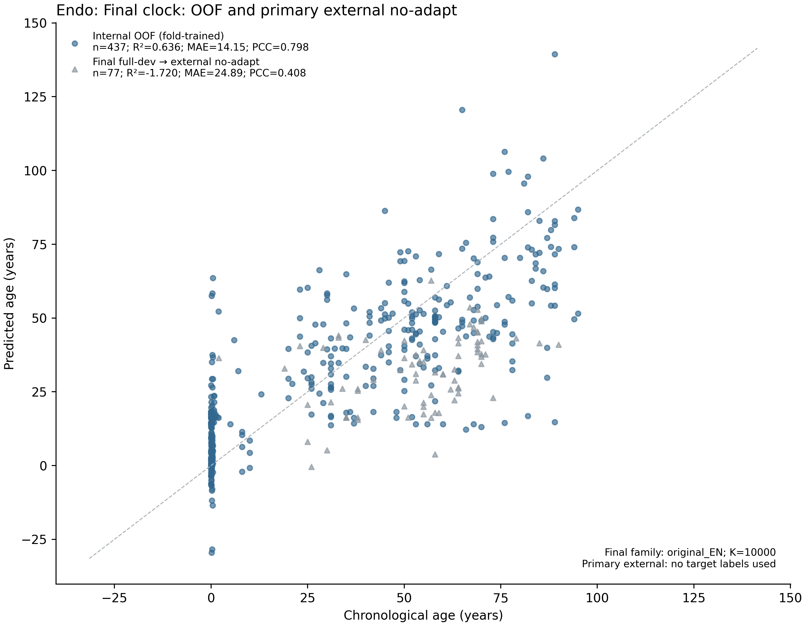
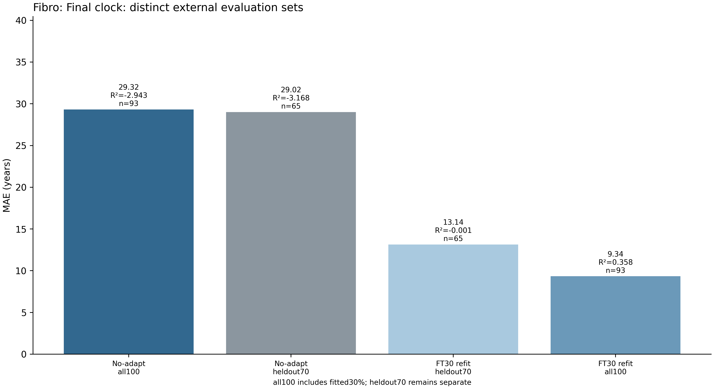
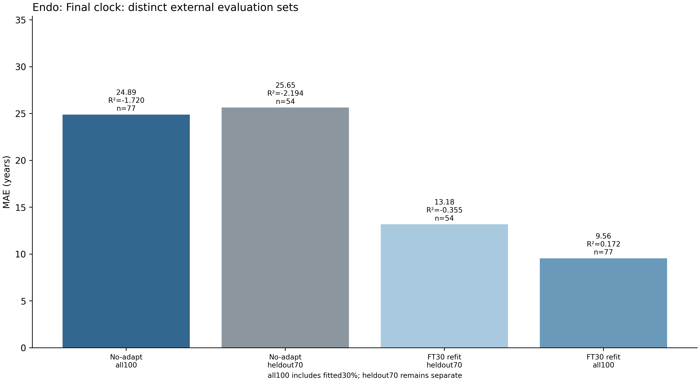
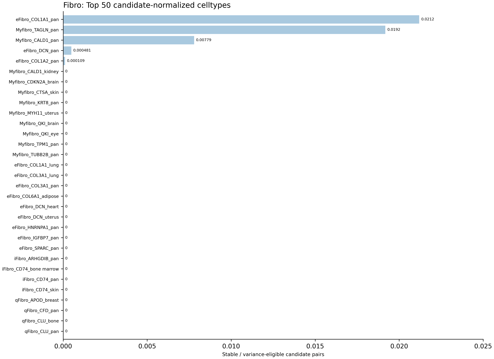
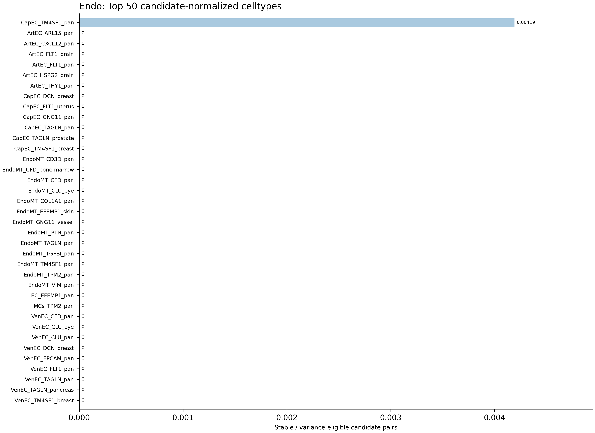
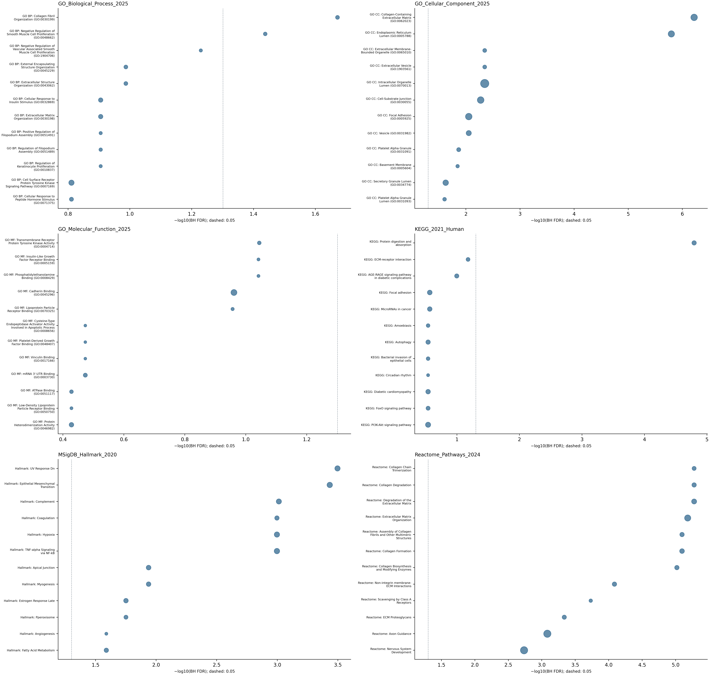
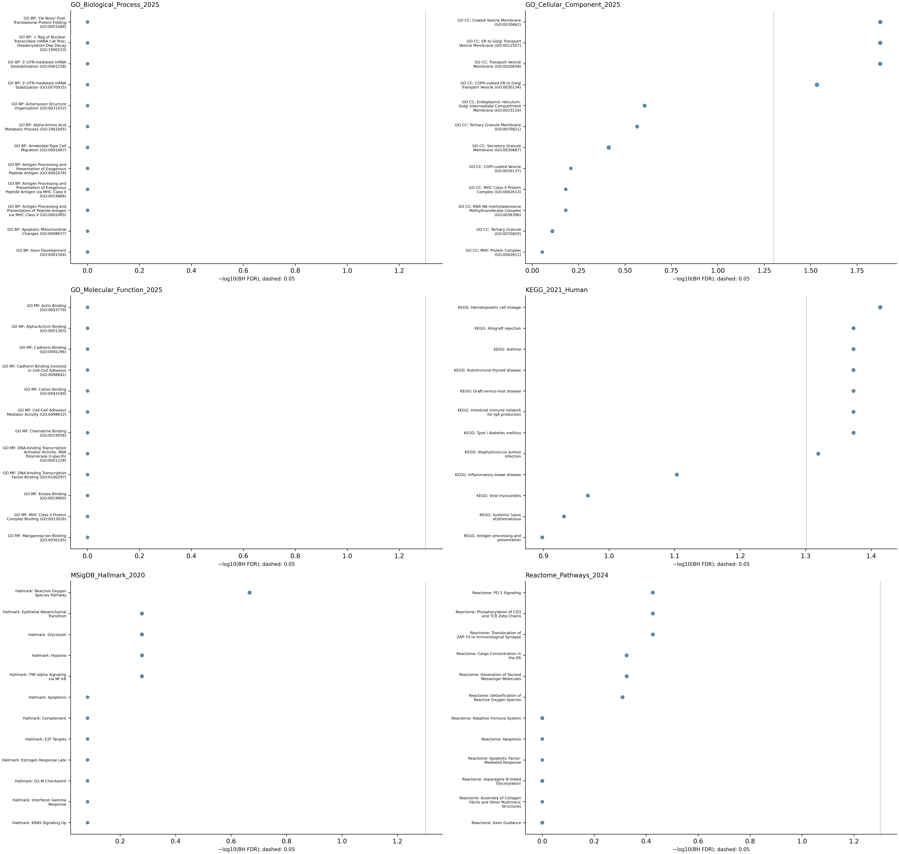
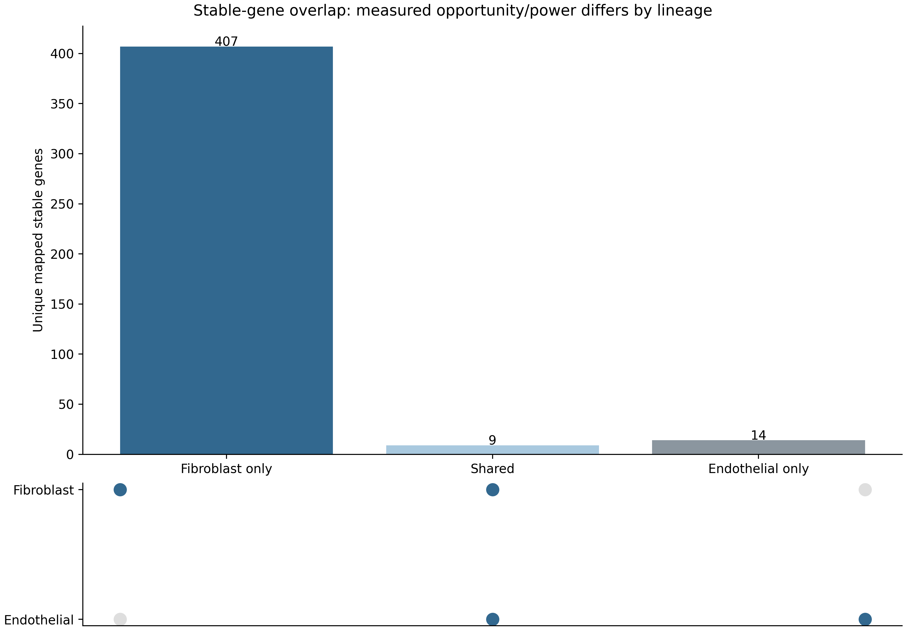

# Rebenchmark, Final ElasticNet and Stable Features

Source project directory: `AgePrediction/GeneModel/TabulaStromal_Rebenchmark_2026`. This page presents the selected verified result versions, original figure files, and aggregate evidence.

**Results:** [English text](../docs/results/Results_Part3_StableFeatures_Mechanisms.md) · [Editable Word](../docs/results/Results_Part3_StableFeatures_Mechanisms.docx) · [Figure legends](../docs/results/Figure_Legends.md)

**Audit:** [File inventory](audit/file_inventory.csv) · [Figure inventory](audit/figure_inventory.csv) · [Evidence registry](evidence/evidence_registry.csv) · [Released asset hashes](audit/released_assets.csv)

**Code:** [Workflow source](../workflows/benchmark/) · [Reproduction instructions](../docs/reproducing.md)

## Figure 3: final EN protocols and interpretation

[Original PDF](figures/combined/Stromal_individual_aging_clock_Fibroblast_Endothelial_FINAL_v2.pdf). Fibroblast/endothelial final EN uses K=20,000/10,000. Stable features remain explanatory because reduced EN models predict less well.

## Independent external evaluation and adaptation

  
  

  
  

No-adaptation merged external n=93/77. FT30 uses 28/23 fitted and 65/54 held-out samples. ALL100 contains fitted observations and must not be described as independent validation.

## Stable cell types and functional overlaps

  
  

  
  

Bootstrap frequency, model coefficients and enrichment are exploratory associations. No causal or perturbation-validated mechanism is claimed. Global enrichment tables retain the original tested terms and FDR family.

## Released file catalogue

Original figure and aggregate-table files

| File | Type | Size (MB) |
| --- | --- | ---: |
| [figures/Fibro/final_clock_GO_Reactome_KEGG_enrichment.png](figures/Fibro/final_clock_GO_Reactome_KEGG_enrichment.png) | figure | 1.63 |
| [figures/Fibro/final_clock_GO_Reactome_KEGG_enrichment.pdf](figures/Fibro/final_clock_GO_Reactome_KEGG_enrichment.pdf) | figure | 0.03 |
| [figures/Fibro/final_clock_aging_sets_overlap.png](figures/Fibro/final_clock_aging_sets_overlap.png) | figure | 0.16 |
| [figures/Fibro/final_clock_aging_sets_overlap.pdf](figures/Fibro/final_clock_aging_sets_overlap.pdf) | figure | 0.01 |
| [figures/Fibro/final_clock_bootstrap_selection_frequency.png](figures/Fibro/final_clock_bootstrap_selection_frequency.png) | figure | 0.18 |
| [figures/Fibro/final_clock_bootstrap_selection_frequency.pdf](figures/Fibro/final_clock_bootstrap_selection_frequency.pdf) | figure | 0.01 |
| [figures/Fibro/final_clock_external_combined_noadapt.png](figures/Fibro/final_clock_external_combined_noadapt.png) | figure | 0.56 |
| [figures/Fibro/final_clock_external_combined_noadapt.pdf](figures/Fibro/final_clock_external_combined_noadapt.pdf) | figure | 0.03 |
| [figures/Fibro/final_clock_external_ft30_comparison.png](figures/Fibro/final_clock_external_ft30_comparison.png) | figure | 0.16 |
| [figures/Fibro/final_clock_external_ft30_comparison.pdf](figures/Fibro/final_clock_external_ft30_comparison.pdf) | figure | 0.01 |
| [figures/Fibro/final_clock_gene_age_associations.png](figures/Fibro/final_clock_gene_age_associations.png) | figure | 0.52 |
| [figures/Fibro/final_clock_gene_age_associations.pdf](figures/Fibro/final_clock_gene_age_associations.pdf) | figure | 0.02 |
| [figures/Fibro/final_clock_internal_cv.png](figures/Fibro/final_clock_internal_cv.png) | figure | 0.18 |
| [figures/Fibro/final_clock_internal_cv.pdf](figures/Fibro/final_clock_internal_cv.pdf) | figure | 0.02 |
| [figures/Fibro/final_clock_pathway_overlaps.png](figures/Fibro/final_clock_pathway_overlaps.png) | figure | 0.32 |
| [figures/Fibro/final_clock_pathway_overlaps.pdf](figures/Fibro/final_clock_pathway_overlaps.pdf) | figure | 0.02 |
| [figures/Fibro/final_clock_per_gse.png](figures/Fibro/final_clock_per_gse.png) | figure | 0.21 |
| [figures/Fibro/final_clock_per_gse.pdf](figures/Fibro/final_clock_per_gse.pdf) | figure | 0.01 |
| [figures/Fibro/final_clock_stable_celltypes.png](figures/Fibro/final_clock_stable_celltypes.png) | figure | 0.34 |
| [figures/Fibro/final_clock_stable_celltypes.pdf](figures/Fibro/final_clock_stable_celltypes.pdf) | figure | 0.02 |
| [figures/Fibro/final_clock_stable_features.png](figures/Fibro/final_clock_stable_features.png) | figure | 0.66 |
| [figures/Fibro/final_clock_stable_features.pdf](figures/Fibro/final_clock_stable_features.pdf) | figure | 0.02 |
| [figures/Fibro/final_clock_stable_genes.png](figures/Fibro/final_clock_stable_genes.png) | figure | 0.33 |
| [figures/Fibro/final_clock_stable_genes.pdf](figures/Fibro/final_clock_stable_genes.pdf) | figure | 0.02 |
| [figures/Fibro/final_clock_subtype_pathways.png](figures/Fibro/final_clock_subtype_pathways.png) | figure | 0.60 |
| [figures/Fibro/final_clock_subtype_pathways.pdf](figures/Fibro/final_clock_subtype_pathways.pdf) | figure | 0.03 |
| [figures/Fibro/Fig3_TabulaStromal_Fibro_FINAL.png](figures/Fibro/Fig3_TabulaStromal_Fibro_FINAL.png) | figure | 3.53 |
| [figures/Fibro/Fig3_TabulaStromal_Fibro_FINAL.pdf](figures/Fibro/Fig3_TabulaStromal_Fibro_FINAL.pdf) | figure | 0.06 |
| [tables/Fibro/benchmark/cv_summary.csv](tables/Fibro/benchmark/cv_summary.csv) | aggregate_table | 0.03 |
| [tables/Fibro/benchmark/cv_fold_metrics.csv](tables/Fibro/benchmark/cv_fold_metrics.csv) | aggregate_table | 0.10 |
| [tables/Fibro/benchmark/model_comparison.csv](tables/Fibro/benchmark/model_comparison.csv) | aggregate_table | 0.02 |
| [tables/Fibro/external/final_clock_external_combined_metrics.csv](tables/Fibro/external/final_clock_external_combined_metrics.csv) | aggregate_table | 0.00 |
| [tables/Fibro/external/final_clock_external_protocol_comparison.csv](tables/Fibro/external/final_clock_external_protocol_comparison.csv) | aggregate_table | 0.00 |
| [tables/Fibro/external/final_clock_per_gse_metrics.csv](tables/Fibro/external/final_clock_per_gse_metrics.csv) | aggregate_table | 0.01 |
| [tables/Fibro/stability/stable_Celltype_Gene.csv](tables/Fibro/stability/stable_Celltype_Gene.csv) | aggregate_table | 0.07 |
| [tables/Fibro/stability/stable_celltypes_ranked.csv](tables/Fibro/stability/stable_celltypes_ranked.csv) | aggregate_table | 0.00 |
| [tables/Fibro/stability/stable_genes_unique.csv](tables/Fibro/stability/stable_genes_unique.csv) | aggregate_table | 0.05 |
| [tables/Fibro/stability/final_clock_internal_cv_summary.csv](tables/Fibro/stability/final_clock_internal_cv_summary.csv) | aggregate_table | 0.00 |
| [tables/Fibro/stability/final_clock_internal_cv_metrics.csv](tables/Fibro/stability/final_clock_internal_cv_metrics.csv) | aggregate_table | 0.00 |
| [tables/Fibro/stability/final_clock_paired_cv_comparison.csv](tables/Fibro/stability/final_clock_paired_cv_comparison.csv) | aggregate_table | 0.00 |
| [tables/Fibro/stability/stable_feature_counts_summary.csv](tables/Fibro/stability/stable_feature_counts_summary.csv) | aggregate_table | 0.00 |
| [tables/Fibro/enrichment/final_clock_enrichment_summary.csv](tables/Fibro/enrichment/final_clock_enrichment_summary.csv) | aggregate_table | 0.00 |
| [tables/Fibro/enrichment/final_clock_gene_set_provenance.csv](tables/Fibro/enrichment/final_clock_gene_set_provenance.csv) | aggregate_table | 0.00 |
| [tables/Fibro/enrichment/final_clock_stable_gene_age_association.csv](tables/Fibro/enrichment/final_clock_stable_gene_age_association.csv) | aggregate_table | 0.07 |
| [tables/Fibro/enrichment/global_pathway_enrichment.csv](tables/Fibro/enrichment/global_pathway_enrichment.csv) | aggregate_table | 2.40 |
| [figures/Endo/final_clock_GO_Reactome_KEGG_enrichment.png](figures/Endo/final_clock_GO_Reactome_KEGG_enrichment.png) | figure | 1.55 |
| [figures/Endo/final_clock_GO_Reactome_KEGG_enrichment.pdf](figures/Endo/final_clock_GO_Reactome_KEGG_enrichment.pdf) | figure | 0.03 |
| [figures/Endo/final_clock_aging_sets_overlap.png](figures/Endo/final_clock_aging_sets_overlap.png) | figure | 0.14 |
| [figures/Endo/final_clock_aging_sets_overlap.pdf](figures/Endo/final_clock_aging_sets_overlap.pdf) | figure | 0.01 |
| [figures/Endo/final_clock_bootstrap_selection_frequency.png](figures/Endo/final_clock_bootstrap_selection_frequency.png) | figure | 0.18 |
| [figures/Endo/final_clock_bootstrap_selection_frequency.pdf](figures/Endo/final_clock_bootstrap_selection_frequency.pdf) | figure | 0.01 |
| [figures/Endo/final_clock_external_combined_noadapt.png](figures/Endo/final_clock_external_combined_noadapt.png) | figure | 0.48 |
| [figures/Endo/final_clock_external_combined_noadapt.pdf](figures/Endo/final_clock_external_combined_noadapt.pdf) | figure | 0.02 |
| [figures/Endo/final_clock_external_ft30_comparison.png](figures/Endo/final_clock_external_ft30_comparison.png) | figure | 0.16 |
| [figures/Endo/final_clock_external_ft30_comparison.pdf](figures/Endo/final_clock_external_ft30_comparison.pdf) | figure | 0.01 |
| [figures/Endo/final_clock_gene_age_associations.png](figures/Endo/final_clock_gene_age_associations.png) | figure | 0.31 |
| [figures/Endo/final_clock_gene_age_associations.pdf](figures/Endo/final_clock_gene_age_associations.pdf) | figure | 0.02 |
| [figures/Endo/final_clock_internal_cv.png](figures/Endo/final_clock_internal_cv.png) | figure | 0.21 |
| [figures/Endo/final_clock_internal_cv.pdf](figures/Endo/final_clock_internal_cv.pdf) | figure | 0.02 |
| [figures/Endo/final_clock_pathway_overlaps.png](figures/Endo/final_clock_pathway_overlaps.png) | figure | 0.28 |
| [figures/Endo/final_clock_pathway_overlaps.pdf](figures/Endo/final_clock_pathway_overlaps.pdf) | figure | 0.02 |
| [figures/Endo/final_clock_per_gse.png](figures/Endo/final_clock_per_gse.png) | figure | 0.20 |
| [figures/Endo/final_clock_per_gse.pdf](figures/Endo/final_clock_per_gse.pdf) | figure | 0.01 |
| [figures/Endo/final_clock_stable_celltypes.png](figures/Endo/final_clock_stable_celltypes.png) | figure | 0.36 |
| [figures/Endo/final_clock_stable_celltypes.pdf](figures/Endo/final_clock_stable_celltypes.pdf) | figure | 0.02 |
| [figures/Endo/final_clock_stable_features.png](figures/Endo/final_clock_stable_features.png) | figure | 0.38 |
| [figures/Endo/final_clock_stable_features.pdf](figures/Endo/final_clock_stable_features.pdf) | figure | 0.02 |
| [figures/Endo/final_clock_stable_genes.png](figures/Endo/final_clock_stable_genes.png) | figure | 0.20 |
| [figures/Endo/final_clock_stable_genes.pdf](figures/Endo/final_clock_stable_genes.pdf) | figure | 0.02 |
| [figures/Endo/final_clock_subtype_pathways.png](figures/Endo/final_clock_subtype_pathways.png) | figure | 0.57 |
| [figures/Endo/final_clock_subtype_pathways.pdf](figures/Endo/final_clock_subtype_pathways.pdf) | figure | 0.03 |
| [figures/Endo/Fig3_TabulaStromal_Endo_FINAL.png](figures/Endo/Fig3_TabulaStromal_Endo_FINAL.png) | figure | 2.76 |
| [figures/Endo/Fig3_TabulaStromal_Endo_FINAL.pdf](figures/Endo/Fig3_TabulaStromal_Endo_FINAL.pdf) | figure | 0.05 |
| [tables/Endo/benchmark/cv_summary.csv](tables/Endo/benchmark/cv_summary.csv) | aggregate_table | 0.03 |
| [tables/Endo/benchmark/cv_fold_metrics.csv](tables/Endo/benchmark/cv_fold_metrics.csv) | aggregate_table | 0.10 |
| [tables/Endo/benchmark/model_comparison.csv](tables/Endo/benchmark/model_comparison.csv) | aggregate_table | 0.02 |
| [tables/Endo/external/final_clock_external_combined_metrics.csv](tables/Endo/external/final_clock_external_combined_metrics.csv) | aggregate_table | 0.00 |
| [tables/Endo/external/final_clock_external_protocol_comparison.csv](tables/Endo/external/final_clock_external_protocol_comparison.csv) | aggregate_table | 0.00 |
| [tables/Endo/external/final_clock_per_gse_metrics.csv](tables/Endo/external/final_clock_per_gse_metrics.csv) | aggregate_table | 0.01 |
| [tables/Endo/stability/stable_Celltype_Gene.csv](tables/Endo/stability/stable_Celltype_Gene.csv) | aggregate_table | 0.00 |
| [tables/Endo/stability/stable_celltypes_ranked.csv](tables/Endo/stability/stable_celltypes_ranked.csv) | aggregate_table | 0.00 |
| [tables/Endo/stability/stable_genes_unique.csv](tables/Endo/stability/stable_genes_unique.csv) | aggregate_table | 0.00 |
| [tables/Endo/stability/final_clock_internal_cv_summary.csv](tables/Endo/stability/final_clock_internal_cv_summary.csv) | aggregate_table | 0.00 |
| [tables/Endo/stability/final_clock_internal_cv_metrics.csv](tables/Endo/stability/final_clock_internal_cv_metrics.csv) | aggregate_table | 0.00 |
| [tables/Endo/stability/final_clock_paired_cv_comparison.csv](tables/Endo/stability/final_clock_paired_cv_comparison.csv) | aggregate_table | 0.00 |
| [tables/Endo/stability/stable_feature_counts_summary.csv](tables/Endo/stability/stable_feature_counts_summary.csv) | aggregate_table | 0.00 |
| [tables/Endo/enrichment/final_clock_enrichment_summary.csv](tables/Endo/enrichment/final_clock_enrichment_summary.csv) | aggregate_table | 0.00 |
| [tables/Endo/enrichment/final_clock_gene_set_provenance.csv](tables/Endo/enrichment/final_clock_gene_set_provenance.csv) | aggregate_table | 0.00 |
| [tables/Endo/enrichment/final_clock_stable_gene_age_association.csv](tables/Endo/enrichment/final_clock_stable_gene_age_association.csv) | aggregate_table | 0.00 |
| [tables/Endo/enrichment/global_pathway_enrichment.csv](tables/Endo/enrichment/global_pathway_enrichment.csv) | aggregate_table | 2.20 |
| [figures/combined/Stromal_individual_aging_clock_Fibroblast_Endothelial_FINAL_v2.png](figures/combined/Stromal_individual_aging_clock_Fibroblast_Endothelial_FINAL_v2.png) | figure | 4.48 |
| [figures/combined/Stromal_individual_aging_clock_Fibroblast_Endothelial_FINAL_v2.pdf](figures/combined/Stromal_individual_aging_clock_Fibroblast_Endothelial_FINAL_v2.pdf) | figure | 0.07 |
| [figures/combined/Stromal_FinalClock_shared_specific_genes.png](figures/combined/Stromal_FinalClock_shared_specific_genes.png) | figure | 0.15 |
| [figures/combined/Stromal_FinalClock_shared_specific_genes.pdf](figures/combined/Stromal_FinalClock_shared_specific_genes.pdf) | figure | 0.01 |

All released images/PDFs are original copies. The figure inventory also lists unselected historical candidates as metadata-only; their presence does not establish a verified or published result.
