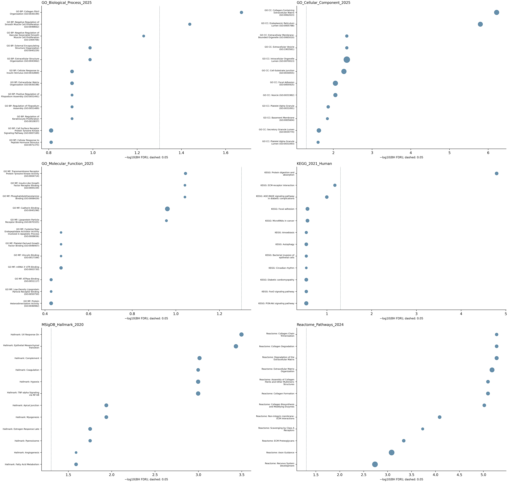
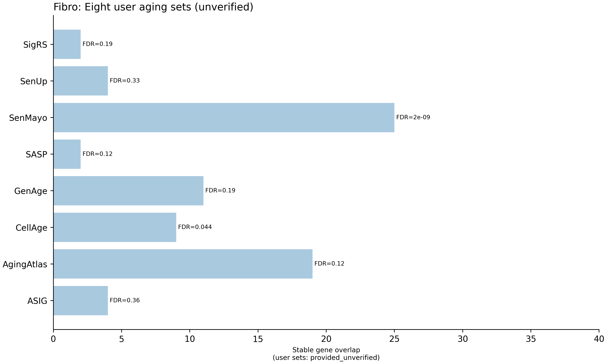
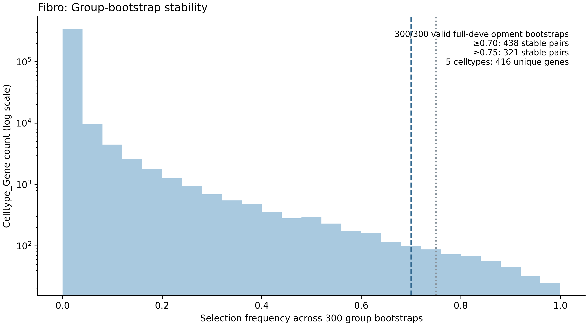
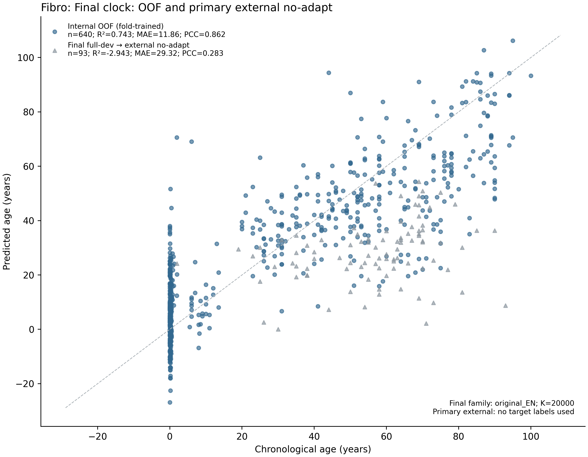
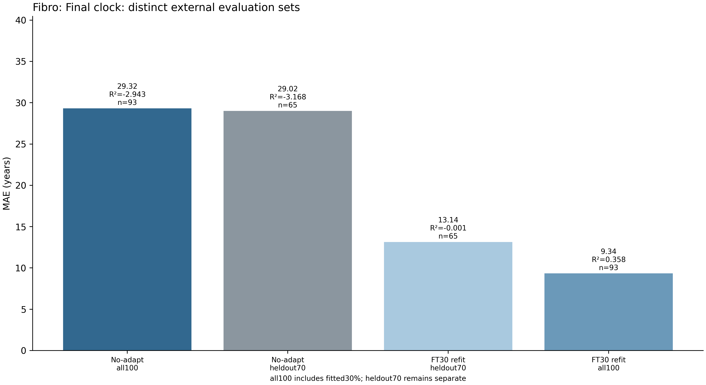
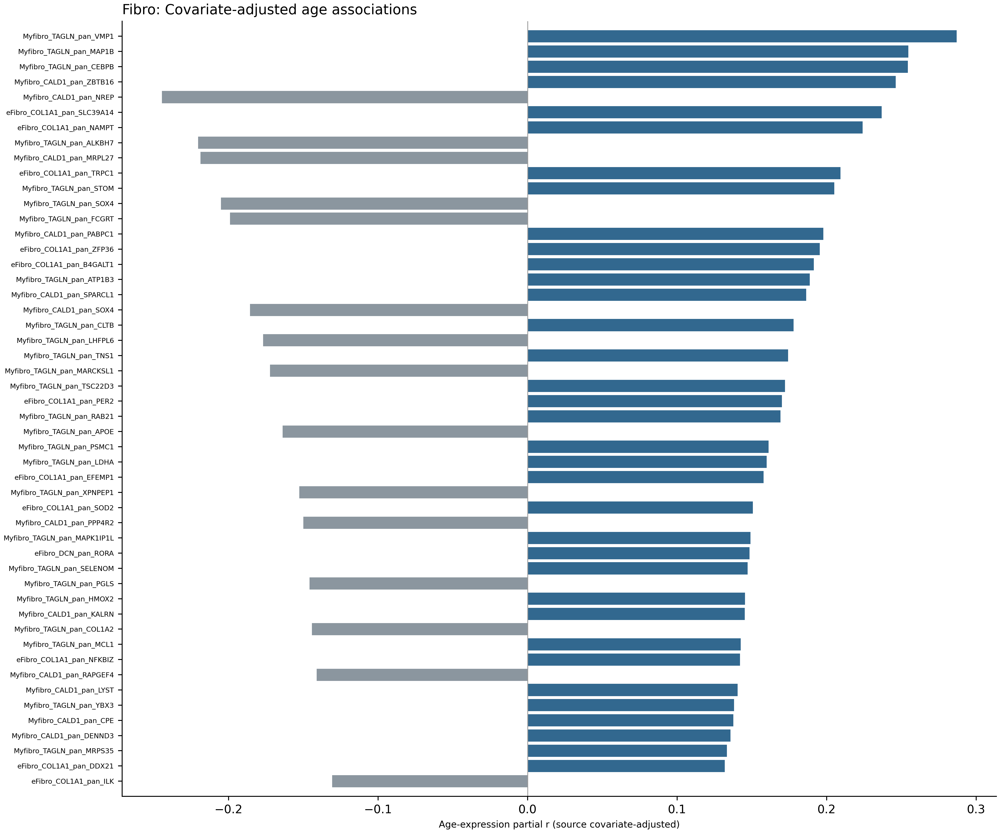
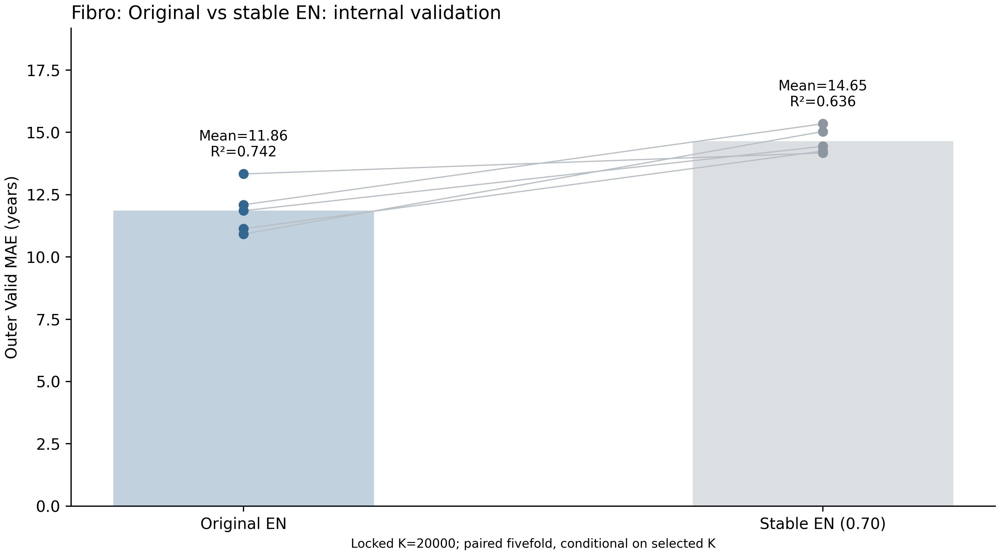
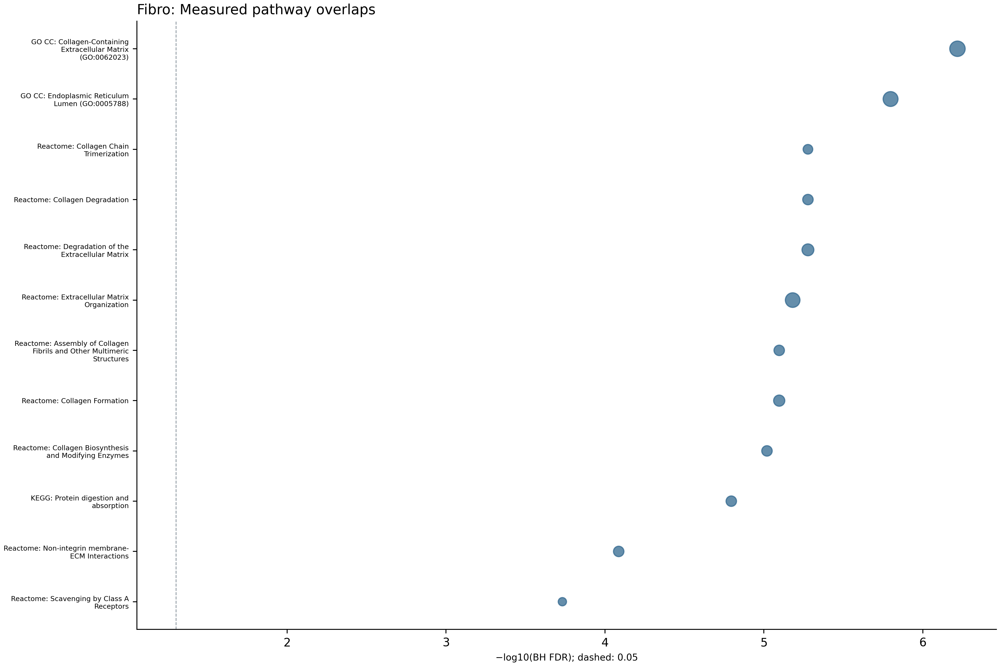

# Fibro

Current snapshot: **19 November 2026**. Counts refer to sample/proxy units unless stated otherwise. Selected expression features are not explicit cell-type proportions; predictive weights and regulatory annotations are not causal evidence.

[Module overview](../../README.md) · [Results and legends](../../../docs/results)

Files named `final_clock_*` and the 438/23-pair signatures describe the earlier unreduced EN branch; the current compact representation is linked from the module overview.

- [Fig3_TabulaStromal_Fibro_FINAL.pdf](Fig3_TabulaStromal_Fibro_FINAL.pdf)
- [Fig3_TabulaStromal_Fibro_FINAL.png](Fig3_TabulaStromal_Fibro_FINAL.png)
- [final_clock_GO_Reactome_KEGG_enrichment.pdf](final_clock_GO_Reactome_KEGG_enrichment.pdf)
- [final_clock_GO_Reactome_KEGG_enrichment.png](final_clock_GO_Reactome_KEGG_enrichment.png)
- [final_clock_aging_sets_overlap.pdf](final_clock_aging_sets_overlap.pdf)
- [final_clock_aging_sets_overlap.png](final_clock_aging_sets_overlap.png)
- [final_clock_bootstrap_selection_frequency.pdf](final_clock_bootstrap_selection_frequency.pdf)
- [final_clock_bootstrap_selection_frequency.png](final_clock_bootstrap_selection_frequency.png)
- [final_clock_external_combined_noadapt.pdf](final_clock_external_combined_noadapt.pdf)
- [final_clock_external_combined_noadapt.png](final_clock_external_combined_noadapt.png)
- [final_clock_external_ft30_comparison.pdf](final_clock_external_ft30_comparison.pdf)
- [final_clock_external_ft30_comparison.png](final_clock_external_ft30_comparison.png)
- [final_clock_gene_age_associations.pdf](final_clock_gene_age_associations.pdf)
- [final_clock_gene_age_associations.png](final_clock_gene_age_associations.png)
- [final_clock_internal_cv.pdf](final_clock_internal_cv.pdf)
- [final_clock_internal_cv.png](final_clock_internal_cv.png)
- [final_clock_pathway_overlaps.pdf](final_clock_pathway_overlaps.pdf)
- [final_clock_pathway_overlaps.png](final_clock_pathway_overlaps.png)
- [final_clock_per_gse.pdf](final_clock_per_gse.pdf)
- [final_clock_per_gse.png](final_clock_per_gse.png)
- [final_clock_stable_celltypes.pdf](final_clock_stable_celltypes.pdf)
- [final_clock_stable_celltypes.png](final_clock_stable_celltypes.png)
- [final_clock_stable_features.pdf](final_clock_stable_features.pdf)
- [final_clock_stable_features.png](final_clock_stable_features.png)
- [final_clock_stable_genes.pdf](final_clock_stable_genes.pdf)
- [final_clock_stable_genes.png](final_clock_stable_genes.png)
- [final_clock_subtype_pathways.pdf](final_clock_subtype_pathways.pdf)
- [final_clock_subtype_pathways.png](final_clock_subtype_pathways.png)
