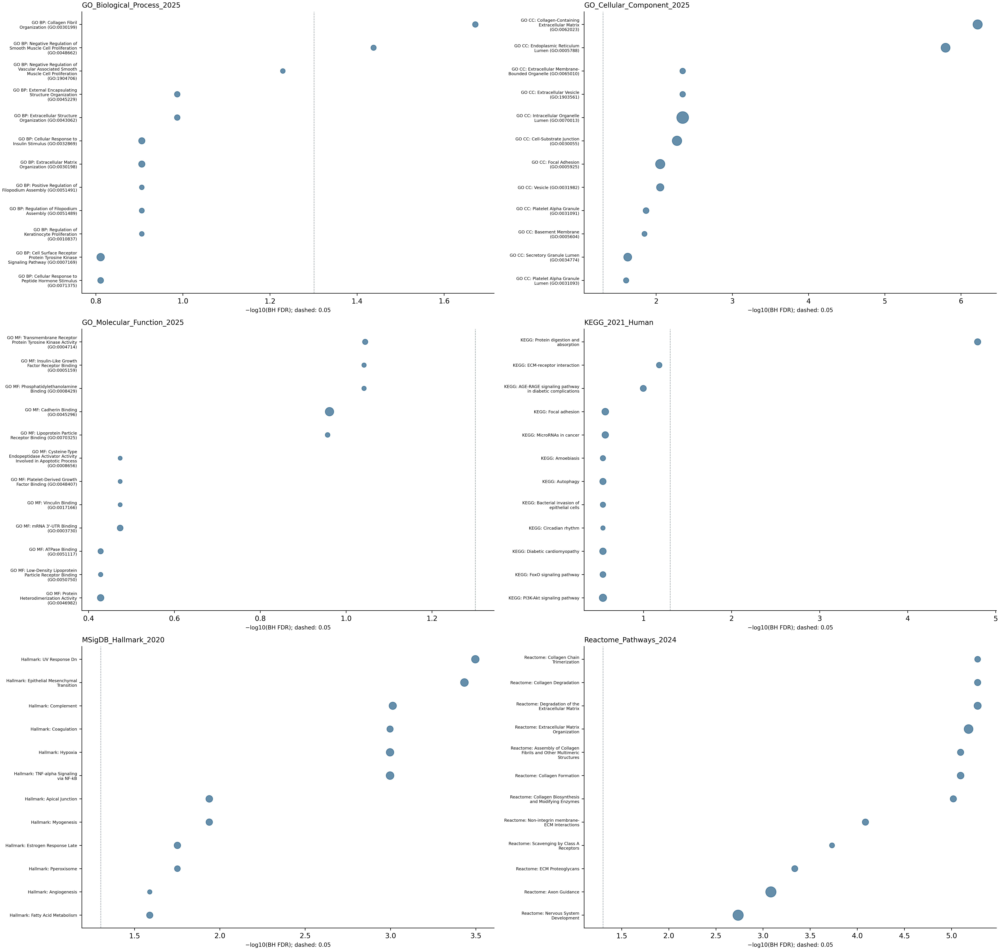
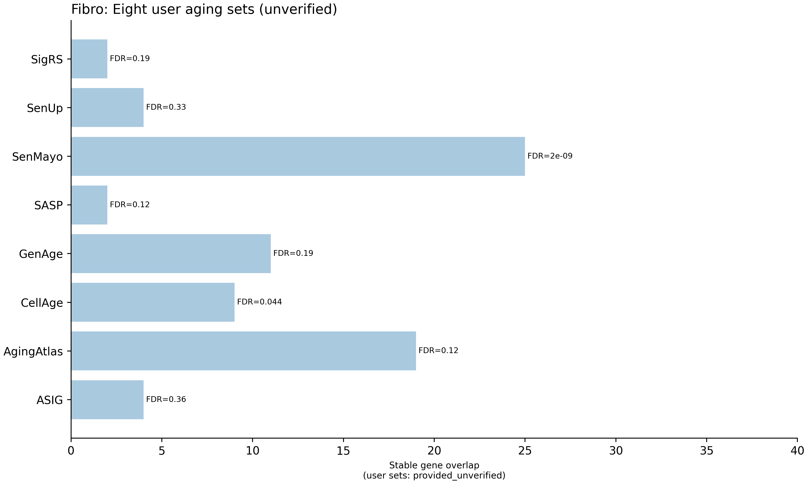
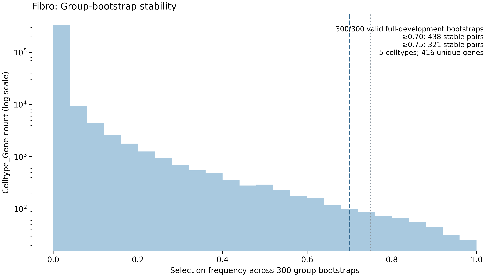
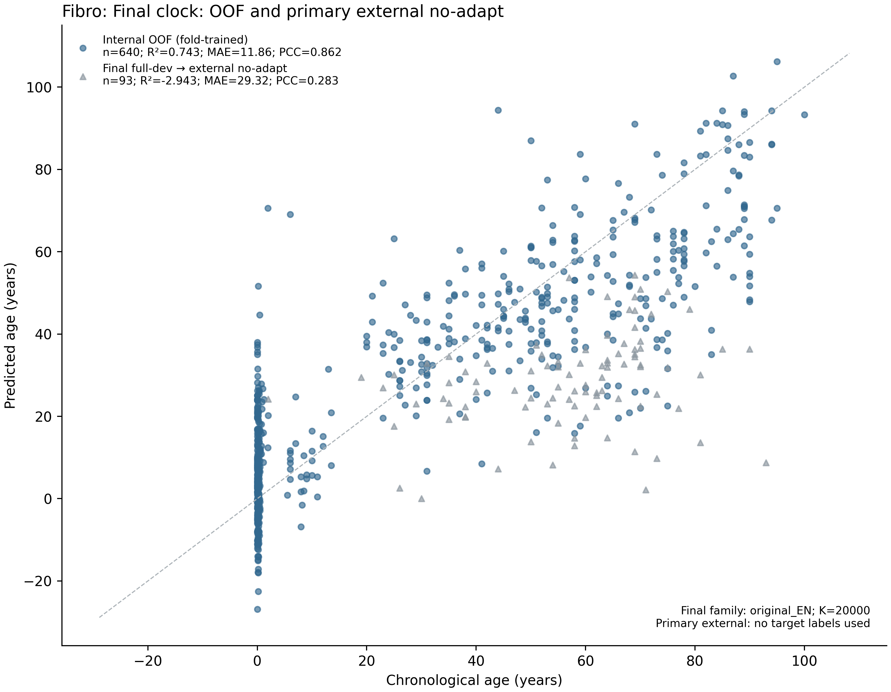
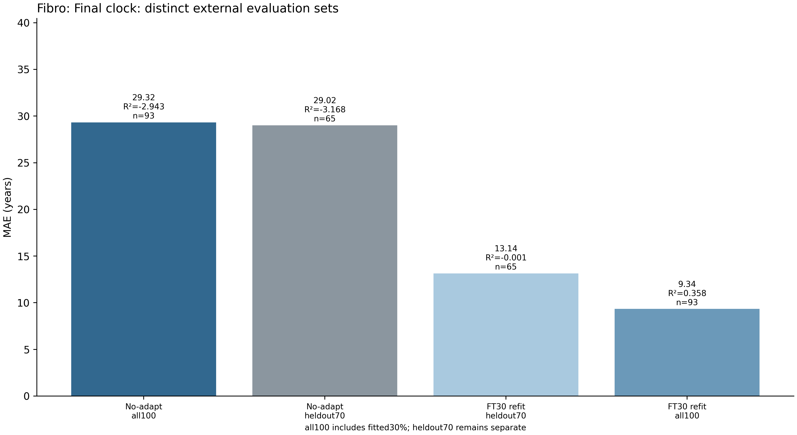
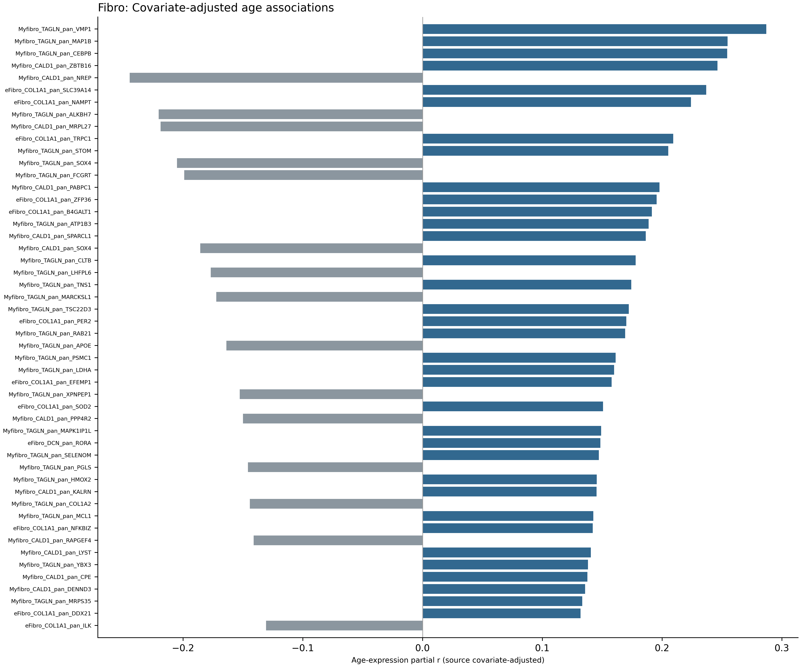
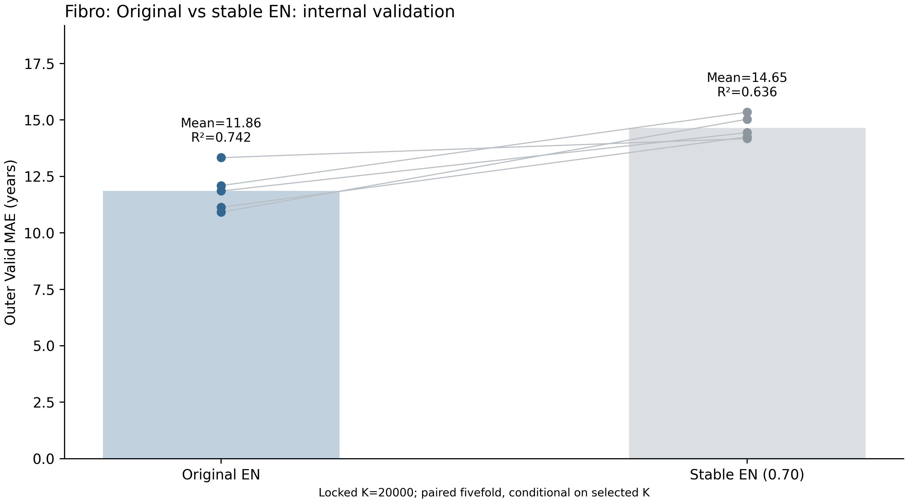
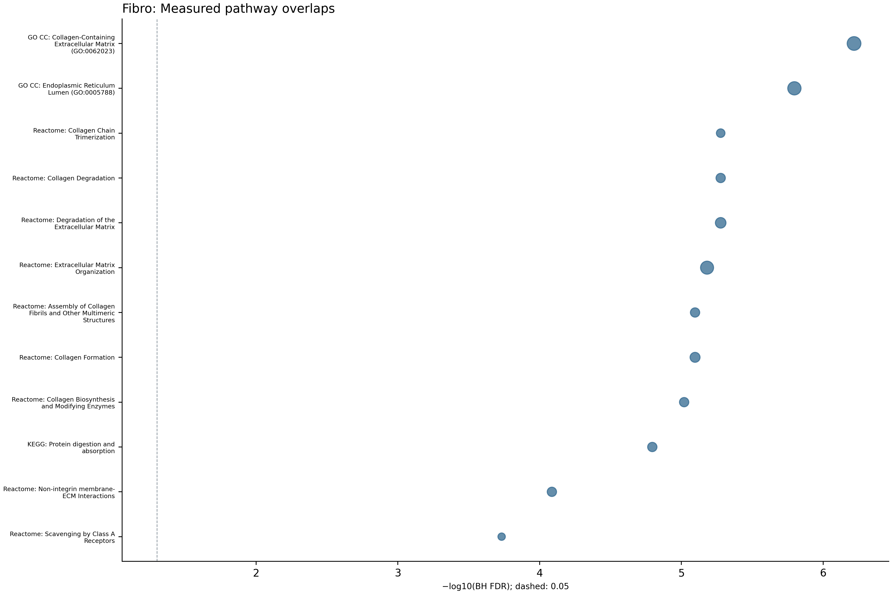

# figures

Current snapshot: **19 November 2026**. Counts refer to sample/proxy units unless stated otherwise. Selected expression features are not explicit cell-type proportions; predictive weights and regulatory annotations are not causal evidence.

[Module overview](../README.md) · [Results and legends](../../docs/results)

Files named `final_clock_*` and the 438/23-pair signatures describe the earlier unreduced EN branch; the current compact representation is linked from the module overview.

Subdirectories: [Endo](Endo/), [Fibro](Fibro/), [combined](combined/).
