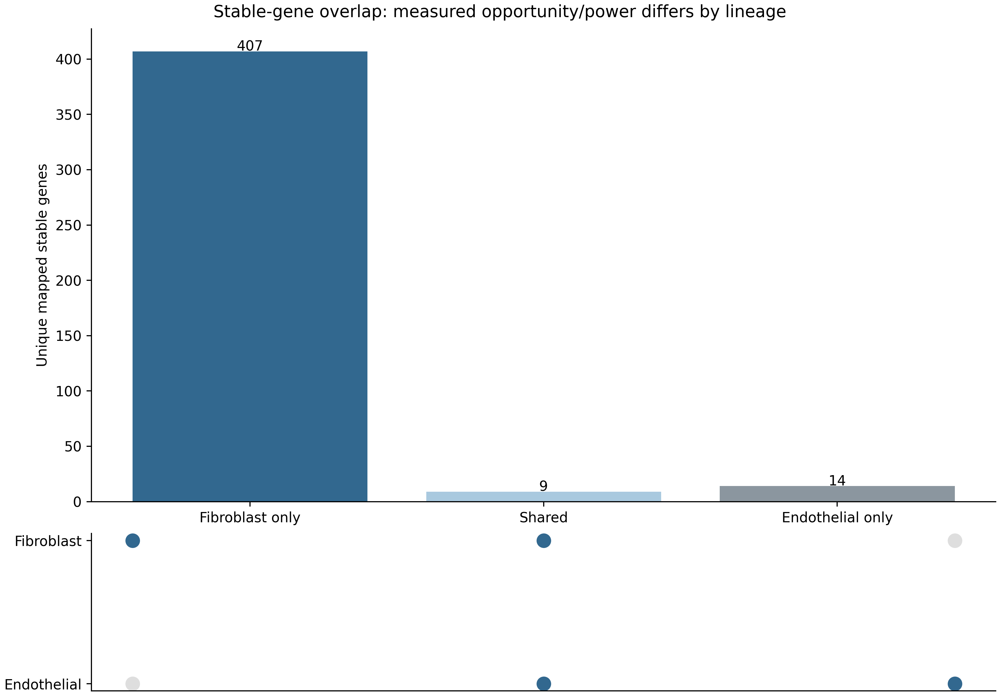

# combined

Current snapshot: **19 November 2026**. Counts refer to sample/proxy units unless stated otherwise. Selected expression features are not explicit cell-type proportions; predictive weights and regulatory annotations are not causal evidence.

[Module overview](../../README.md) · [Results and legends](../../../docs/results)

Files named `final_clock_*` and the 438/23-pair signatures describe the earlier unreduced EN branch; the current compact representation is linked from the module overview.

- [Stromal_FinalClock_shared_specific_genes.pdf](Stromal_FinalClock_shared_specific_genes.pdf)
- [Stromal_FinalClock_shared_specific_genes.png](Stromal_FinalClock_shared_specific_genes.png)
- [Stromal_individual_aging_clock_Fibroblast_Endothelial_FINAL_v2.pdf](Stromal_individual_aging_clock_Fibroblast_Endothelial_FINAL_v2.pdf)
- [Stromal_individual_aging_clock_Fibroblast_Endothelial_FINAL_v2.png](Stromal_individual_aging_clock_Fibroblast_Endothelial_FINAL_v2.png)
