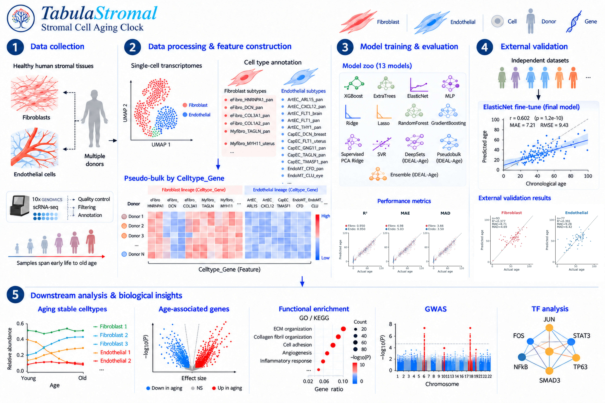

# Documentation

- [Three Results sections and Word downloads](results/)
- [Updated workflow and supporting metrics](workflow.md)
- [Data contract](data.md)
- [Reproduction](reproducing.md)
- [Scientific scope](results.md)
- [Testing](testing.md)
- [Original project map](project_map.md)
- [Portability](portability.md)

The original 6144 × 4096 workflow now includes current development-set fits and adapted ALL100 results. Their evaluation scopes, exact supporting tables and remaining illustrative elements are explained in the [workflow documentation](workflow.md).
