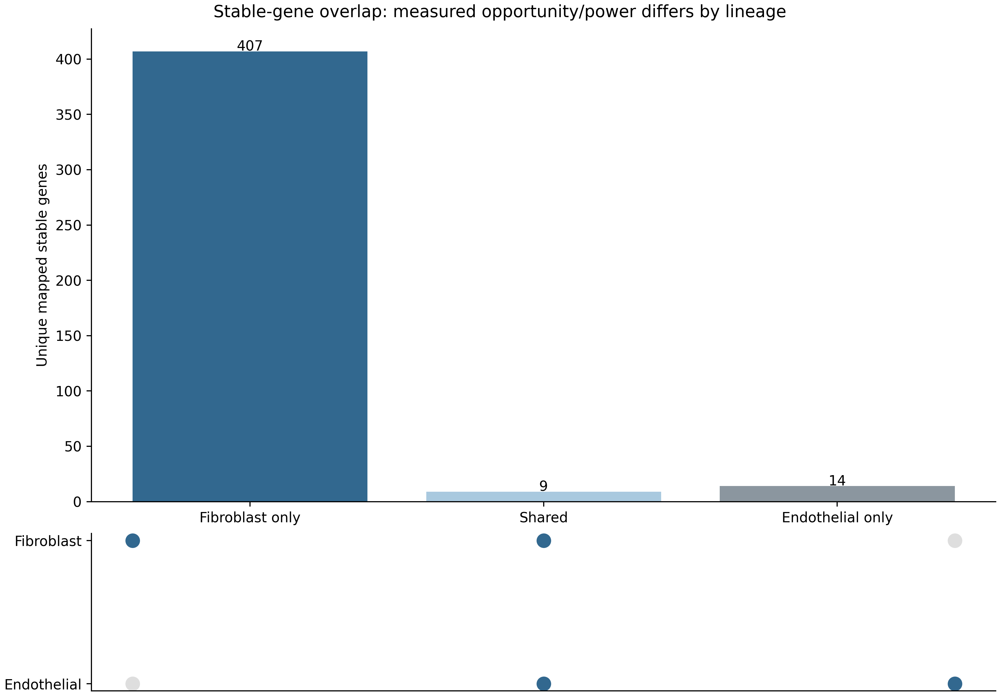

# Evidence-linked Results

| Section | English text | Editable Word | PDF reading copy |
| --- | --- | --- | --- |
| Part 1: Stromal Atlas | [Read](Results_Part1_StromalAtlas.md) | [Word](Results_Part1_StromalAtlas.docx) | [PDF](Results_Part1_StromalAtlas.pdf) |
| Part 2: Clock Overview, Performance and CellAge | [Read](Results_Part2_ClockPerformance_CellAge.md) | [Word](Results_Part2_ClockPerformance_CellAge.docx) | [PDF](Results_Part2_ClockPerformance_CellAge.pdf) |
| Part 3: Stable Features and Molecular Associations | [Read](Results_Part3_StableFeatures_Mechanisms.md) | [Word](Results_Part3_StableFeatures_Mechanisms.docx) | [PDF](Results_Part3_StableFeatures_Mechanisms.pdf) |

[Combined Results Word](TabulaStromal_Results_Combined.docx) · [Combined PDF](TabulaStromal_Results_Combined.pdf) · [Figure Legends](Figure_Legends.md) · [Legends Word](Figure_Legends.docx) · [Legends PDF](Figure_Legends.pdf)

Source figures and data are linked from each section. Quantitative statements map to [evidence](../../evidence/evidence_registry.csv) and [paragraph records](../../audit/claim_to_evidence_report.csv). Word text and tables are verified against the same Markdown, and figure/evidence links are clickable in Word and PDF. Reading copies are actual LibreOffice renders of the released Word files; see [text validation](../../audit/docx_validation_report.md) and [page rendering](../../audit/docx_rendering_report.md). Original scientific figures are available in the four result galleries.

Rebuild with `python scripts/write_results_sections.py` and `python scripts/build_results_documents.py` from the repository root. Install `requirements/manuscript.txt` first.
