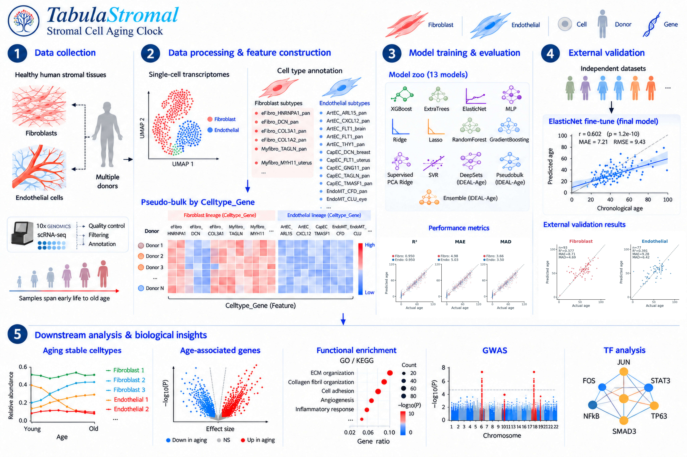

# Updated TabulaStromal workflow

The 19 November 2026 refresh publishes the supplied `F2_ModelPerformance/overview/TabulaStromal_Workflow_V6.png` at its original **6144 × 4096** resolution. The [homepage asset](assets/TabulaStromal_Workflow_V6.png) and [F2 gallery asset](../F2_ModelPerformance/figures/TabulaStromal_Workflow_V6.png) contain identical, unmodified source bytes. Dimensions and SHA256 values are recorded in the [refresh receipt](../audit/workflow_refresh.json).

The workflow connects stromal atlas collection, cell annotation, Celltype_Gene pseudo-bulk construction, model comparison, external adaptation and downstream analysis. Its updated lower performance plots use the current compact ElasticNet results. The two lineages have separate models, retaining 750 fibroblast and 350 endothelial Celltype_Gene features.

| Workflow plot | Lineage | Samples | R² | MAE, years | MAD (MedAE), years | Evaluation scope |
|---|---|---:|---:|---:|---:|---|
| Lower model-training/evaluation plots | Fibroblast | 640 | 0.950 | 4.98 | 3.66 | Development-set in-sample fit |
| Lower model-training/evaluation plots | Endothelial | 437 | 0.950 | 5.03 | 3.50 | Development-set in-sample fit |
| Lower external-results plots | Fibroblast | 93 | 0.377 | 8.71 | 4.69 | Adapted ALL100; outcomes used in model selection |
| Lower external-results plots | Endothelial | 77 | 0.391 | 9.28 | 6.42 | Adapted ALL100; outcomes used in model selection |

Exact values come from [development-fit metrics](../F2_ModelPerformance/tables/Fig2_scatter_metrics.csv) and [ALL100 external metrics](../F2_ModelPerformance/tables/Fig2_workflow_external_metrics.csv). The development values describe fitting the same samples, and the ALL100 outcomes informed model selection; neither establishes independent generalization. In these updated plots, **MAD denotes median absolute prediction error**, also called MedAE.

The upper external example reporting r = 0.602, P = 1.2 × 10⁻¹⁰, MAE = 7.21 and RMSE = 9.43 remains illustrative artwork. It is not the current compact-model evaluation. The healthy-only caption, donor icons, generic subtype trends and GWAS drawing likewise do not establish healthy-only sampling, verified unique donor counts, measured age trajectories or completed GWAS. Actual downstream enrichment, LISA2 and RNA-network evidence is documented in [F3](../F3_ds_analysis/) and [Results Part 3](results/Results_Part3_StableFeatures_Mechanisms.md); the illustrative TF network does not establish its drawn interactions.

The [homepage Model Performance panels B–D](../README.md#model-performance) are the separate source-fold-4 benchmark with model-specific feature-count selection. Their panel D MAD measures **mean absolute age-label deviation**, unlike the MedAE in the updated workflow. The [complete Figure 2](../F2_ModelPerformance/figures/Fig2_StromalClock_ModelPerformance.png), [Results Part 2](results/Results_Part2_ClockPerformance_CellAge.md) and [figure legend](results/Figure_Legends.md) retain their protocol-specific interpretations.
