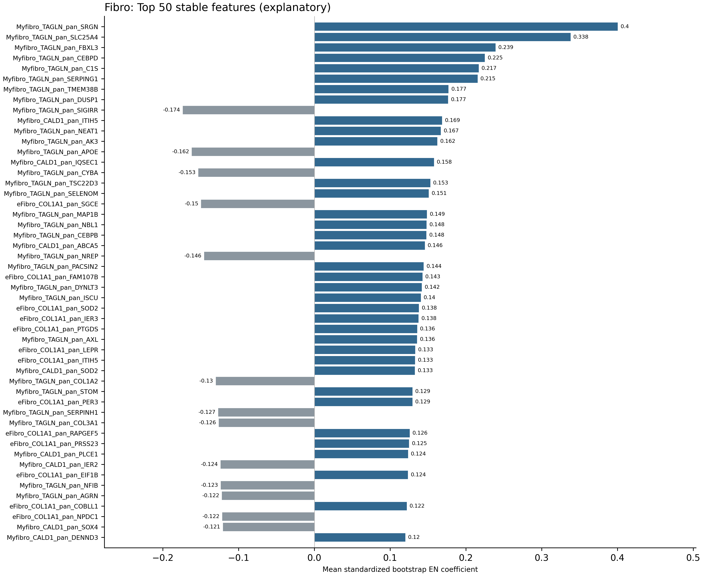

# Fibro aggregate results

Compact aggregate tables from the original source release. [Complete result gallery](../../TabulaStromal_Rebenchmark_2026/) · [Results Part 3](../../docs/results/Results_Part3_StableFeatures_Mechanisms.md).

The final EN uses the original selected features; these stable features are explanatory. Source paths and hashes are available in the global evidence and asset registries.
