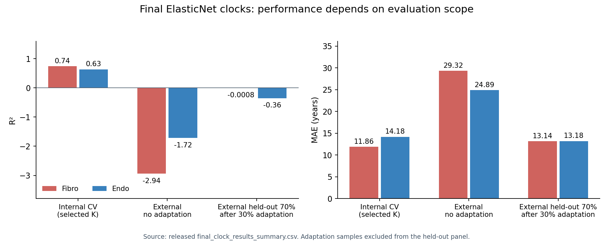

# Compact aggregate results

These tables preserve the original compact release. The expanded galleries contain additional source tables and figures:

- [Stromal Atlas](../F1_StromalAtlas/)
- [Figure 2](../F2_ModelPerformance/)
- [Final EN and stable features](../TabulaStromal_Rebenchmark_2026/)
- [CellAge](../CellAge_Exploration/)

