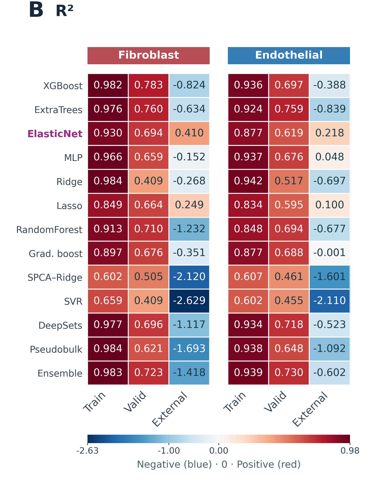

# Historical Figure 2 aggregate tables

[Full figure, original panels and protocol](../../F2_ModelPerformance/)

Source fold 4, not fivefold mean. External uses FT30 ALL100 and includes adaptation observations. MAD is age-label dispersion.
